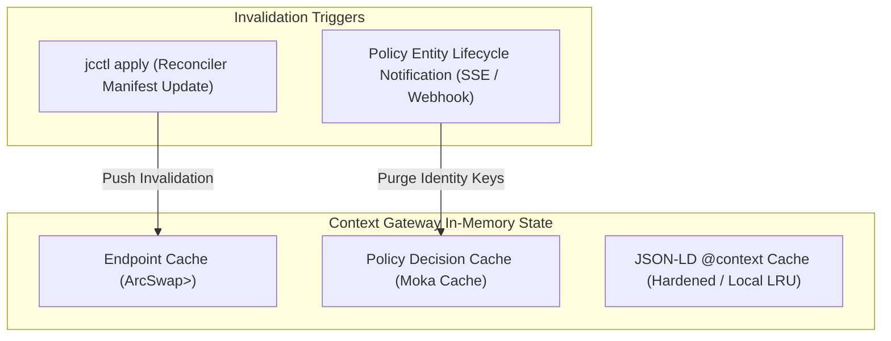

# Context Gateway Internals & Policy Enforcement Point

The Context Gateway is a high-performance security proxy and representation translator implemented in Rust (`axum`, `hyper`, `tower`). It acts as the Policy Enforcement Point (PEP) guarding the context broker, enforcing rules R1–R60 and GW1–GW31.

```text
+---------------------------------------------------------------------------------------------------+
|                                  CONTEXT GATEWAY INTERNALS (PEP)                                  |
|                                                                                                   |
|  Inbound Request (via APISIX Edge Reverse Proxy)                                                  |
|         |                                                                                         |
|         v                                                                                         |
|  Stage 0: Header sanitization, before routing or anything reading a header (EP-21)                |
|         |                                                                                         |
|         v                                                                                         |
|  Stage 1: Identity & token verification (OIDC bearer JWT against the realm's JWKS)                |
|         |                                                                                         |
|         v                                                                                         |
|  Stage 2: Endpoint / Space Resolver (O(1) in-memory RwLock map; slug -> space + policy metadata)  |
|         |                                                                                         |
|         v                                                                                         |
|  Stage 3: Tenant pinning (NGSILD-Tenant set from the resolved Space, never from the request)      |
|         |                                                                                         |
|         v                                                                                         |
|  Stage 4: What stays the gateway's: query shape (GW31, GW33), media type, core context (GW35),  |
|           identifiers, minted ids and daily creates, model units, relationships, quality rules  |
|         |                                                                                         |
|         v                                                                                         |
|  Stage 5: Forward to the broker's view /x/views/{view}/ngsi-ld/v1 under the verified x-jc-* subject|
|           (the view's engine decides, narrows, projects and counts: GW10-GW14, R9, R22)         |
|         |                                                                                         |
|         v                                                                                         |
|  Outbound Response (Filtered NGSI-LD, GeoJSON, CSV, OGC Features, or MCP Result)                  |
+---------------------------------------------------------------------------------------------------+
```

## 1. Execution Pipeline Stages

### Stage 0: Header Sanitization (EP-21, GW20, GW25)

Every handler calls `tenancy::strip_client_headers` as its first statement, before routing, before authentication and before anything reads a header (`crates/context-gateway/src/middleware/tenancy.rs`). It removes `NGSILD-Tenant`, `X-Userinfo`, `X-Access-Token`, `X-Allowed-Scope-Ids`, `X-Endpoint-Slug` and `X-Consumer-Identity`, and it removes every value of each name rather than the first, so a repeated header leaves no copy behind for whoever reads the last one. APISIX drops the same six at the edge; the gateway does not rely on that, because nothing downstream may depend on an enforcement it did not perform itself.

### Stage 1: Identity & Token Verification

The gateway receives requests from APISIX and verifies the bearer token itself, against the realm's JWKS. The edge does not do it: the realm signs ES256 and the APISIX `openid-connect` plugin verifies RS and HS signatures only, so the plugin would refuse every token the realm issues. It validates that the request originated from the meshed ingress via Linkerd mTLS, and extracts the caller identity:

- Verified OIDC claims (`sub`, `iss`, `client_id`).
- Verified Verifiable Presentation claims forwarded by the VCVerifier.
- Service account identities for internal platform components.
- Anonymous callers are assigned the synthetic identity `role:public` (GW22). On an Endpoint with `audience: public` every caller holds that role as well as what its token asserts, so a signed-in person is never granted less than an anonymous one (EP-16).

### Stage 2: Endpoint / Space Resolver

The incoming path is matched:

- `/cs/{space}/*`: Direct space access. Resolves `{space}`.
- `/api/endpoint/{endpointSlug}/*`: Endpoint access. Resolves `{slug}` in the pre-compiled in-memory endpoint cache to extract `contextSpaceId`, `policySet`, `enabledRepresentations`, and `audience`.
- Unknown spaces or slugs terminate immediately with `404 Not Found` (R20).

### Stage 3: Tenant Pinning (GW20, SP-05–SP-07)

The client's own `NGSILD-Tenant` is already gone: Stage 0 dropped it before any of this ran. With the Space resolved, the gateway sets the internal tenant header from that Space and from nothing the request carried:

```http
NGSILD-Tenant: {resolved_space_id}
```

This header is exposed only on the internal cluster network to the context broker.

### Stage 4: What the gateway keeps (GW31, GW33, GW35)

On the NGSI-LD surface the gateway decides no grant (T-3644). It refuses what is malformed
whoever asks, before anything is forwarded: a `type` or `q` the specification refuses and a query
naming no selector (GW31, GW33), a body that is not JSON-LD or JSON, a `@context` other than the
core one (GW35), an identifier that is no NGSI-LD URN of its type (PF-43, PF-44), a write the
Endpoint's model refuses (DM-61) or whose quantities are not in the model's units, and a
Relationship to an entity the caller cannot see. A form's minted ids and its daily create limit
are applied here too.

### Stage 5: The broker's view decides (plan 5.1, GW10–GW14, R9, R22)

Every NGSI-LD request is forwarded to `/x/views/{view}/ngsi-ld/v1{rest}`: `{view}` is the
Endpoint's slug, or `cs-{space}` for a space's canonical surface. The caller's query goes as it
was sent, and the subject the gateway verified (user, roles, groups, service account, agreement)
goes in `x-jc-*` headers the broker trusts only from the gateway. The view's engine (the
joinedcontext policy addon in Antares) matches the Endpoint's `Policy` entities, intersects the
request with the grants (OR across policies, AND inside one; scope folding; geographic and
temporal clamping), projects the answer to the granted attributes, counts the narrowed set, and
sets `NGSILD-Results-Restricted` only when the caller opted in. A conditional write is the
view's as well: the broker compares the entity tag (T-3789).

An Endpoint without a view (a slug longer than 63 characters, which no view id can hold) answers
`503 no-view` on this surface, as its other surfaces do. There is no fallback pipeline in the gateway.

The gateway's in-process evaluator (`context-gateway/src/pdp/`) no longer decides an NGSI-LD
request. It still decides the WebSocket fan-out per connection (T-4133), the access document and
the schema projection, the MCP tools, a write's Relationship and quality checks, and the
representation translators of an Endpoint without a view until T-3652 moves them.

**Tenant sanitization (SP-05).** `NGSILD-Tenant` is pinned on the request to the broker and
removed from the answer, on the space surface as on the endpoint surface. The tenant is an
internal name and a probe for which spaces exist; it never leaves the gateway.

---

## 2. Reads vs. Writes Enforcement (GW15–GW19)

The gateway enforces fundamentally different validation semantics for read versus write operations. Both start from the same names: only the NGSI-LD core context is accepted from a caller, so a body with another `@context` or a `Link` naming another context is refused with `400` before anything is decided, and the broker expands exactly the names the gateway authorised (GW35, T-3287). The ETSI TTF cases that bring the test suite's own context therefore answer `400` through the gateway where the broker alone accepts them.

| Dimension | Read Operations (`queryEntity`, `retrieveEntity`) | Write Operations (`createEntity`, `updateEntity`, `deleteEntity`) |
|---|---|---|
| **Enforcement Model** | **Silent Narrowing (GW15):** The request is rewritten to match only permitted resources. | **Strict Rejection (GW16):** The payload MUST fall 100% inside a single matching policy grant. |
| **Partial Grant Outcome** | Returns subset of matching entities and attributes; missing items are omitted without error (R20). | **Denied Entirely (GW17):** If a single attribute in a PATCH/POST is unauthorized, the write of that entity is rejected whole with `403 Forbidden`; in a batch the other entities are still judged on their own (GW18). |
| **Geographic Validation** | Queries are clamped to the granted polygon (GW11). | The entity's `location` coordinates in the payload are tested for containment inside the granted polygon. |
| **Missing Entity Response** | `GET /entities/{id}` for an unauthorized entity returns `404 Not Found` (R20). | Returns `403 Forbidden` with detailed ProblemDetails specifying unauthorized attributes or scope violations. |
| **Batch Operations** | Returns entities satisfying grants. | Returns `207 Multi-Status` detailing per-entity success or failure (GW18). |

Narrowing starts from a well-formed request (GW31): a `type` that is no NGSI-LD name or a `q` that does not lex is answered `400 BadRequestData` before the PDP adds its constraints, without repeating the value; an empty intersection (GW12) answers well-formed queries only.

Narrowing never rescues a request the specification calls malformed (GW33). A query naming no selector at all — an `id` list or an `idPattern` alone — is `400 BadRequestData` under CIM 009 5.7.2.4, even though the caller's grants would have supplied a type for it: a grant decides which of the well-formed answers a caller sees, never which status code the surface returns. Our own clients name a type rather than relying on the narrowing.

### Conditional writes (R45, GW16)

A conditional write goes to the view like any other write (T-3644). The broker publishes an
entity tag and compares the caller's `If-Match` with it (T-3789): `412` on a mismatch, and a write
without `If-Match` is forwarded as sent. A grant whose decision depends on the stored entity (a
policy `q` or a granted area) is the view engine's to evaluate against the stored state, so the
gateway no longer reads an entity to decide a grant; what it reads before a write are the
Relationship targets the write names (stage 4). GW16's advice stands: partition write
authority by type, `scope` or an `idPattern` the policy names (ADR-N-041) wherever possible, and
keep conditions for entities that move.

---

## 3. Cache Architecture & Revocation Propagation (R40, R48)

To achieve target latencies under 5 milliseconds (R40), the gateway operates an in-process, lock-free caching hierarchy:



### Cache Hierarchy

1. **Endpoint Cache:** Maps slugs to internal spaces and allowed representations. Completely immutable; atomically swapped via `arc-swap` on reconciler updates.
2. **Policy Decision Cache:** High-speed `moka` cache keying `(SubjectID, SpaceID, Operation, TargetType)` to compiled AST filters. Configured with a default TTL of 30 seconds.
3. **Context Cache (R58):** Caches remote JSON-LD `@context` documents with SHA-256 integrity verification to prevent context poisoning attacks.

### Revocation Propagation Protocol (R48)

When a `Policy` entity is updated or deleted in the administrative Context Space:

1. The broker emits an internal subscription notification to the Context Gateway's management listener.
2. The gateway purges all policy decision cache entries matching the affected `assignee` or `space`.
3. Active WebSocket connections (`ngsi-ld-ws`) associated with the invalidated policy are immediately closed with close code `4403 Policy Revoked`.
4. Live MCP sessions receive a `notifications/tools/list_changed` frame within 1 second.

---

## 4. Deployment Modes: Embedded vs. Standalone

The Context Gateway is designed to deploy in two topological configurations:

```text
MODE A: EMBEDDED IN ANTARES BROKER              MODE B: STANDALONE PROXY GATEWAY
+------------------------------------+          +--------------------+      +--------------------+
| Pod: Antares Context Broker        |          | Pod: Context GW    |      | Pod: External CB   |
| +--------------------------------+ |          | (Rust PEP Proxy)   |      | (Scorpio / Stellio)|
| | Context Gateway PEP Module     | |          |                    |      |                    |
| +--------------------------------+ |  HTTP    | Forward Rewritten  | HTTP | Standard ETSI      |
| | In-Process Broker Core Engine  | | -------> | POST /query        | ---> | CIM 009 API        |
| +--------------------------------+ |          |                    |      |                    |
| +--------------------------------+ |          +--------------------+      +--------------------+
| | Direct PostgreSQL Client Layer | |
| +--------------------------------+ |
+------------------------------------+
```

### Mode A: Embedded Mode (Default with Antares)

The Context Gateway pipeline compiles directly into the Antares broker binary as an integrated `tower` service layer.

- **Zero-Copy AST Passing:** The parsed and rewritten AST is passed directly across internal memory pointers into Antares' query compiler without serialization.
- **Native GiST/RLS Query Pushing (GW24):** Scope and spatial constraints bypass regular expression conversion and execute directly against PostgreSQL native `ltree` and PostGIS GiST indexes, resolving the R41 performance bottleneck.
- **Latency:** Sub-millisecond internal gateway processing overhead.

### Mode B: Standalone Mode (Any CIM 009 Broker)

The Context Gateway runs as an independent proxy container in front of external context brokers (Scorpio, Stellio, Orion-LD).

- **Network Decoupling:** Communicates with downstream brokers over HTTP/2 using standard CIM 009 operations.
- **Regex-Folded Compatibility:** Scope constraints are folded into standard `q` expressions per R13.
- **Interoperability:** Verifiable conformance against any compliant context broker without vendor-specific modifications (CC-01).

---

## 5. Performance Budgets & Fail-Secure Design

### Performance Targets

- **Throughput:** ≥ 5,000 requests/second per gateway replica on 2 vCPU / 4 GiB RAM.
- **Latency Overhead:** ≤ 3.5 ms p99 gateway overhead for cached policy decisions (excluding broker execution).
- **Memory Footprint:** ≤ 45 MiB baseline resident set size per replica.

### Requests in flight and the load generator (T-4782, T-5124, T-5921)

Each replica works on at most `JC_GATEWAY_MAX_IN_FLIGHT` requests at once (default 128) and one caller on at most `JC_GATEWAY_MAX_IN_FLIGHT_PER_CALLER` of them (default 32). The caller is the principal of a token the realm signed, else the client address. Anonymous requests share half the slots and are answered `429` past it; an eighth stays reserved for signed-in writes; any other refusal is `503` with `Retry-After`.

At about 100 ms per answer, 32 in flight hold one caller near 320 requests a second, so a load generator could not measure the platform at 1,000. The gateway therefore knows one load generator class:

- The class is the Keycloak client `JC_GATEWAY_LOADTEST_CLIENT` names (empty: no class). Only a token the realm signed, checked by `Verifier::identify`, whose `azp` is that client, enters it. A token that merely claims the client, and any client address, meets the plain caps.
- A read of the class is held to `JC_GATEWAY_LOADTEST_IN_FLIGHT` (default 512) in place of the caller's 32. It still takes a slot of the total and of the readers' share, so the replica's total and the writers' reserve hold, and the anonymous share is untouched.
- The class only reads. Any other method from that client is refused `403` before the request reaches the Policy or the broker, whatever the client's Policy says.
- The client's ServiceAccount holds the role `public` only, so it reads what an anonymous caller reads ([Security §7](13-security.md)). Keycloak keeps the client disabled outside a load run.

### Fail-Secure Guarantees (R5, GW5)

The gateway enforces a hard fail-closed architecture across all failure conditions:

| Failure Scenario | Gateway Behavior | Client Response |
|---|---|---|
| **Policy index not loaded / stale beyond bound (R48)** | Refuses to evaluate; no request reaches the broker. | `503 Service Unavailable` with RFC 7807 details. |
| **Malformed Policy Entity** | Rejects policy compile; treats caller as unpermitted. | `403 Forbidden` |
| **antares-ql Parser Error** | Rejects unparseable user parameters immediately. | `400 Bad Request` |
| **Unresolved Context Space** | Drops request; prevents broker wildcard queries. | `404 Not Found` (Existence concealed). |
| **Downstream Broker 5xx Error** | Surfaces error without exposing internal topology. | `502 Bad Gateway` |

## 6. Notifications (R46, GW27)

A subscription is a standing query whose answers leave the platform later, with no caller on
the request. Since the switch to the broker's surfaces (plan 5.5) the broker keeps it and
delivers it, and its policy engine decides every delivery; the gateway holds no delivery path
and no delivery key (T-3653, T-3654).

**At creation and on every update.** `POST` and `PATCH` of a `Subscription`, and every read and
delete of one, go to the Endpoint's view, `/x/views/{slug|cs-space}/ngsi-ld/v1/subscriptions`,
as sent: the subscriber's own `notification.endpoint.uri`, under the `x-jc-*` subject the
gateway verified. The broker stores that subject with the subscription (`__subject`, ADR-0020),
refuses watched attributes the view does not show (`400`), and reaches a subscription only
through the view it was made in. The gateway checks one thing first, the target: `400` for a
`uri` that is neither `http://` nor `https://`, and for one whose host is `localhost` or an
address inside the platform's own networks (loopback, private, link-local with the cloud
metadata address, unspecified, shared RFC 6598, an IPv4 address mapped into IPv6), read with
the WHATWG parser the outbound clients use, so `http://127.0.0.1?x`, `http://0x7f.1/` and
`http://2130706433/` are the loopback they dial (T-1302, T-3653). An installation whose
subscribers sit inside the cluster names them in `JC_GATEWAY_EGRESS_PRIVATE_HOSTS`.

**At delivery.** The broker matches the subscription inside its view and asks the engine's
`pre_notify` for the subscriber stored with it: a revoked grant drops the notification, a
narrowed one projects it, and an entity the view does not show never leaves. Where a delivery
may go is the broker's egress guard (`ANTARES_EGRESS_ALLOW_PRIVATE=false` with the named
in-cluster peers, checked on every resolution and every redirect hop, T-3908, T-3909) and its
NetworkPolicy (public addresses on 80 and 443, every private range excepted, T-3882).

**What no view takes.** Nothing: the gateway has no NGSI-LD pipeline of its own (T-3644). An
Endpoint whose slug is longer than a view id (63 characters) has no view, and every NGSI-LD
request on it, a subscription included, answers `503 no-view`; nothing is stored
on the broker's plain surface, where nothing would decide its deliveries.

Subscriptions stored before the switch, with the gateway's old delivery route in their
endpoint, were moved to their view by a one-time migration (T-3883) before that route was
deleted.

---

## 7. View mappings (EP-54, DM-51, DM-52)

An Endpoint with `spec.viewMappingRef` serves its space as somebody else's model. The gateway
runs the Mapping's compiled **IR** — the JSON artifact Model Tools produces from the same
specification as the Bloblang, so the two executors cannot disagree (DM-39, DM-52) — in two
directions on every request.

**Out, target to source.** The caller writes in the target model, and the broker only knows the
source model, so the query is inverted before it is forwarded:

| Parameter | What happens |
|---|---|
| `attrs` | each target attribute becomes the source attribute it derives from; a target the mapping does not define is `400` |
| `q` | attribute names are replaced, and a compared value goes through the inverse of the slot's own transform: a `valueMappings` value through the inverse table, a `unitConversion` value through the inverse linear conversion |
| `geoQ` | the `geoproperty` name is replaced |

A slot the IR marks non-filterable — a constant, or an `expr` — has no inverse to rewrite
through, so naming it in `q` is `400` rather than a filter quietly dropped or forwarded under a
name the broker does not know (DM-51).

**Back, source to target.** Every entity in the answer is rebuilt in the target model: `type`
becomes the IR's `targetClass`, each slot is written under its target name with its transform
applied (rename, linear `unitConversion`, `valueMappings` through the forward table, `cast`),
constants are added, and a source attribute the mapping does not derive is dropped — a view
serves the target model and nothing else. Projection and the geo and temporal filters run
before this, on the source names the grants are written in.

**Read only.** `POST`, `PATCH`, `PUT` and `DELETE` on a view Endpoint answer `405` with
`Allow: GET, HEAD, OPTIONS`, before authentication and before anything is forwarded. A write in
the target model would have to be inverted into a source entity, and a mapping is invertible
per slot, not per entity: a required source slot no target slot derives has no value to
reconstruct, and a constant or an `expr` slot has none at all. Writing through a view is
therefore not a feature that is missing, it is one the model cannot be made to have (EP-54).

---

## Related

- [01-overview](../Architecture/01-overview.md) — where this chapter sits in the whole.
- [00-index](../Requirements/00-index.md) — the normative requirements behind it.
