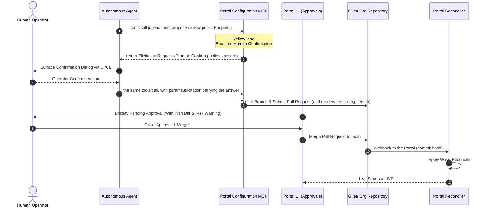
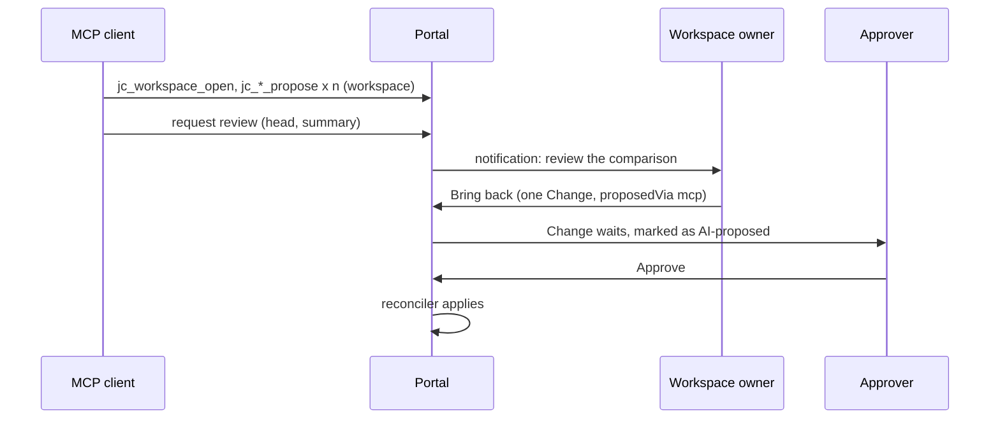
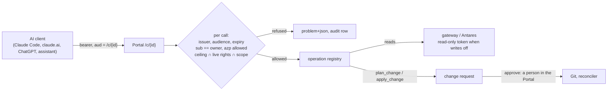

# Autonomous Agents & Model Context Protocol (MCP)

joinedcontext platform natively supports autonomous AI agents as first-class operational actors per CC-45–CC-48 and SP-14–SP-20. Agents interact with the platform exclusively through the standardized **Model Context Protocol (MCP)** using Streamable HTTP.

```text
+---------------------------------------------------------------------------------------------------+
|                                  AI AGENT OPERATIONAL BOUNDARIES                                  |
|                                                                                                   |
|  [ Autonomous Agent (OpenHands SDK / Claude Code / Custom Model) ]                                |
|        |                                                   |                                      |
|        v (OAuth 2.1 Bearer Token)                          v (OAuth 2.1 Bearer Token)             |
|  +-------------------------------+                   +-------------------------------+            |
|  | Context Space Data MCP        |                   | Portal Configuration MCP      |            |
|  | /api/endpoint/{slug}/mcp      |                   | /api/v1/mcp                   |            |
|  | - Query Entities              |                   | - Dry runs and drafts         |            |
|  | - Describe DataModels         |                   | - Registry operations         |            |
|  | - Subscribe to Context        |                   | - Propose Manifest Changes    |            |
|  +-------------------------------+                   +-------------------------------+            |
|                 |                                                   |                             |
|                 v                                                   v                             |
|  [ Context Gateway (PEP Firewall) ]                  [ Gitea Git PR -> CI Gates -> Lanes ]        |
|  (Evaluated against Policy entities)                 (Never direct broker or DB write)            |
+---------------------------------------------------------------------------------------------------+
```

## 1. Dual MCP Surfaces

The platform exposes two distinct, decoupled MCP surfaces:

### 1. Data-Plane MCP Façade (`/api/endpoint/{endpointSlug}/mcp` or `/cs/{space}/mcp`)

Operates directly over context data (SP-14).

- Exposed by the Context Gateway as a lightweight Streamable HTTP service.
- The tool catalogue is dynamically projected from the caller's effective policy grants (SP-15).
- An agent with read-only grants receives query tools only; write and subscription tools are omitted from the tool list.
- All requests pass through the Context Gateway PEP firewall, applying AST query rewriting and attribute-level response projection (SP-16).

### 2. Configuration-Plane MCP (the Portal, `/api/v1/mcp`)

Operates over platform configuration and lifecycle management (CC-45, AG-60, ADR-N-021).

- Served by the Portal, which already owns the configuration plane (changes, dry runs, the forge, permissions); `jcctl` stays the offline renderer and reconciler and serves no MCP.
- Streamable HTTP, stateless, protocol `2026-07-28`: `server/discover`, `tools/list` filtered by the caller's effective permissions (PF-50) the way the data façade filters by grants, `tools/call` with structured results, `resources/read` for manifests, kinds' schemas, a model's artifacts, drafts and change plans, `prompts/list` for the guided units, the Tasks extension for calls longer than a request.
- Every tool is an operation of the registry (AG-59): the same function the REST route, the assistant and the agent runner call. The tool catalogue below is that registry, `jc_`-prefixed; `GET /api/v1/projects/{project}/ops` lists it for a caller.
- Authorization as on the data façade (AG-32): a bearer whose `aud` names the Portal, RFC 9728 protected-resource metadata, `401` with `WWW-Authenticate`; the edge session is not accepted here. Keycloak carries the audience through the `mcp:portal` client scope until RFC 8707 lands.
- **Strict Invariant:** the Configuration MCP is strictly non-mutating on live data plane state (CC-46). An agent CANNOT directly write to context brokers, databases, or API gateways. All modifications take the form of drafts (AG-61), verdicts (AG-62), Git branch commits and pull requests (CC-03, CC-46); a Yellow or Red proposal asks the person through elicitation (AG-63).

---

## 2. Tool Catalogue Specification

### Data-Plane MCP Tools (`/api/endpoint/{endpointSlug}/mcp`)

The catalogue is the CIM 009 read surface, one tool per operation, so an agent can ask anything a REST client can ask and nothing more (AG-29, AG-84). Every tool is scoped to the one Context Space its URL names; a space, tenant or slug offered as a tool argument is refused rather than ignored (AG-05).

A tool's arguments and its handler are functions of the Endpoint the URL names, never of a server-wide "current endpoint": the façade keeps no such state (SP-19), so one connector may later serve several Endpoints and let the agent name which one it reads without anything built today having to change. [ADR-N-025](../Decisions/adr-n-025-one-mcp-connector-several-endpoints.md) (accepted) is that connector: a hub at `/api/mcp` whose tools take a required `endpoint` argument, each call run as that Endpoint's own call, bounded by the token's `endpoint:{slug}` scopes and a per-subject bucket across Endpoints (EP-87, EP-88). §7 says how a connector reaches it.

Since T-3647 an Endpoint's `/mcp` is the broker's MCP surface of its view, and the broker's catalogue is normative (Antares `docs/src/mcp.md`: the same operations, `list_types` and `list_attributes` split into `list_type_details` and `list_attribute_details`, `get_attribute_value`, the write tools, `type` as a list, an opaque `cursor`); the gateway keeps `describe_access` and `describe_schema` and their resources ([API/02 §8](../API/02-endpoint-representations.md#8-model-context-protocol-mcp)). Since T-4115 the hub and the named servers list the same tools under the same names and argument shapes, plus `endpoint` and `list_endpoints` (EP-112), and hand a call on as it came; their table is a copy of the broker's in `crates/context-gateway/src/mcp/tools.rs`, pinned by a unit test. The rows below are those tools by CIM 009 operation; the broker's other write tools (`create_entity`, `merge_entity`, `replace_entity`, `delete_entity`, the attribute writes, `batch_create`, `batch_update`, `batch_merge`, `batch_delete`, `update_subscription`, `delete_subscription`) are listed the same way wherever the grant holds their operation.

Every tool the hub `/api/mcp`, a named server, an Endpoint's `/mcp` or a space's `/cs/{space}/mcp` lists carries a human title of at most 64 characters, as `title` and as `annotations.title` (MCP 2025-06-18), and `readOnlyHint`, `destructiveHint` and `openWorldHint` as booleans; a connector directory refuses a tool without them (T-4732). A read-only tool is not destructive, a write is unless it says otherwise, and a tool reads this platform's own broker and catalogue, so `openWorldHint` is `false` unless the tool says otherwise; a missing `readOnlyHint` is never guessed. The gateway sets the title as it answers `tools/list`: a tool keeps one it has, and otherwise gets its name in words (`query_entities` is "Query entities"). The names in the table stay as they are, because clients call tools by name.

| CIM 009 operation | REST | Tool | Annotations | Arguments |
|---|---|---|---|---|
| Query Entities | `GET /entities` | `query_entities` | `readOnlyHint: true` | every selector and representation argument of the table below |
| Query Entities (POST) | `POST /entityOperations/query` | `batch_query` | `readOnlyHint: true` | the same, as the Query body; `type` is required |
| Query Entities, as a profile (Antares T-4680) | `GET /entities`, paged by the broker | `summarize` | `readOnlyHint: true` | `type` (exactly one), `q`, `scopeQ`, `georel`, `geometry`, `coordinates`, `geoproperty`, `lang`; it answers the broker's count of what the caller reads and per-attribute statistics over at most 1,000 of those entities (fewer when the broker is busy, `basis` says which), plus five of them, never the rows; it runs `query_entities`' operation and grant, so it is listed wherever `query_entities` is |
| Query Entities, per type for one area (Antares T-5279) | `GET /entities` once per type, eight at a time | `area_overview` | `readOnlyHint: true` | `geometry` (`Point`, `LineString`, `Polygon`, `MultiPolygon`), `coordinates`, `maxDistance` m (a Point's radius, default 500; a LineString's buffer, default 50), `type`, `limit` (entities per type, 1 to 20, default 5), `lang`; refused with a slug past 5,000 m, 1,000 positions, a ring that crosses itself, out-of-range coordinates or 100 km²; it answers per type the count of what the caller reads in the area and the `limit` nearest entities (id, name, distance, up to four attributes), never an entity the view hides; it runs `query_entities`' operation and grant, so it is listed wherever `query_entities` is |
| Retrieve Entity | `GET /entities/{id}` | `get_entity` | `readOnlyHint: true` | `id`, plus the projection and representation arguments |
| Query Temporal Evolution | `GET /temporal/entities` | `query_temporal` | `readOnlyHint: true` | the selector table, plus the temporal grammar |
| Query Temporal Evolution (POST) | `POST /temporal/entityOperations/query` | `batch_query_temporal` | `readOnlyHint: true` | the same, as the Query body; the grant operation is `queryTemporal`, and the body is narrowed like the entity batch's |
| Retrieve Temporal Evolution | `GET /temporal/entities/{id}` | `retrieve_temporal` | `readOnlyHint: true` | `id`, the projection arguments, and the temporal grammar |
| Retrieve Available Entity Types | `GET /types` | `list_types` | `readOnlyHint: true` | none; `list_type_details` is the details form (`retrieveEntityTypeDetails`) |
| Retrieve Entity Type Information | `GET /types/{type}` | `get_type` | `readOnlyHint: true` | `type`; the grant operation is `retrieveEntityTypeInfo`, not the `retrieveEntityTypeDetails` the list takes |
| Retrieve Available Attributes | `GET /attributes` | `list_attributes` | `readOnlyHint: true` | none; `list_attribute_details` is the details form (`retrieveAttrTypeDetails`) |
| Retrieve Attribute Information | `GET /attributes/{attrId}` | `get_attribute` | `readOnlyHint: true` | `attrId`; the grant operation is `retrieveAttrTypeInfo` |
| Query Subscriptions | `GET /subscriptions` | `list_subscriptions` | `readOnlyHint: true` | `limit`, `cursor`, `count` |
| Retrieve Subscription | `GET /subscriptions/{id}` | `get_subscription` | `readOnlyHint: true` | `id` |
| Create Subscription | `POST /subscriptions` | `create_subscription` | `destructiveHint: true` | `subscription` (JSON object), Yellow lane, elicitation before it is created (§3) |
| Batch Upsert | `POST /entityOperations/upsert` | `batch_upsert` | `destructiveHint: true` | `entities` (at most 100), `options`; requires an explicit write grant, and the person confirms it (Antares `docs/src/mcp.md` §3) |
| Effective grants (EP-55) | `GET /access` | `describe_access` | `readOnlyHint: true` | `format` (`permissions` default, `odrl`, `grant-ast`) |
| Schema surface (EP-46) | `GET /schema/...` | `describe_schema` | `readOnlyHint: true` | `entityType`, `format`, `version` |

Retrieve Entity Map (`GET /entityMaps/{id}`) has no tool either, and the Endpoint surface does not
serve it: an entity map names the context sources an answer was assembled from, with their URLs, and
an Endpoint names a federated member without ever disclosing where it lives (EP-71, AG-85). Federated
paging is reached with the `entityMap` argument of a query instead, which carries the map's id back to
the broker without reading the map out to the caller.

Context source registrations, their subscriptions, `jsonldContexts` and `info/sourceIdentity` have no
tool, because the Endpoint surface does not serve them: a registration is a manifest a person
proposes (UI-28), not a read of context data, and the `@context` documents an Endpoint admits are its
own configuration. An agent that needs them reads the Configuration MCP instead.

#### The shared read parameter table (AG-84)

One table, two surfaces: every entity-selecting tool takes these as arguments under the same names
as the REST read surface. The REST surface forwards the shaping parameters unchanged
(`crates/context-gateway/src/query.rs`, `PASSTHROUGH`) and rewrites the selectors (`type`, `attrs`,
`q`, the geo compound) under the policy decision before the broker sees them. Where CIM 009 takes a comma-separated string, the tool takes a JSON
list and the gateway joins it, because a list is what a schema can bound and a client can build
without quoting rules. Every bound below is published in the tool's JSON Schema and refused before a
broker request is built (AG-31).

| Argument | JSON type and bound | Meaning |
|---|---|---|
| `type` | string, or a list of at most 50 strings, or a type selection expression string of at most 1024 characters (`A,B` or, `A;B` and, parentheses) | entity type selection |
| `id` | list of at most 100 NGSI-LD URNs | entity ids |
| `idPattern` | string, at most 256 characters, a regular expression | id pattern; valid only beside `type`, `attrs`, `q` or `georel`, never alone |
| `attrs` | list of at most 256 attribute names | attribute projection and selector |
| `pick`, `omit` | lists of at most 256 member names, `id`, `type` and `scope` included | member projection |
| `q` | string, at most 4096 characters | the NGSI-LD query language whole: `==`, `!=`, `>`, `>=`, `<`, `<=`, `~=`, `!~=`, ranges `..`, value lists, `;` for and, `&#124;` for or, parentheses, attribute paths `a.b`, trailing paths `a[b]`, existence `a` and `!a`, relationship and language-map forms |
| `csf` | string, at most 1024 characters | context source filter; only on an Endpoint that federates |
| `geometry`, `coordinates`, `georel`, `geoproperty` | enum; string of at most 8192 characters; string of at most 256; attribute name, `location` when absent | geo query: `near;maxDistance==`, `near;minDistance==`, `within`, `contains`, `intersects`, `equals`, `disjoint`, `overlaps` |
| `scopeQ` | string, at most 1024 characters | scope query: `/a/b`, `+`, `#`, `;`, `,` |
| `lang` | string, at most 64 characters | language filter for a LanguageProperty |
| `datasetId` | list of at most 50 URNs, `@none` allowed | dataset instances |
| `join`, `joinLevel` | enum `inline`, `flat`, `@none`; integer 1…3 | linked entity retrieval |
| `containedBy` | list of at most 50 URNs | loop protection for a hierarchical join |
| `entityMap` | boolean | keeps a federated entity map for paging; only on an Endpoint that federates |
| `local` | boolean | a local-only answer |
| `orderBy` | string, at most 1024 characters | CIM 009 §4.23 Entity Ordering, `attr[;asc\|desc]` comma-separated; on `query_entities` (EP-116) |
| `limit`, `cursor`, `count` | integer 1…1000; integer ≥ 0; boolean | paging; the structured result carries `total` and `nextCursor` |
| `details` | boolean | on REST `/types` and `/attributes`: each row's members; an MCP surface has `list_type_details` and `list_attribute_details` instead (EP-112) |

Representation arguments, on every tool that returns entities, `get_entity` and `retrieve_temporal`
included:

| Argument | Values |
|---|---|
| `format` / `options` | `normalized` (the default), `simplified`/`keyValues`, `concise`, `sysAttrs`; on the temporal tools also `temporalValues` and `aggregatedValues`. A tool takes `format` and `sysAttrs` (boolean, sent as `options=sysAttrs`) on `get_entity` and `query_entities` (`normalized`, `concise`, `keyValues`) and on `query_temporal` and `retrieve_temporal` (`normalized`, `temporalValues`, `aggregatedValues`) (EP-116) |
| `geometryProperty` | which GeoProperty becomes the geometry of a GeoJSON answer |
| `accept` | `json` (the default), `json-ld` (the body carries `@context`), `geo+json` (a FeatureCollection) |
| `context` | one or more `@context` URLs, the REST `Link` header's value: `https` only, from the Endpoint's own allow-list, and never fetched on an agent's say-so beyond what the REST path already fetches |

`geoproperty` and `geometryProperty` are served on both surfaces, each with the rule that keeps it
narrow (T-2299, AG-85). Neither is a passthrough, because each moves the attribute a decision is
taken on:

- `geoproperty` rides with the geo compound and never alone. Where no grant draws an area, the
  caller's `geoproperty` goes upstream beside its own `georel`, `geometry` and `coordinates`. Where
  a grant draws one, that area was written for the GeoProperty the grant is about, which is CIM
  009's default `location`; a caller's `geoproperty` naming another attribute is refused `400
  BadRequestData` with the parameter named (CIM 009 clause 5.5.2), never applied to the grant's own
  polygon. Otherwise an entity whose `location` is outside the granted area and whose
  `homeLocation` is inside it would come back.
- `geometryProperty` is admitted only when the attribute it names is one the grant covers and the
  endpoint does not hide; otherwise `400` naming the parameter. A value the broker copies into a
  GeoJSON `geometry` is not that attribute any more and the answer narrowing no longer sees it, so
  the check happens before the request is sent. A request for a member the caller may not read is a
  bad request rather than an empty answer: the attribute's existence is not the secret, its value
  is.

Both are the same refusal in the same words on the REST surface and in the tool, because the rule
lives in the shared handler and the parameter table, not in either door (AG-84).

Two arguments of these tables are not served yet, on either surface, and a tool refuses them as
unknown until they are (T-2299): `accept` and `context`. `accept` changes the shape the answer
narrowing reads — a FeatureCollection is not a list of entities, so the projection has to be proved
over that shape before a tool may ask for it — and `context` needs the Endpoint allow-list this
table names, which no Endpoint manifest carries today. Each arrives on both surfaces in one change,
with its rule (AG-85).

The temporal grammar, on `query_temporal`, `retrieve_temporal` and the temporal batch: `timerel`
(`before`, `after`, `between`), `timeAt`, `endTimeAt`, `timeproperty` (`observedAt`, `createdAt`,
`modifiedAt`, `deletedAt`), `lastN`, `aggrMethods` (`totalCount`, `distinctCount`, `sum`, `avg`,
`min`, `max`, `stddev`, `sumsq`) and `aggrPeriodDuration` (an ISO 8601 duration) (AG-30).

A caller without a token on the hub or a named server (T-4168) reads history at a bounded cost,
because the per-IP request limit counts calls, not the attribute instances one call makes the
broker read (T-4261). Before anything reaches the broker, `query_temporal` and `retrieve_temporal`
need `timerel: between` with `timeAt` and `endTimeAt` at most 31 days apart; `query_temporal` needs
`type` or `id`; `lastN` is 100 when absent and a larger one is refused; `limit` stays at or below the
page cap of 1000; and `aggrMethods` needs an `aggrPeriodDuration` of at least `PT1H` (a year as 365
days, a month as 30). A call outside a bound is the tool error (`isError: true`) that names the
bound, as SP-17 names an ungranted operation. The broker has 10 seconds to answer such a call; past
them the caller gets a tool error, not a held stream. A caller with a token keeps the Endpoint
Policy's own limits and none of these.

Never an argument, on any tool: `space`, `tenant`, `NGSILD-Tenant`, `endpoint`, an upstream URL and
`via`. The space is the URL's (AG-05); the rest are the deployment's, not a caller's.

What an answer must not lose, because a REST client does not lose it: the result count
(`NGSILD-Results-Count`) as `total`; the next page (`Link rel="next"`) as `nextCursor`; every
`NGSILD-Warning` as `warnings[]`, which is also where a partial federated answer shows (the tool
result carries no `partial` flag of its own); and a refusal as the tool error carrying the REST
ProblemDetails' `type`, `title` and `detail`, in the same words (AG-84).

`describe_schema` answers the JSON formalisms as the document itself (`summary`, `json-schema`, `context`) and every text formalism (`linkml`, `shacl`, `owl`, `rdf`, `markdown`, and `qb` where a granted class is a Data Structure Definition, DM-60) as `{ "format", "mediaType", "document" }`, the same bytes the REST route `/api/endpoint/{slug}/schema/v{major}/{artifact}` serves for the same token. With no `format` it answers `summary`, which names LinkML as the
formalism to load (`recommended: "linkml"`) and lists every artifact with its `format`, `mediaType`,
`bytes`, `sha256` and resource URI, LinkML first: LinkML is the source the others are rendered from
(ADR-N-010), so it is the one document that cannot disagree with the model. SHACL is for validating
what an agent is about to write, RDF and OWL for a reasoner, JSON Schema for building a form, and
`markdown` for a person to read. `entityType` narrows the answer to one type, or to the list of classes an agent needs (`["User", "Vehicle"]`, at most 64); a type the caller may not read is refused exactly as an unknown one is, by name, whether it stands alone or in a list, so the argument is no way to ask which types exist (EP-47, SP-15, SP-20). A rendered document over 1 MiB is refused with the words that name `entityType` and `version` as the way to narrow it, and is never truncated: half a SHACL file is not SHACL, and a model that silently lost its last classes is the one thing a schema surface must not serve (AG-29).

The hub's and every named server's `initialize.instructions` carry the NGSI-LD primer of [ADR-N-025 §4c](../Decisions/adr-n-025-one-mcp-connector-several-endpoints.md) (`crates/context-gateway/src/mcp/hub_lead.md` and the query-language primer the broker's `antares_ql` crate publishes): what an entity is, `@context`, the query language with examples, the temporal reads, and the order of work, `list_endpoints` → `describe_schema` → `list_types`/`get_type` → query. A caller without a token lists and calls the read tools of `ANONYMOUS_TOOLS` alone: `list_endpoints`, `list_types`, `get_type`, `list_type_details`, `list_attributes`, `list_attribute_details`, `get_attribute`, `query_entities`, `get_entity`, `get_attribute_value`, `query_temporal`, `retrieve_temporal`, `describe_schema` and `describe_access`, each where a grant holds its operation (EP-116, T-4168).

Four properties hold across the whole catalogue:

1. **The tool list is the grant list.** A tool whose operation the caller does not hold is not advertised, and calling it by name answers exactly as calling a tool nobody ever defined does (SP-15, SP-20).
2. **Temporal is the same grammar.** `timerel`, `timeAt`, `endTimeAt`, `lastN`, `aggrMethods` and `aggrPeriodDuration` are forwarded to the broker's `/temporal/entities` unchanged, under the same policy decision that governs the REST path, so history is neither a second query language nor a second authorization path (AG-30).
3. **Arguments are validated before anything is called.** Each tool publishes a JSON Schema draft-07 with `additionalProperties: false`, and the server validates the arguments against it before it builds a broker request; an unknown field is a tool error, never a silently dropped parameter (AG-31, AG-21). Values are checked as well as names: an `id` that is not an NGSI-LD URN and a `type` that is not an NGSI-LD type name are refused by name, because an argument that cannot denote anything is a bad request and answering it with an empty result tells the caller it was accepted (AG-21).
4. **The structured half of a result is an object.** Every tool publishes an output schema, and `structuredContent` matches it: entities under `entities`, a schema or access document under its own name, and `restricted: true` beside them when the policy narrowed what came back (AG-13, R22). A bare list matches no output schema, and every client that reads the structured half by name reads nothing from one.

The same server lists resources (`resources/list`, `resources/read`):

| Resource URI | What it holds |
|---|---|
| `ngsi-ld://{space}/types/{type}` | the type's current entity set, as the caller may read it |
| `ngsi-ld://{space}/entities/{id}` | one entity, projected to the grant |
| `schema://{endpointSlug}/v{n}/{artifact}` | a rendered schema artifact; `{artifact}` is the `format` name the summary publishes (`linkml`, `json-schema`, `context`, `shacl`, `owl`, `rdf`, `markdown`, `qb`), and the REST file name (`model.shacl.ttl`) names the same document (EP-52) |
| `access://{endpointSlug}` | the caller's effective grant document (EP-60) |
| `card://{endpointSlug}` | the Endpoint's NGSI-LD query card, `text/plain`: the query rules naming the read tools the caller's grants cover, then each type the caller may read with its attributes as compact lines (`attr:range[unit]`, `attr:a\|b`, `attr:Type`, `attr[]`) and one example `q`; past 1,500 tokens the types with their attribute counts. Made by `jc_core::query_card` from the LinkML the caller is served; listed and read only by a caller who reads something on the Endpoint, otherwise an unknown resource. The Portal's Endpoint page shows it and its assistant puts it in the prompt (T-4759, T-4760, AG-05) |

The Portal's own server addresses its resources under `jc://` (AG-81):

| Resource URI | What it holds |
|---|---|
| `jc://schemas/{Kind}` | the kind's JSON Schema, as the registry generates it |
| `jc://{project}/{plural}/{name}` | one manifest of the project, as the caller may read it |
| `jc://{project}/drafts/{Kind}/{name}` | a draft and the verdict of its last check |
| `jc://{project}/changes/{changeId}` | a change's plan, when the caller reads the kind it proposes |
| `jc://{project}/datamodels/{name}/linkml` | the model's LinkML source (the JSON Schema and the `@context` are the endpoint façade's renderings, EP-47) |
| `jc://-/{plural}/{name}` | a resource of the organization itself — `Role`, `RoleBinding`, `Group`, `Organization`, `Project`, `AgentProfile`, `ServiceAccount` — which belongs to no project |

`-` heads the organization's own resources because it is not a DNS-1123 label and so can never be
a project's name; a project called after the organization stays unambiguous. Reading one asks the
permission the REST route asks, so a caller who may not read `RoleBinding` is answered as if it
were not there (PF-59).

The endpoint's DCAT-AP record (EP-27) is the server description an MCP client shows before any tool runs, so the catalogue entry a person reads and the description an agent reads are the same document.

### Configuration-Plane MCP Tools (the Portal, `/api/v1/mcp`; every row an operation of the registry, AG-59)

One registry, every door (ADR-N-021): the table below lists the configuration operations; `GET /api/v1/projects/{project}/ops` lists the whole registry a caller may run, among it the change, activity, workspace, run, project, service-account key and sync-source operations the table leaves out. The Portal's own pages, the Portal's own pages, its REST routes, this MCP server and the assistant call the same functions. An operation the caller's role refuses is not listed to them and is refused when called by name (AG-64, SP-15).

| Operation | Kind | Lane | Annotations | What it does |
|---|---|---|---|---|
| `jc_catalog_search` | `*` | Green | `readOnlyHint: true` | Find spaces, endpoints, and data models matching search keywords |
| `jc_change_approve` | `Change` | Red | `destructiveHint: true` | Approves and merges a change proposal |
| `jc_change_list` | `*` | Green | `readOnlyHint: true` | Lists open change proposals and merge requests for review |
| `jc_change_reject` | `Change` | Yellow | `destructiveHint: false` | Rejects a change proposal with a reason and closes its merge request |
| `jc_datasource_check` | `DataSource` | Green | `readOnlyHint: true` | Dry-runs a DataSource manifest and probes the external feed |
| `jc_datasource_propose` | `DataSource` | Yellow | `destructiveHint: false` | Proposes creation or update of a DataSource manifest, from a draft when one is named |
| `jc_draft_drop` | `*` | Green | `destructiveHint: true` | Discards a shared draft (AG-61) |
| `jc_draft_get` | `*` | Green | `readOnlyHint: true` | Reads one shared draft with its verdict (AG-61) |
| `jc_draft_list` | `*` | Green | `readOnlyHint: true` | Lists the shared drafts of a project (AG-61) |
| `jc_draft_put` | `*` | Green | `destructiveHint: false` | Writes the shared draft of a manifest every window, assistant run and MCP client sees (AG-61) |
| `jc_endpoint_propose` | `Endpoint` | Yellow | `destructiveHint: false` | Renders an Endpoint and its draft Policy manifests from a request to share data, and proposes them when it is given a manifest or a draft |
| `jc_kpi_compute` | `Endpoint` | Green | `readOnlyHint: true` | Folds an attribute over context entities and renders a KeyPerformanceIndicator entity |
| `jc_manifest_dry_run` | `*` | Green | `readOnlyHint: true` | Dry-runs candidate manifest changes and returns validation result and plan diff |
| `jc_model_infer` | `DataModel` | Green | `readOnlyHint: true` | Infers a draft LinkML data model from sample data bytes or text, or from what an http(s) `url` answers, fetched on the project's runner with `propose` on `DataSource` (DM-54) |
| `jc_model_propose` | `DataModel` | Yellow | `destructiveHint: false` | Proposes creation or update of a DataModel manifest, from a draft when one is named |
| `jc_pipeline_propose` | `Pipeline` | Yellow | `destructiveHint: false` | Proposes creation or update of a Pipeline manifest, from a draft when one is named |
| `jc_pipeline_test` | `Pipeline` | Green | `readOnlyHint: true` | Tests candidate pipeline mapping and validation on runner without writing |
| `jc_resource_delete` | `*` | Red | `destructiveHint: true` | Proposes removing a resource by kind and name, its name typed back; refused while other resources reference it |
| `jc_resource_get` | `*` | Green | `readOnlyHint: true` | Reads one resource's manifest and status by kind and name |
| `jc_resource_list` | `*` | Green | `readOnlyHint: true` | Lists the resources of one kind in the project, optionally of one context space |
| `jc_resource_propose` | `*` | Yellow | `destructiveHint: false` | Proposes creating or changing a resource of any kind from its manifest or a draft; the change waits for a person's approval |
| `jc_space_complete` | `ContextSpace` | Yellow | `destructiveHint: false` | Opens an endpoint or folder that partly defines a space and completes LinkML, data source, and pipeline drafts (MCP clients pass the files) |
| `jc_space_propose` | `ContextSpace` | Yellow | `destructiveHint: false` | Proposes creation or update of a ContextSpace manifest, from a draft when one is named |

Three properties hold across this catalogue too. The lane is the operation's, not the caller's: a `Yellow` operation leaves a change for a person to approve, a `Red` one needs the red lane's approval, and nothing an agent calls approves itself (AG-63). An operation that only renders a manifest writes nothing, which is why `jc_kpi_compute` is `readOnlyHint: true`: it answers with what a person then submits. The annotation says what the operation can do, not what its lightest path does — `jc_endpoint_propose` renders from parameters and opens a change from a manifest or a draft, so it is not read-only, and an agent runtime asks a person before calling it (AG-07, AG-63). And the arguments are validated against the operation's own JSON Schema, `additionalProperties: false`, before the body runs (AG-31).

---

## 3. Human-in-the-Loop Elicitation & Confirmation Flow

When an agent initiates an operation classified as `destructiveHint: true` or targeting a Yellow/Red interaction lane, the MCP server invokes the **Elicitation Protocol** before creating a pull request or executing changes:

### The shape both servers use (AG-08, AG-63)

Both MCP servers are one stateless `POST`, so neither can hold a server→client request open while a person decides. The elicitation is therefore a **result the client carries back**, the same shape on the configuration plane and on the data plane (ADR-N-021):

```json
{ "isError": false, "status": "input_required",
  "structuredContent": { "elicitation": {
    "elicitationId": "eli-…", "mode": "url" | "form",
    "url": "https://portal…/…",  "schema": { … },
    "message": "<what this call would do, in one sentence>",
    "expiresIn": 600 } } }
```

The client shows it to the person and repeats the **same** `tools/call` with `params.elicitation = { "elicitationId": "eli-…", "action": "accept" }`; `"decline"` (or `"cancel"`) answers a refusal and nothing runs. The id is what makes the second call the person's rather than the model's: the **server** mints it, it is one-shot, it belongs to the token's subject, it expires in ten minutes, and it is bound to the operation and to a digest of the arguments it was asked about — different arguments need a new question. A confirmation the model can compose itself (a boolean argument in the same call) proves nothing, because the model writes both calls.

On the data plane this gates `create_subscription`, which outlives the conversation that made it, and every other tool annotated `destructiveHint: true`. The nonce lives in the server that minted it, so a gateway running more than one replica needs the question and its answer to reach the same one, or a shared store for them.



---

## 4. Agent Identity, Attributability & Audit (CC-44)

1. **No rights of its own:** An agent run acts for the person who started it, narrowed by its AgentProfile's `spec.access` (`src/agents/access.rs`, AG-03, AG-70). It holds no credential; `jc-agent-proxy` injects the ones a request needs, and on the data plane that is a token exchanged from the person's own, so the gateway decides a run's reads on that person's grants ([ADR-N-038](../Decisions/adr-n-038-an-agent-run-reads-as-its-person.md), AG-01, AG-94, AG-95).
2. **Audit Attribution:** When the app builder commits to the forge through `jc-agent-proxy` (`crates/agent-proxy/src/routes/forge.rs`):
   - **Git Author and Committer:** `agent:app-builder@{project} <agent-builder@{project}.local>`.
   - **Git Trailer:** `Co-Proposed-By:` names the person who started the run:

     ```text
     Add the air quality map

     Co-Proposed-By: demo.steward@example.org
     ```

   A proposal made through the Portal, by a person or an assistant acting for one, is authored by that person. A Change records the channel it came through (`proposedVia`: `person`, `mcp` or `agent`, and the client), and a commit proposed over MCP carries a `Proposed-Via` trailer ([§10](#10-contribution-workflow), AG-17, AG-18, AG-137).
3. **Grounded Tool Results (CC-47):** A data-plane tool result carries `restricted: true` when the policy narrowed the answer, beside `total`, `nextCursor` and `warnings`.

---

## 5. Defense Against Indirect Prompt Injection

Digital twin contexts process external telemetry from public sensors, citizen reports, and third-party APIs. This data MUST be treated as an untrusted attack vector for indirect prompt injection.

### Security Controls

1. **Data Is Never Instruction:** Responses from the Data-Plane MCP are tagged strictly as structured data payloads (`role: tool_result`). Agent runtime environments MUST apply system prompts instructing models to treat context observations as untrusted string literals.
2. **Read-Only by Default:** An AgentProfile grants reads unless it names more. An agent writes an entity or proposes a pipeline only when the person who started it holds that grant and the profile names the operation.
3. **No Dynamic Execution:** Tools execute fixed Rust and Go routines. Agents cannot submit arbitrary code, SQL queries, or shell scripts to the platform.
4. **Sandboxed Workspaces:** For testing complex multi-action tasks, agents are provisioned ephemeral **Sandbox Context Spaces** (CC-67). Sandboxes are completely isolated, assigned a strict TTL, and automatically destroyed without affecting production data.

## 6. Agents that build apps

The `app-from-prompt` blueprint lets an agent generate a complete application for a user. The agent derives the app's `dataNeeds` from `describe_schema`, the user confirms the list, and the reconciler renders a dedicated Endpoint and `Policy` set from it, so the generated code can reach exactly that and nothing else. The Agent Runner executes the `builder` profile within an ephemeral, credential-free workspace mediated by `jc-agent-proxy`, which injects model, gateway, and forge credentials per request while enforcing strict token budgets and path scoping (ADR-N-020, [Architecture/19-agent-runner.md](19-agent-runner.md)). Generated applications run as a single container behind the APISIX `openid-connect` edge login (ADR-N-019). Details in [Architecture/16](16-apps-on-demand.md), [Architecture/19](19-agent-runner.md), and AP-01…AP-55.

## 7. Connecting from a phone

The Data MCP is a remote MCP server, so a person adds it to the Claude or ChatGPT mobile app as a custom connector and asks the city a question without installing anything. Two shapes of endpoint, two experiences:

- **A `public` Endpoint has a public MCP.** `tools/list` and every read tool answer with no token at all, under the same synthetic `public` role the other representations use (EP-16, GW22). Adding the connector is one paste of the URL. Only `create_subscription` and any representation that is not public still ask for a login.
- **An assistant that insists on OAuth still gets the public MCP.** Gemini's custom apps connect only through OAuth 2.1 with Dynamic Client Registration. For a server an anonymous caller may read, the gateway's own authorization server on `api.{domain}` registers the client without storing it, redirects back at once with no login, and issues a token that names nobody and grants exactly the public rights ([ADR-N-052](../Decisions/adr-n-052-anonymous-oauth-public-mcp.md), EP-129).
- **Everything else is an OAuth 2.1 login.** The route publishes protected-resource metadata under RFC 9728 and answers an unauthenticated call with `401` plus `WWW-Authenticate: Bearer resource_metadata="https://api.{domain}/api/endpoint/{endpointSlug}/.well-known/oauth-protected-resource"`. The client reads that document, finds the Keycloak realm as the authorization server, runs an authorization-code flow with PKCE S256 and `resource=https://api.{domain}/api/endpoint/{endpointSlug}/mcp` (RFC 8707), and returns with a token whose audience is that endpoint and no other.

```text
GET /api/endpoint/{endpointSlug}/.well-known/oauth-protected-resource

{
  "resource": "https://api.{domain}/api/endpoint/{endpointSlug}/mcp",
  "authorization_servers": ["https://idm.{host}/realms/{organization}"],
  "bearer_methods_supported": ["header"],
  "resource_documentation": "https://api.{domain}/api/endpoint/{endpointSlug}/"
}
```

The deployment defines one Keycloak client for the mobile apps, `mcp-mobile` (`components/context-gateway/keycloak-clients.yaml`): public client, PKCE S256 mandatory, no client secret, the redirect URIs of the known mobile clients, and dynamic client registration off. The client is the app and the endpoint is the resource: the `resource` audience (RFC 8707) binds each token to one endpoint, so a token minted for one endpoint is refused by every other, and a mobile app never holds a secret (PF-45, PF-46, AG-32).

A client on the person's own computer (Claude Code, an IDE, MCP Inspector) receives the code on a loopback port that changes per login, so it uses a second public client, `mcp-local` (T-5611, RFC 8252): its redirect URIs are `http://localhost/callback` and `http://127.0.0.1/callback`, which Keycloak 26 matches on any port and on that exact host and path, so no wildcard is registered. It has PKCE S256, no secret, no `offline_access`, five-minute access tokens and an eight-hour session, so a token left in a terminal's configuration dies with the session. Neither connector client takes the realm's default `roles` scope, whose audience-resolve mapper names every client the person holds a role of (`account`, each `app-*`); each maps `realm_access.roles` itself, so a token with `mcp:portal` names only `portal-api`. The edge removes `registration_endpoint` from the realm's discovery documents (APISIX route `keycloak-discovery`), so a client that would register itself asks for the fixed client id instead; the registration endpoint still refuses anonymous callers. The User Guide page [Connect Claude, ChatGPT and Claude Code](../User-Guide/21-connect-ai-clients.md) gives the client recipes.

**One connector over several Endpoints.** The hub at `https://api.{domain}/api/mcp` (ADR-N-025, EP-87) is its own protected resource: an unauthenticated call answers `401` with `WWW-Authenticate: Bearer resource_metadata="https://api.{domain}/api/mcp/.well-known/oauth-protected-resource"`, and the metadata names `https://api.{domain}/api/mcp` as the resource. The deployment defines a second public PKCE client for it, `mcp-hub`, with the same callbacks and consent on; its tokens carry `aud: mcp-hub`. The Portal's reconciler renders one optional client scope `endpoint:{slug}` on `mcp-hub` per MCP-enabled Endpoint, and the connector asks for the ones the person picked. The gateway accepts a hub token at `/api/mcp` only, and only for the Endpoints its scopes pick: the same token is refused at every Endpoint URL (EP-88). An Endpoint's own token and the edge session reach through the hub what they reach without it. `list_endpoints` answers the caller's Endpoints; every other tool takes one required `endpoint` from that list and runs as that Endpoint's own call. An Endpoint outside the list answers exactly like a slug that does not exist (SP-20).

**The whole portal as one connector (T-4114, ADR-N-025 §4b).** Without a token the hub answers over every `public` Endpoint that serves `mcp`; a login adds the internal ones. The consent screen offers `endpoint:*` ("every Endpoint you may read") by default and the single Endpoints as a narrower choice (EP-87, EP-88). An agent finds its Endpoint with one `list_endpoints` call: `q`, `type`, `attribute`, `space`, `access`, `domain` and `theme` filter it, and each row is one line naming its title, space, access, types, Smart Data Model domain, EU theme, area and period; `get_endpoint` answers the picked one, by slug or by its readable `{project}/{name}`: its NGSI-LD query card first (the same text as `card://` and the per-Endpoint `initialize` instructions), then title, publisher, types, whether temporal reads are served, and its links, its DCAT record, surface URLs, MCP URL and the model as LinkML, SHACL, JSON Schema and `@context`; `detail: "attributes"` gives the card's type lines in full, for every type or the one `type` names (EP-111, T-4492, T-4748, T-5642). A hub or named server over at most 8 Endpoints whose cards fit 2,000 tokens carries those cards in its `initialize` instructions. The same tools serve 1 Endpoint or 10,000: `endpoint` is an argument of each, never a copy of the tool per Endpoint, and the knowledge assistant's data loop offers its model that one set too (AG-05, T-4748). It then calls `describe_schema` for the LinkML model, JSON Schema and `@context`, `describe_access` for what its grant allows, and the read tools, with the same names and arguments it would use at the Endpoint's own URL, a named server or a space's MCP (EP-112). The catalogue's home, every dataset page and the Portal's Endpoint page carry one "Connect an AI assistant" panel with the hub's URL and copy buttons for Claude, VS Code, Cursor and a plain `mcpServers` entry (EP-113).

**A named server over chosen Endpoints.** An `McpServer` manifest (MF-53, ADR-N-043) curates up to ten Endpoints, of any project, into one address, `https://api.{domain}/api/mcp/{project}/{name}`, with its own protected-resource metadata and Keycloak client. It offers the hub's catalogue narrowed to the members this caller may read; a read without `endpoint` visits each such member as that member's own call and answers one result per member, never blended (EP-92…EP-96). A member the caller may not read is never named; a member that fails is named in a `partial` answer.

**Connector profiles (ADR-N-043 §7, T-4504).** A server may `select` Endpoints by project, space, domain, theme and access level instead of, or beside, naming them; the gateway resolves the selector per call from the caller's own reach, so it only narrows, and a public server selects public Endpoints only (EP-120, MF-55). A read without `endpoint` fans out over ten Endpoints at most; past that the agent searches the `catalog` first (EP-121). Every organization has `org/all` (EP-122), an AssistantDeployment names its server in `spec.mcpServer` (MF-56), and a person keeps up to ten personal connectors with their favourite Endpoints in the Portal, served at `/api/mcp/me/{name}` to them alone (EP-123, UI-98).

Setting it up:

1. Portal, Endpoints view, copy the endpoint's MCP URL.
2. In the mobile app, add a custom connector and paste the URL.
3. A public endpoint connects immediately. A private one opens the Keycloak login in the app's browser, and the organization's own login rules apply.
4. Ask. "Which of the buses is nearest to the station" is a `query_entities` call with a `georel` argument, and "what was the air quality at station X yesterday" is a `retrieve_temporal` call. Both answers are projected to the grant, so the phone never sees an attribute the endpoint hides.

## 8. What an agent may reach

An autonomous agent or assistant conversation operates under strict least-privilege scoping governed by the `AgentProfile` manifest (AG-70, MF-40, UI-56). An agent holds no ambient authority; its capabilities are constrained by its assigned profile and bounded dynamically by the permissions of the human operator who initiated the run.

In Git the same bound is a repository (AG-86): an agent workspace clones the repository of its run's project and nothing else, with a forge credential the proxy issues for that repository alone, and reaches the organization repository only through an organization-level operation of the registry with a Change of its own (CC-87, [19 §4](19-agent-runner.md#4-the-proxy-surface)).

### The profile access block

The `kind: AgentProfile` manifest carries an optional `spec.access` block defining permitted registry operations, resource kinds, and context space endpoints:

```yaml
# spec of an AgentProfile, the access block only
access:
  operations: [jc_catalog_search, jc_endpoint_propose]
  kinds:
    - kind: ContextSpace
      verbs: [read]
    - kind: Endpoint
      verbs: [read, propose]
  endpoints:
    - name: helsinki-bikes
      verbs: [read]
```

Internet hosts stay in `spec.egress.allowedHosts` (AG-65). The Assistant page access view displays the declared network egress hosts alongside the access rules.

### Dynamic intersection at call time

An agent run never gains broader authority than the human operator who initiated it. At the moment of every tool invocation or data fetch, the platform calculates the run's effective access as the strict intersection of two boundaries:

1. The static constraints defined in `AgentProfile.spec.access`.
2. The effective permissions of the initiating user within the active project (`GET /api/v1/projects/{project}/permissions/me`, PF-51).

If the initiating user lacks permission to execute an operation or propose a change, the agent cannot execute that action, even if the `AgentProfile` permits it. Conversely, permissions held by the user that are omitted from `spec.access` are unavailable to the agent. A profile can only narrow authority; it can never widen it.

When an `AgentProfile` omits the `spec.access` block entirely, a safe default is enforced: the agent is restricted to operations annotated with `readOnlyHint: true` and possesses zero write or proposal capabilities.

### Tool filtering and execution gates

The tool catalogue presented to an agent model (`tools/list` over the Portal MCP or the in-process assistant loop) is dynamically filtered to the effective intersection set (AG-60, AG-64). Tools exceeding the effective access are omitted from discovery.

If an agent attempts to call a tool outside its effective access, the Portal refuses the call before the backing function executes. The platform records the blocked invocation on the run timeline as a `tool` event with `status: "failed"` and an error describing the permission denial (AG-56).

### Validation and governance

The `access` block is validated strictly during manifest admission (MF-40):

- Operation names must match `^jc_[a-z0-9_]+$` and correspond to registered operations in the platform registry.
- Resource kinds must be kinds of the platform registry (`jc_core::registry::KINDS`), each named once.
- Kinds verbs must only include `read` and `propose`.
- Endpoints verbs must only include `read` and `write`.
- Endpoint names must be valid DNS-1123 labels.
- Wildcards are strictly forbidden across operations, kinds, and endpoint lists.

The Assistant page provides a visual access inspector (UI-56) that displays the effective capabilities of each profile for the currently signed-in user alongside allowed egress hosts. Editing an `AgentProfile` generates a declarative merge request through the standard change flow, requiring domain steward or administrator approval before changes take effect.

## 9. The assistant is a loop over the registry

The Portal's assistant runs no intent switch. Each turn it is given the operations of §2's configuration-plane table that this person may call — the registry filtered by the profile's access block and by the person's own grants, the same two halves the call itself checks (AG-64, AG-70) — and it calls them by name. A call is a fenced JSON block naming the operation and its arguments; the Portal runs it through the one registry function, publishes a `tool` event with the input and the output, and hands the answer back to the model for the next turn (AG-56). `describe_tool` returns one operation's input schema, so the prompt carries a line per operation and the detail only where it is needed.

Three tools have no manifest behind them, because what they do is the conversation itself:

| Tool | What it does |
|---|---|
| `jc_ui_navigate` | Opens a page for the person: a page kind out of an enum and the names that page needs, rendered into a route the Portal builds. A route outside the enum is refused before the `navigate` event exists (UI-59). The pages are `spaces`, `space`, `models`, `model`, `endpoints`, `endpoint`, `policies`, `shared`, `draft`, `activity`, `approvals`, `approval`, `explore`, `entity`, `entities`, `ckan`, `assistant`, `app` and `resource`; `entities` takes `endpoint`, `type` and an optional `q`, and opens that endpoint's grid already narrowed, because a person who asked a question wants the rows that answer it and not the list to filter by hand (UI-64, UI-67). `draft` takes the draft's name and opens the page of that draft's own kind, read from the drafts the project holds; a name no draft has is refused with the drafts that exist, and `draft` and `resource` never fall back to a kind nobody named (T-2768). |
| `jc_ui_open_form` | Opens an object's editor with fields filled in (T-5959, S-41): `kind`, `name` and `prefill`, a JSON merge patch of the manifest, or `new: true` for a Pipeline's create form. The Portal merges the patch into the object as the mirror holds it, refuses a kind without a form, an object that does not exist (answered with the names that do), a rename and every value the kind's JSON Schema refuses except a missing field, and sends a `navigate` to the kind's editor with the manifest as `prefill`. Nothing is saved: the person proposes from the editor. |
| `jc_ui_show_diff` | Opens the editor on the first change of a plan `jc_change_plan` made, the planned manifest as `prefill`: only the person's own plan in this project, before it expires; another person's plan is answered as missing. Nothing is applied. |
| `jc_ui_highlight` | Points at one field of the open form: `kind`, `field` as a dotted manifest path the kind's schema names, and a one-line `message` of at most 280 characters, sent as a `ui` event the page renders as text beside the focused field. |
| `jc_ui_filter_table` | Types `query` (one line, at most 200 characters) into the open page's table filter, as a `ui` event. |
| `jc_ask` | Asks the person one question with a JSON Schema, a default and its options, and waits for the answer (AG-80). `pick` names a kind and the platform fills the options from what the person may read (AG-83); `multiple` takes several answers (UI-73). A single answer renders as buttons, so the usual answer is one click (UI-57). |
| `describe_tool` | The input and output schema of one operation the person may call. |

What the assistant may never do is unchanged by this: it proposes, it does not approve (AG-63), every write is a draft or a Change a person submits, and a call an entity's own data wrote is refused however it came to be written (AG-20).

While it works, the person watches. The assistant edits the draft the open form is editing, and the form shows each change as it lands, marks what the assistant wrote and never overwrites the field the person has in hand (UI-58, UI-47, AG-61). The panel keeps the last three routes as breadcrumbs (UI-59), so "create a data model for bike counters" is a conversation the person walks through — which space, which base model, which unit — and ends with a checked draft whose Propose is theirs to click.

## 10. Contribution workflow

Decided in [ADR-N-060](../Decisions/adr-n-060-contribution-workflow-over-mcp.md) (Proposed). "Improving the platform" over an MCP connector means two things, and each has its own path.

**The project's configuration.** A change to one resource is one proposal on `main`: the client calls `jc_*_propose`, the person confirms the elicitation (AG-63), and the Change waits for an approver. A change to more than one resource is a workspace ([ADR-N-024](../Decisions/adr-n-024-workspaces-branch-and-preview.md), AG-82):

1. The client opens a workspace (`jc_workspace_open`) and proposes each resource into it (`jc_*_propose` with `workspace`). A write inside a workspace changes nothing on `main`, so it runs in the Green lane after the same verdict and coverage checks as the REST `?workspace=` door (PF-57, CC-76).
2. The client compares and previews the workspace, then asks for a review with a short summary through the review-request operation of ADR-N-060 §2 (follow-up F2, not built yet). The request pins the branch's head commit and opens no Change (AG-138).
3. The workspace owner gets a notification that opens the comparison with **Bring back**. The person's click opens one Change for the whole workspace. If the branch moved after the request, the Portal asks the person to compare again instead.
4. An approver approves or rejects the Change in the Portal, and the reconciler applies it. The approver sees "Proposed with an AI client" and the client's name on the Change (AG-137).

The client never brings a workspace back, discards it or decides a Change, on MCP or on REST: the Portal decides the channel from the token's client, not from the route (AG-11, AG-82, AG-133).



A two-resource contribution takes 4 clicks from the two people together, against 6 for two separate Changes and 11 for a workspace today (ADR-N-060 §3).

**Who may contribute.** `spec.policies.agents.mcp.propose` on the Organization names the Roles that may propose over MCP, narrowed per project under `projects`; absent, it is every Role that may propose in the Portal. It only narrows the person's own rights (AG-139).

**The platform's own behaviour.** Code and product changes come in as feedback (API/01 §38), from any Portal page or over MCP with the feedback operation of ADR-N-060 §2 (follow-up F6, not built yet) after the person reads the text. Feedback is anonymous unless the person signs it, may link the Change that showed the need, and reaches the board as a blocked proposed task (AG-140).

**Limits.** `spec.limits.contributions` bounds per person, across every channel, the open Changes, the open workspaces, the MCP calls a minute, the review requests a day and the feedback an hour (AG-141, [ADR-N-035](../Decisions/adr-n-035-organization-policies-and-limits.md)).

## 11. Scoped connectors

A person hands an AI client (Claude Code, claude.ai, ChatGPT, the Portal assistant) a part of what they may do, not all of it ([ADR-N-064](../Decisions/adr-n-064-scoped-connectors.md), AG-142…AG-157). The part is a **connector**: a grant the Portal keeps per person at `https://portal.{domain}/c/{id}`, a Streamable HTTP MCP server, with its routes and tools in [API/14](../API/14-connectors.md).



**What a connector holds.** Owner, name, segments, a scope of projects, spaces, Endpoints and pipelines (each `read` or `write`), `writes` (off by default), `expiresAt`, an optional list of allowed clients and `revokedAt`. It lives in the Portal's database, never in Git: it is one person's choice, and a repository would show it to every reviewer (ADR-N-043 §7.7 kept personal connectors in preferences for the same reason).

**Who sets the ceiling.** An administrator writes `kind: DelegationPolicy` manifests in the organization repository ([Development/04](../Development/04-manifest-kinds.md#delegationpolicy)): which people and Groups may hand AI clients which projects, kinds, Endpoints and verbs, for how long and to which clients, and whether a request above it is refused or queued for approval. A person no policy names gets the organization default, `data-read` for 30 days.

**Every call.** The Portal verifies the token (issuer, audience = the connector's address, expiry), requires `sub` to be the owner and `azp` to be an allowed client when the list is set, and computes the effective rights as ceiling ∩ the owner's live rights ∩ the connector's scope: the same intersection §8 draws for a profile, with two more halves. `tools/list` shows only what those rights reach; each call is checked again for its target before the operation runs; each writes one audit row. A connector never widens anything, and a lost role, a revocation or an expiry refuses the next call.

**Segments.** A person picks presets when creating a connector and edits them later:

| Segment | Tools | Verbs on the scope |
|---|---|---|
| `data-read` | `get_schema`, `list`, `get`, `query_data` over Endpoints and spaces | read |
| `context` | as `data-read`, plus `plan_change`, `apply_change` on DataModel, ContextSpace, Endpoint, ModelProjection | read, propose |
| `pipeline` | as `context` on Pipeline and DataSource, plus `sample_source`, `try_mapping`, `run_pipeline`, `pipeline_logs` | read, propose, run |
| `access` | `plan_change`, `apply_change` on Policy, Role, RoleBinding, Group, ServiceAccount, plus `member_list` (the project's people, no e-mail) | read, propose |
| `publish` | `plan_change`, `apply_change` on an Endpoint's publish block and CkanInstance, plus `model_source_get` and `kpi_compute` | read, propose |
| `apps` | `plan_change`, `apply_change` on App, Dashboard, Layer; the UI actions while the owner's Portal tab is paired | read, propose |
| `operate` | reads of runs, health, activity and limits; `run_pipeline` | read, run |
| `admin` | every tool, within the ceiling | every verb the ceiling allows |

No segment approves, merges or decides: those doors refuse a connector's token (CC-41).

**Writes.** A write is two calls. `plan_change` runs it with `validate_only`: every check, nothing saved, the diff and field errors as problem+json. `apply_change` takes the plan's id unchanged and opens a change request or a workspace change. A person approves it in the Portal; in claude.ai and ChatGPT the plan renders as an MCP App view that links there.

**Below the tools.** A connector with writes off gets a read-only token. The gateway and Antares refuse every write for it whatever the person's grants, so a model steered by text in the data reaches nothing a tool would have refused.

**The Portal assistant is one more connector.** A conversation is a connector of the person with the segment chosen on the data bar (AG-92), the profile's `spec.access` as a further ceiling, and native tool calling over the same tools and schemas. Its own extra tools are UI actions the browser performs and shows (`navigate`, `open_form`, `highlight`, `show_diff`, `filter_table`), none of which submits.

**Client binding.** claude.ai and ChatGPT identify themselves by published Client ID Metadata Documents with fixed redirect URIs, so an allowed-clients list naming them holds. Claude Code signs in through a loopback redirect any local program can use: naming it is a label, not a control. "One organization" means sign-in only through that customer's identity provider. Dynamic client registration names and DPoP give no binding today (ADR-N-064 §4).

## Related

- [ADR-N-064](../Decisions/adr-n-064-scoped-connectors.md) — scoped connectors and the generic tool set (§11).
- [API/14](../API/14-connectors.md) — the connector routes and the tool contract.
- [ADR-N-060](../Decisions/adr-n-060-contribution-workflow-over-mcp.md) — the contribution workflow over MCP.
- [Architecture/16](16-apps-on-demand.md) — referenced above.
- [ADR-N-025](../Decisions/adr-n-025-one-mcp-connector-several-endpoints.md) — one connector over several Endpoints (EP-87, EP-88).
- [01-overview](../Architecture/01-overview.md) — where this chapter sits in the whole.
- [00-index](../Requirements/00-index.md) — the normative requirements behind it.
