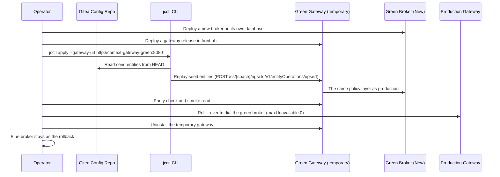

# Upgrading & Version Management

Platform components are versioned independently and deployed immutably. Upgrades are categorized into standard rolling updates (stateless web and gateway components) and blue/green data plane replacements (the NGSI-LD broker).

## 1. Component Upgrade Order

When upgrading the platform version, apply updates in strict sequence:

1. **Cluster operators**: CloudNativePG and the Kyverno policies, through
   `deployment/helmfile-operators.yaml`. There is no Strimzi in this platform: the legacy Kafka bus
   was replaced by Bento pipelines.
2. **PostgreSQL**: a minor patch is a CNPG rolling instance restart, driven by the image digest in
   `components/postgres/images.yaml`.
3. **Identity and forge**: Keycloak, then Gitea.
4. **Context Gateway**: the gateway image. The reconciler is not a workload of its own, so nothing is
   deployed for it here ([00-intro.md](00-intro.md) §1).
5. **Context Broker**: Antares, through the procedure in section 2.
6. **Portal**: one image carrying the API, the UI and the reconciler.
7. **Pipeline runners**: the Bento image, which the resident runner and the CronJobs share.

## 2. Blue/Green Zero-Downtime Broker Upgrade (CC-51)

Because the platform configuration is fully managed in Git, major upgrades of the Context Broker (e.g., migrating from Antares v1 to v2 or migrating between broker engines) are executed via parallel blue/green replay without modifying data in place:



### Execution Commands

One script runs the whole sequence, and the numbers it prints are the steps of the diagram
above (`scripts/upgrade-broker-bluegreen.sh` in the deployment repository, OPS-13, OPS-14):

```bash
# What the upgrade needs, asserted against the live instance. Writes nothing.
scripts/upgrade-broker-bluegreen.sh --check

# The upgrade. The image is pinned by digest (CC-35); a tag is refused.
scripts/upgrade-broker-bluegreen.sh \
  --image ghcr.io/marek-mraz/antares-broker@sha256:... \
  --repo-dir /var/git/city-config \
  --token-file /var/run/secrets/joinedcontext/token
```

The script discovers the blue releases and their namespaces from Helm, so it needs no
environment argument. In order, it:

1. creates a green database beside the blue one, owned by the same role and with the same
   extensions, so the replay cannot write into live data;
2. installs the green broker from the blue release's own values, with the name, the image and
   the database changed;
3. installs a green gateway in front of it, because nothing writes to a broker directly (CC-04)
   and the replay must pass the policy layer production uses;
4. replays the repository's seed entities with `jcctl apply --gateway-url <green gateway>`;
5. asserts parity with `jcctl plan`, which must print `0 to add, 0 to change, 0 to delete`;
6. reads `/healthz` through the green gateway, because rolled out is not the same as answering;
7. cuts over by upgrading the **production gateway** release so it dials the green broker.

Nothing at the edge moves. APISIX keeps routing to the same gateway Service, so there is no
route to flip and no window in which it holds a stale upstream. The cut-over is a rolling
update, and the workload chart sets `maxUnavailable: 0`, so no request is dropped; the script
asserts that value before it writes anything.

Anything that goes wrong before step 7 leaves blue serving: a plan with a diff in it, a green
gateway that does not answer, a replay that fails. The blue broker and its database are never
written to and never removed. They are the rollback, and taking them away is a later decision.

### After the cut-over

The cluster is now ahead of Git, and the next `helmfile apply` would undo the switch. The
script prints the two changes to commit:

```text
components/context-broker/images.yaml   digest: sha256:...
components/context-broker/values/broker/base-values.yaml.gotmpl
                                        ANTARES_DATABASE_URL -> /antares_green
```

After that apply, the release named `context-broker-broker` is the upgraded broker on the green
database, the gateway dials it by its ordinary name again, and the ephemeral
`context-broker-green` release can be uninstalled. Nothing carries the word green.

## 3. Automated Dependency Maintenance

`renovate.json` tracks container images, Helm charts, Rust crates and npm dependencies and opens the update as a change proposal.

Every image is pinned by digest, not by tag. A tag may be present and is decoration: `components/*/images.yaml` carries `repository`, `tag` and `digest`, and the workload chart addresses the image by its digest, so a moving tag like `main` still resolves to fixed bytes. Two checks hold that: `scripts/ci/check-image-digests.py` refuses an image in this repository without one, and the Kyverno policy `require-image-checksum` refuses a pod whose image carries no checksum, with "Images must use checksums rather than tags." Re-pin a digest with `docker buildx imagetools inspect <repository>:<tag>` and copy the digest of the image index.

## 4. Manifest Title Migration: Multi-Language Maps to Plain Strings

Starting with version `v0.9`, manifest `metadata.title` (as well as user-authored descriptions and labels) is standardized as a single plain string in the author's working language instead of a multi-language map (UI-50). The Portal never prompts authors for per-language variants of their own names; Portal interface chrome remains translated in the shipped locale bundles.

### Migration Schedule and Compatibility

- **Release `v0.9` (Dual Mode):** Manifests containing the legacy multi-language map format (`title: { en: "...", sk: "..." }`) remain valid to read. When reading a legacy map, `jcctl` and the Portal extract one string: the manifest's author locale if recorded, then `en`, then the first non-empty string. On the next save or change proposal, `jcctl` rewrites `metadata.title` to a single plain string.
- **Release `v1.0` (Enforced String):** Manifests with multi-language map objects in `metadata.title` are rejected during CI schema validation and admission.
- **Deliberate Translations:** Where formal multilingual presentation is needed (such as an open-data portal distribution), manifests may define an optional `translations` map beside `title` (for example, `translations: { en: "...", sk: "..." }`). This map is never shown in default Portal creation forms.
- **Text Rendering:** Titles are user-provided text. They are strictly rendered as text, never evaluated as markup.

## 5. Update an Installation to a Release

A release is a tag `v<major>.<minor>.<patch>` of `joinedcontext-deployment` that carries its notes, `releases/<version>.md`. `just release-notes <version>` writes them, and nobody types them. The front matter lists every image as `repository:tag@digest`, read from `components/*/images.yaml`, and the version-specific steps queued in `releases/next.yaml`. The body lists the subjects of the commits since the previous tag. Commit the file, then tag that commit.

One command takes an installation to a release:

```bash
# What would change, the version jump and the steps. Changes nothing.
just upgrade production v1.2.0 --check

# The update.
just upgrade production v1.2.0
```

In order, stopping at the first refusal:

1. The tag exists and carries its notes.
2. The cluster answers, and the command reads the version it runs from the ConfigMap `jc-release`. Every node has at least `--min-free-gib` free (default 5).
3. Each CloudNativePG cluster takes a `Backup` now (the method its `spec.backup` configures), and the command waits until the backup completes. A cluster with no backup configured refuses the run. Pass `--i-have-a-backup` only when you hold one yourself; the command logs who passed it and when.
4. The command checks the release out into a temporary git worktree with your `deployment/` copied in, so your checkout never moves, and shows `helmfile diff`.
5. `helmfile sync` runs, the command waits for the rollouts, runs the release's steps in order, then runs `scripts/smoke.sh` against the installation's domain (from the `apisix-edge` Certificate, or `--domain`).
6. Green: the command writes the version into `jc-release`. Red: it rolls back every helm release that advanced to its previous revision and leaves a release new in this version installed. It then names the backup to restore if the old version refuses the migrated schema ([07-backup-restore](07-backup-restore.md) §3 step 2). It deletes no data.

The `dev` cluster is applied by its deployer with `just dev-apply` and takes `--check` only.

CIVITAS/CORE updates an installation by hand (`civitas-core-docs_v2/Deployment/09-updating.md`): a Velero backup taken by hand, `git pull`, `global.yaml` reviewed by eye, then `helmfile diff` and `helmfile apply`. Its "Version Specific Update Process" section is empty and it has no rollback. Here the backup is taken and checked before anything changes, a release's steps travel with its tag, and a red smoke test rolls the releases back.

## Related

- [00-intro](00-intro.md) — which component is which before upgrading them in order.
- [07-backup-restore](07-backup-restore.md) — the backup to take before step 2, and the restore a rollback may need.
- [03-configuration](03-configuration.md) — the values an upgrade may change.
- [09-troubleshooting](09-troubleshooting.md) — what to read when a rollout does not become Ready.
- [01-runbooks](../Operations/01-runbooks.md) — what to do when it breaks.
- [13-security](../Architecture/13-security.md) — the security model being deployed.
