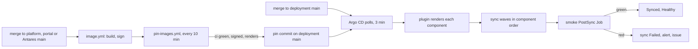

# GitOps for dev

Argo CD keeps the `dev` cluster on `main` of `joinedcontext-deployment` ([ADR-N-054](../Decisions/adr-n-054-gitops-argo-cd-helmfile.md)). It renders the same helmfile deployment `just dev-apply` applies, through a plugin, so the hand path and Argo CD converge to the same objects. This page is the operator's: what happens after a merge, how to stop it, how to undo a change, what it needs and what it costs.

## 1. From a merge to a running change



- **A deployment change** reaches `dev` when Argo CD next polls the repository, every 3 minutes, plus the render and the sync: under 10 minutes (OPS-54).
- **A platform, Portal or Antares change** waits for its image (about 20 minutes), then for `pin-images.yml`, which pins the digest of the commit at the head of that repository's `main` once its `ci` run is green, its signature verifies and the dev render passes. The pin is an ordinary commit on deployment `main`, so `git log components/*/images.yaml` is the record of what reached `dev` and when (OPS-57).
- **The smoke** runs as the PostSync hook of the `smoke` Application. It waits until every Application is Synced at the same revision and Healthy, then runs `scripts/smoke.sh` in the cluster. A red smoke marks the sync Failed (OPS-58).

## 2. What Argo CD runs

| Object | Where | What it does |
|---|---|---|
| Argo CD v3.5.4 | namespace `argocd`, component `gitops` | controller, repo server, server, Redis, notifications; no Dex, no ApplicationSet controller |
| plugin sidecar `helmfile` | repo server pod | `gitops/cmp/generate.sh`: assemble, `helmfile -e dev -l component=… template`, the data guard |
| root Application `dev` | `gitops/chart` with `gitops/dev.yaml` and `gitops/hold.yaml` | the AppProject `platform`, one Application per component, the `smoke` Application |
| `gitops/dev.yaml` | generated by `scripts/gitops-apps.py dev` | each component's namespace and sync wave, in the order of the environment's `components:` |

Regenerate `gitops/dev.yaml` after adding or removing a component or moving one in the `components:` list; the fast CI lane fails while it is stale:

```bash
just _dev-assemble
python3 scripts/gitops-apps.py dev > gitops/dev.yaml
```

The component `gitops` is not one of the Applications: helmfile installs Argo CD, so a lost cluster is rebuilt with `just dev-apply` and Argo CD takes over from there.

## 3. What Argo CD never does

- **Delete data.** Every PersistentVolumeClaim, CNPG `Cluster`, Secret, Namespace and CustomResourceDefinition carries `Prune=false,Delete=false` (OPS-55). Removing one from Git leaves it in the cluster; delete it by hand, with the owner's word, if it is meant to go.
- **Rewrite a generated Secret.** Secrets are created once and their data is never compared or applied again, and the same holds for the APISIX standalone configuration the Portal composes. Rotate with `scripts/rotate-secret.sh`.
- **Roll back by itself.** A failed sync or a red smoke stays failed until a fix lands.

## 4. Rollback

1. **Find the commit.** `scripts/gitops-status.sh` lists each Application with its revision, sync and health status and last sync time; the failed one names the revision.
2. **Fix forward**, or **revert** the offending commit on deployment `main` (`git revert <sha>`, an ordinary pushed commit, never a force push). For a platform image, revert its pin commit: `pin-images.yml` pins the next green commit when one lands.
3. **Emergency only:** an Argo CD administrator may roll an Application back to an earlier synced revision in the UI. Automatic sync is suspended for that Application until it is re-enabled, so revert in Git as well and re-enable it.

## 5. The hold switch

`gitops/hold.yaml` stops every automatic sync (OPS-56):

```yaml
hold: true
reason: "Postgres minor upgrade, deployer, until 14:00Z"
```

Merged to `main`, the root Application adds a `deny` sync window over every Application of the project; a manual sync from the UI or `argocd app sync` is still allowed for the deployer. Set `hold: false` to resume. The root Application itself stays outside the window, so the hold can always be lifted from Git.

## 6. Credentials

| Credential | Who creates it | Where it lives |
|---|---|---|
| repository read | none: the repository is public | — |
| pin commits | the `GITHUB_TOKEN` of `pin-images.yml` | GitHub Actions, never the cluster |
| Keycloak client `argocd` | the Keycloak configuration of the `gitops` component | Secret `keycloak-client-argocd`, from the secrets generator |
| notification token | the owner (owner action, T-4674) | Secret `argocd-notifications-secret`, key `github-token`, `secretRef` only |

The local `admin` account is disabled and `argocd-initial-admin-secret` deleted once a Keycloak login of a `platform-admins` member can sync. No kubeconfig leaves the cluster.

## 7. Sizing

Measured before the install: `kubectl top nodes` 12319 Mi, 89 % memory. Argo CD's requests stay at or below 600 Mi:

| Pod | Request | Limit |
|---|---|---|
| application controller | 192 Mi | 768 Mi |
| repo server | 96 Mi | 384 Mi |
| plugin sidecar | 160 Mi | 640 Mi |
| server | 64 Mi | 256 Mi |
| Redis | 32 Mi | 128 Mi |
| notifications controller | 32 Mi | 128 Mi |
| **total** | **576 Mi** | |

The repo server renders one component at a time (`parallelismLimit: 1`), so a commit re-renders 30 components in about 3 minutes. If the node would pass 92 % memory, move a stopped component off before installing.

## Related

- [ADR-N-054](../Decisions/adr-n-054-gitops-argo-cd-helmfile.md): the decision and its alternatives.
- [Upgrading & Version Management](06-updating.md): the component order the sync waves follow.
- [Backup, Disaster Recovery & Restore](07-backup-restore.md): what protects the data Argo CD never deletes.
- [Production Instance smartcity](14-production-smartcity.md): production keeps the hand promotion until it copies this pattern.
