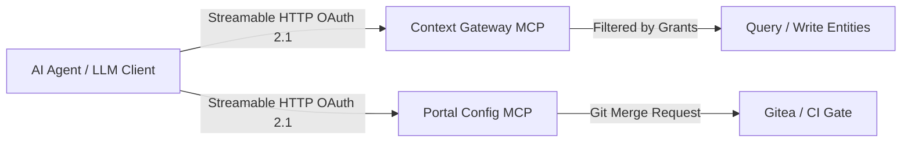

# Model Context Protocol (MCP) & AI Agents

The platform implements the open Model Context Protocol (MCP) using the official Rust `rmcp` SDK. Agents participate as first-class actors under strict identity and access governance.

## 1. Architectural Split: Two MCP Facades

1. **Context Data MCP** (Part of Context Gateway, SP-14…SP-20): Exposes spaces and endpoints as MCP Streamable HTTP servers. Tools are projected dynamically from the caller's active permissions.
2. **Configuration Plane MCP** (`POST /api/v1/mcp` on the Portal, CC-45…CC-48): Exposes blueprint instantiation, plan evaluation, and merge request proposals to autonomous agents. It is one adapter over the operation registry, so a tool call and the button a person presses run the same function ([ADR-N-021](../Decisions/adr-n-021-one-operation-registry-behind-ui-api-assistant-and-mcp.md)). It was specified as `jcctl serve --mcp` and built in the Portal instead: `jcctl` has no MCP code, and the configuration API — changes, dry runs, git, permissions — lives where the sessions and the forge credentials already are.



## 2. Standard Context Data MCP Toolset

An Endpoint's own MCP server (`/api/endpoint/{slug}/mcp`, `/cs/{space}/mcp`) is the broker's MCP surface of its view: the gateway verifies the caller and forwards each message to `/x/views/{view}/mcp`, where the view's policy lists and decides every data tool (T-3647, T-3648). The gateway answers `describe_access` and `describe_schema` itself and adds them to the broker's `tools/list` (`crates/context-gateway/src/mcp/describe.rs`). The hub and the named servers list the same tools from `TOOLS` in `crates/context-gateway/src/mcp/tools.rs`, a copy of the broker's table (Antares `docs/src/mcp.md`) in which each row names the NGSI-LD operations it needs (EP-112). `tools/list` returns only those the caller's grants would let through, so the tool list is itself an access decision and a tool a caller may not use is never offered.

The read side is `query_entities`, `batch_query`, `get_entity`, `get_attribute_value`, `list_types`, `list_type_details`, `list_attributes`, `list_attribute_details`, `get_type`, `get_attribute`, the three temporal tools, `list_subscriptions`, `get_subscription`, `describe_schema` and `describe_access`; the write side is `batch_upsert`, `create_subscription` and the broker's other write tools, each confirmed by the person.

```json
[
  {
    "name": "query_entities",
    "description": "Query Entities (TS 104 175 10.4.3): by type, id, q, scopeQ or area, a page at a time.",
    "annotations": { "readOnlyHint": true },
    "inputSchema": {
      "type": "object",
      "properties": { "type": { "type": "array" }, "id": { "type": "array" }, "q": {}, "limit": {}, "cursor": { "type": "string" } },
      "additionalProperties": false
    }
  },
  {
    "name": "batch_upsert",
    "description": "Create several Entities or update those that exist (TS 104 175 10.3.3).",
    "annotations": { "readOnlyHint": false, "destructiveHint": true },
    "inputSchema": {
      "type": "object",
      "required": ["entities"],
      "properties": { "entities": { "type": "array" }, "options": { "enum": ["update", "replace"] } },
      "additionalProperties": false
    }
  }
]
```

The argument names and types are the broker's, so a call that works at an Endpoint's own URL works on the hub with `endpoint` beside it (EP-112). CIM 009 5.7.2.4 wants at least one selector and does not accept `idPattern` alone; the broker refuses such a query by name.

## 3. Configuration Plane MCP Tools

The Portal's MCP surface is an adapter over the operation registry, so every tool is an operation with a `jc_` name and the same lane, permission check and dry run as the button a person presses: `jc_catalog_search`, `jc_endpoint_propose`, `jc_pipeline_propose` with its `jc_pipeline_test` check, `jc_datasource_propose` with `jc_datasource_check`, `jc_manifest_dry_run`, `jc_project_create`, `jc_project_import`, `jc_workspace_propose`, `jc_workspace_discard` and the rest. `GET /api/v1/projects/{project}/ops` lists exactly what the caller would be let through; the registry is `joinedcontext-portal/src/ops/mod.rs`.

A propose operation does not write to a live system. It synthesises the manifest, runs the kind's check, branches the configuration repository and opens a merge request, and the lane decides who approves it.

## 4. Prompt Injection Defense & Sandboxing

1. **Data Is Untrusted**: Payloads returned by `query_entities` are strictly isolated from tool instruction blocks.
2. **No Direct Writes**: Agents cannot issue direct writes to configuration or production data without going through a lane.
3. **Elicitation Mode**: High-risk or destructive tool executions trigger an interactive confirmation dialogue (`ConfirmRisky`) in the Portal UI before proceeding.

## Related

- [00-intro](00-intro.md) — development overview.
- [06-configuration-as-code](../Architecture/06-configuration-as-code.md) — how changes reach the platform.
