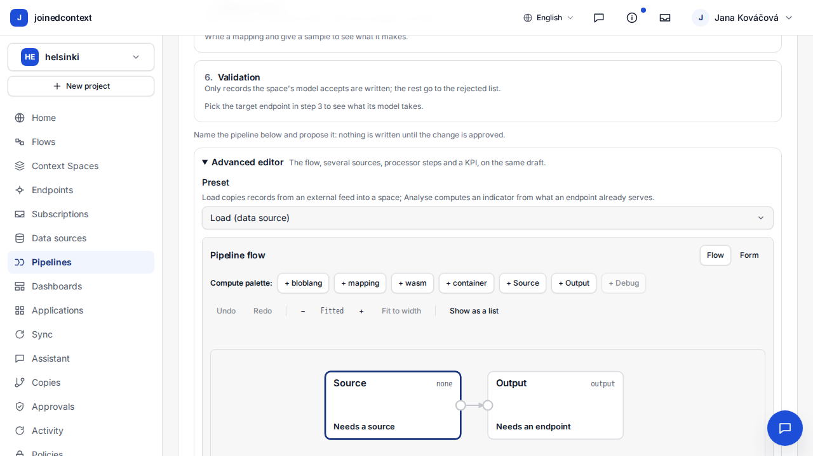
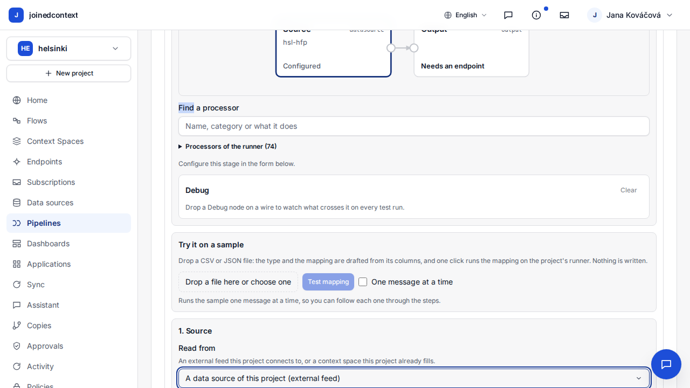
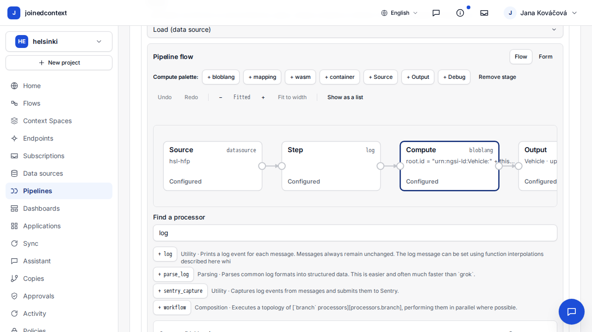
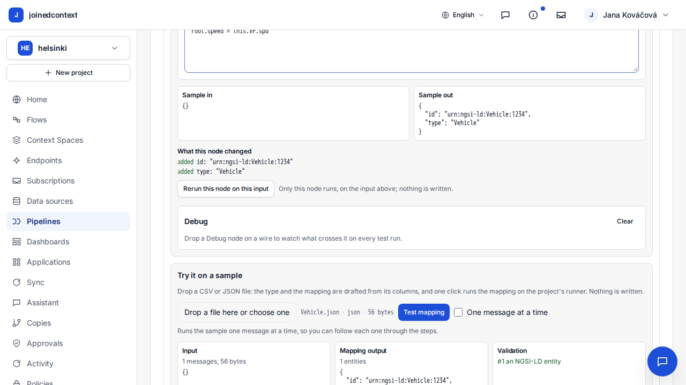
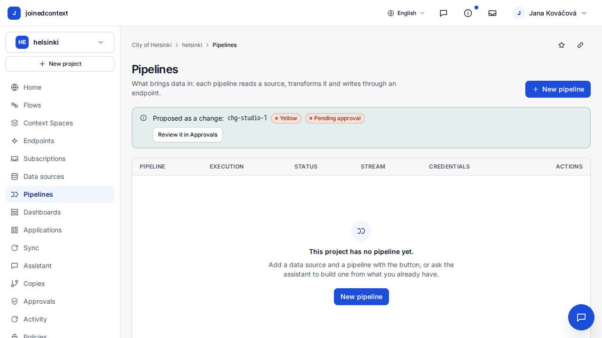

# Pipeline studio and the NiFi editor

CIVITAS/CORE moved data with Apache NiFi and its canvas; joinedcontext replaced NiFi with Bento pipelines (ADR-N-006) and a Portal studio. T-3919 asks whether a person can still build a pipeline the way the NiFi canvas let them. This report lists the NiFi capabilities CIVITAS/CORE names, what the Portal does today with the file that does it, three walks through the studio, and a task for every gap.

## 1. Method

- Capabilities come from the CIVITAS/CORE pipeline-engine pages and the legacy pipeline editor documentation. `D2` is `civitas-core-docs_v2/Architecture/Pipeline_Engine/` (adr027 sits under `civitas-core-docs_v2/Architecture/`), `LEG` is `civitas-core-platform/portal-frontend/src/app/(main)/datasets/[datasetId]/data-flow/pipeline-editor/DOCUMENTATION.md`. The legacy editor had a categorised palette, a canvas and an inspector panel per node; the NiFi pages name the rest at architecture level. Neither describes templates.
- Portal cells cite a file of `joinedcontext-portal` (`PF` is `ui/src/pages/pipelines/PipelineFlow.tsx`).
- The walks run in Playwright against the Portal UI with its API stubbed (`ui/e2e/pipeline_studio_walk.spec.ts`, 3 walks and 3 edge cases, green). They prove what the UI sends, not what the cluster does: the same walks on `dev`, with build times, are T-3967.

## 2. Capability table

| # | Capability (NiFi) | CIVITAS/CORE source | Portal today | Code | Task |
|---|---|---|---|---|---|
| 1 | Search the processor palette | LEG:27 (categories, no search) | works | PF:593-601, 1222-1258 | none |
| 2 | Drag a processor onto the canvas and wire it | LEG:27-28, 333 | works | PF:898-927 | none |
| 3 | Configure a processor in a form with help | LEG:29, 301 | works | `StepBlock` PF:1317-1483, `processorForm.ts` | none |
| 4 | Route or branch a flow | D2 `sketch_nifi.md:79`, `comparison.md:25` | partial: one lane, `switch` only inside a step | `pipelineGraph.ts:4-6` | T-3920 |
| 5 | Merge several sources | D2 `sketch_nifi.md:79` (funnels), `comparison.md:25` | works | PF:201, jc-core `pipeline.rs:78-80` | none |
| 6 | Test a flow on a sample | D2 `comparison.md:62` | works, test run per node | `PipelineTest.tsx`, `src/api/pipeline_test.rs:472` | none |
| 7 | Data provenance of a running flow | D2 `adr038.md:69,92`, `comparison.md:28` | test runs only | `DebugPanel.tsx`, PF:428 | T-3974 |
| 8 | Counters per processor | D2 `adr038.md:79`, `sketch_nifi.md:123`, `comparison.md:46` | partial: cumulative, polled every 15 s | PF:463 | T-3921 |
| 9 | Queue size and back-pressure on a connection | D2 `adr038.md:91`, `comparison.md:45` | API returns `bufferDepth`, no UI reads it | `src/api/pipelines.rs:46,107` | T-3973 |
| 10 | Start and stop a flow | D2 `sketch_nifi.md:29` | works, through approval | `PipelinesPage.tsx:578-581` | none |
| 11 | Version a flow, diff, revert | D2 `adr038.md:67`, `sketch_nifi.md:30,112` | project-wide history only | `ApprovalsHistory.tsx:110-124`, `src/api/restore.rs` | T-3975 |
| 12 | Templates | not in the CIVITAS/CORE docs; a NiFi feature | four fixed recipes | `recipes.ts:20` | T-3976 |
| 13 | Export and import a flow | D2 `sketch_nifi.md:30`, `comparison.md:31` | YAML tab; export API not on the page | `src/api/export.rs:36-47` | T-3977 |
| 14 | Who changed what | D2 `adr038.md:65,69` | works, project level | `src/api/changes.rs:50` | T-3975 for per pipeline |
| 15 | Secrets in processor fields | D2 `sketch_nifi.md:101`, `Architecture_Decisions/ready_adrs/adr027.md:15` | refused: help says `${VAR}`, the server refuses it | `src/api/mutate.rs:22,66` | T-3972 |

## 3. Walks

Each walk opens New pipeline, More options, Advanced editor, sets the source on its node, drags a processor and a Bloblang step from the palette, uploads a sample, writes the mapping, picks the target Endpoint, runs Test mapping, Check and Propose, then reads the posted `v1alpha2` manifest.

| Walk | Source | Processor | Sample | Actions |
|---|---|---|---|---|
| hsl-vehicles | `hsl-hfp` (MQTT) | `log` | `Vehicle.json` | 16 |
| air-quality | `air-poll` (HTTP) | `switch` | `AirQualityObserved.json` | 16 |
| parking-zones | `parking-csv` (file) | `unarchive` | `ParkingZone.csv` | 16 |

Sixteen actions per walk: fourteen clicks, selects or drags and two typed fields. The hsl-vehicles walk:

What the walks found:

| Finding | Effect | Task |
|---|---|---|
| With no first source, the editor writes `v1alpha1` and drops the extra sources, processor steps and extra outputs drawn on the canvas (`PipelineEditor.tsx:272`) | data loss without a message | T-3969 |
| Check with an empty required field sends nothing and scrolls to Basics, not to the field | the person searches for the field | T-3970 |
| A sample upload replaces a typed mapping, and the entity type comes from the file name | typed work lost | T-3971 |
| The first source and output have no editor on their nodes, only the extra ones do | canvas building leads to "+ Source" and T-3969 | T-3978 |
| The canvas sits under two folds below the six-step workbench | slower to reach | none, by design of ADR-N-034 |

## 4. What T-3920 and T-3921 cover

- T-3920 adds branches and routes on the canvas (row 4).
- T-3921 adds live per-step rates to the counters (row 8).
- Every other gap row has its own task above; none of them waits on T-3920 or T-3921.

## Related

- [ADR-N-006](../Decisions/adr-n-006-bento-pipelines-supersede-nifi.md) — why Bento replaced NiFi.
- [ADR-N-023](../Decisions/adr-n-023-pipeline-sources-steps-outputs.md) — sources, steps and outputs of a pipeline.
- [ADR-N-034](../Decisions/adr-n-034-pipeline-workbench.md) — the six-step workbench the canvas sits under.
- [Architecture/08](../Architecture/08-pipelines.md) — the pipeline architecture.
- [Requirements/pipelines.md](../Requirements/pipelines.md) — PL-52, PL-56 and PL-68.
