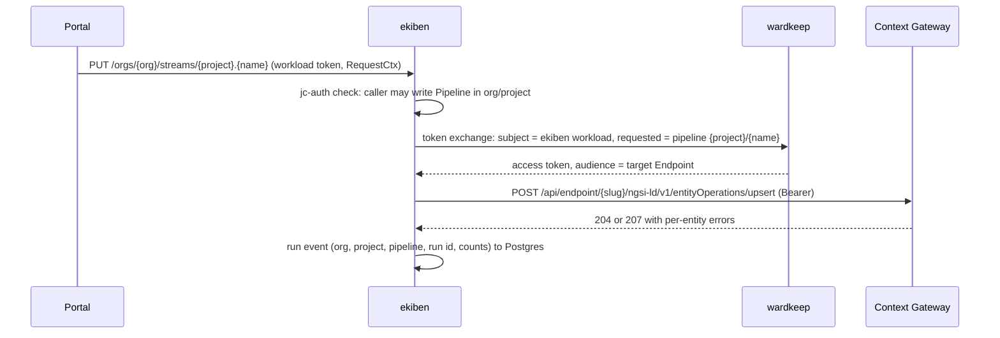

# Bento for ekiben

This report covers Bento 1.22.0 (the pipeline runner the platform deploys today) for the Rust replacement ekiben. It inventories what upstream offers, what the Portal uses, how upstream isolates streams and plugins, and what ekiben must add so one process can serve many Organizations safely. It ends with a pack plan for a second Argon run. It is written for the worker who assembles that pack and for the reviewers of the generated code. Task T-6636, written by worker-t6636 on 2026-11-07.

Pinned sources (every `path:line` below resolves at these commits):

| prefix | repository | commit |
|---|---|---|
| `bento:` | github.com/warpstreamlabs/bento, tag `v1.22.0` | `2fbbce3076619cd18c28f2dc23fd413a49744250` |
| `ekiben:` | github.com/marek-mraz-jc/ekiben, `main` | `1bacb1e0f0be4407dfc7a001cdcef2a6c8356d78` |
| `portal:` | joinedcontext-portal, `main` | `d7f91eb28d094f936a5c9cfbd5cf7260091c0503` |
| `platform:` | joinedcontext-platform, `main` | `e59ceb9f086c0e823fb476ec5228c1c1e4977f04` |
| `deployment:` | joinedcontext-deployment, `main` | `cee6ebcb9c8e76dc24f3b4760d24da8ce86228ab` |

The Portal pins `jcctl` at platform `9b0b85944083ae547b331d2327db4021e81cd08a` (`portal:Cargo.toml:81`). Platform rows cite platform `main`. Commands run for this report are quoted where they prove a claim. `scripts/research/bento-sources.sh` re-measures the token counts in section 8.

## 1. Capability inventory

Upstream inventory from `bento list --format json` of the release binary (checked by SHA-256 in `ekiben:scripts/reference-bento.sh:5-11`): 66 inputs, 75 outputs, 78 processors, 16 caches, 2 rate limits, 4 buffers, 12 scanners, 7 metrics exporters, 4 tracers, 42 Bloblang functions and 178 Bloblang methods. Usage counts come from every Pipeline, DataSource and bento file in the deployment seeds: 831 Pipeline manifests, 795 DataSources (780 `http`, 9 `generate`, 5 `mqtt`, 1 `nats`) and 779 bento files. The counting script walks `spec` of each manifest with `yaml.safe_load_all` and counts a key as a component when it sits in a processor list and is a jc-core processor or input name (`platform:crates/jc-core/src/kinds/bento_processors.rs`, `bento_inputs.rs`). "ekiben" says whether `ekiben:main` registers it (exact `register_*("name")` matches).

### Inputs (66)

| class | components | evidence |
|---|---|---|
| used today | `generate` (clock of every polled source, 9 DataSources), `mqtt` (5), `websocket`, `nats` (1), `broker` (wraps mqtt/websocket with batching), `http_client` (GTFS-RT, turned into `generate` + `http` for one run) | `portal:src/reconciler/streams/render.rs:609-677`; `portal:src/reconciler/run_queue.rs:946-1060` |
| allowed by jc-core, unused in seeds | `kafka`, `kafka_franz`, `nats_jetstream`, `nats_stream`, `amqp_0_9`, `amqp_1`, `redis_streams`, `redis_pubsub`, `gcp_pubsub` (resident list) and the rest of the 84-entry INPUTS list | `portal:src/reconciler/run_queue.rs:44-69`; `platform:crates/jc-core/src/kinds/data_source.rs:517-600` |
| refused by jc-core | `dynamic`, `http_server`, `inproc`, `kubernetes_watch`, `resource`, `socket_server`, `stdin`, `subprocess` | `platform:crates/jc-core/src/kinds/data_source.rs:995-1004` |
| needed for the platform | the used set, plus `nats_jetstream` and `nats_kv` (the bus, owner: no Kafka), `mqtt_v5`, `sequence`, `read_until`, `batched`, `inproc` (internal wiring only), `sql_select` (Postgres sources), `http_server` (push intake behind jc-edge, never a raw listener) | ekiben has 13: `batched broker csv file generate http_client inproc nats nats_jetstream read_until resource sequence stdin` |
| not needed | `kafka*` (owner rule), cloud vendor inputs `aws_* azure_* gcp_*` (no cloud account in scope; a feature-gated crate on demand), `beanstalkd nanomsg nsq zmq4n pulsar s2 hdfs etcd cassandra cockroachdb_changefeed mongodb cypher discord twitter_search redis_*` (no such systems in the platform), `subprocess stdin socket* dynamic kubernetes_watch fsevent file_tail` (host access, refused today) | jc-core refusals above; owner rule in `ekiben:README.md:7` |

### Outputs (75)

| class | components | evidence |
|---|---|---|
| used today | `switch`, `drop`, `reject`, `broker` (`fan_out_sequential_fail_fast`), `fallback`, `http_client` (outcome sink, replay of rejected records). Writes to the gateway are `http` processors in `branch`, not outputs | `portal:src/reconciler/streams/identity.rs:319-430`; `portal:src/pipeline_log.rs:270-338` |
| needed | used set, plus `nats_jetstream`, `nats`, `nats_kv`, `inproc`, `retry`, `resource`, `sync_response`, `stdout`/`file` (CLI and tests) | ekiben has 18: `broker cache drop drop_on fallback file http_client inproc nats nats_jetstream nats_kv reject reject_errored resource retry stdout switch sync_response` |
| not needed | `kafka*`, vendor and database sinks (`aws_* azure_* gcp_* elasticsearch_v2 opensearch snowflake_put splunk_hec datadog_logs questdb cassandra couchbase mongodb redis_* sql_*`), chat sinks (`discord slack_webhook pusher`), `subprocess socket websocket http_server` (a sink to the world goes through an Endpoint, every write passes a Policy) | CLAUDE.md non-negotiable "every write to context data goes through an Endpoint and its Policy" |

### Processors (78)

| class | components (seed count) | evidence |
|---|---|---|
| used today | `mapping` 2279, `http` 690, `unarchive` 681, `branch` 493, `archive` 466, `mutation` 389, `resource` 379 (`events_tail`), `sleep` 350, `log` 230, `try` 222, `split` 165, `switch` 133, `xml` 73, `catch` 40, `for_each` 15, `while` 14, `parquet_decode` 11, `cache` 8, `rate_limit` 2, `group_by_value` 2, `protobuf` 2, `bloblang` 1, `decompress` 1; Portal-rendered also `dedupe`, `cached` | seed walk; `portal:src/reconciler/streams/identity.rs:121-235` |
| refused by jc-core (also nested) | `awk`, `command`, `file`, `javascript`, `python`, `subprocess`, `template`, `wasm` | `platform:crates/jc-core/src/kinds/pipeline.rs:1201-1300` |
| needed | used set, plus `workflow`, `parallel`, `processors`, `retry`, `bounds_check`, `dedupe`, `cached`, `group_by`, `select_parts`, `insert_part`, `compress`, `json_schema`, `jq`/`jmespath` (common in public configs), `msgpack`, `avro` (later), WASM compute through the platform wasm-host (section 3) | ekiben has 37; missing among needed: `cached`, `group_by` (branch T-6627), `json_schema`, `jq`, `jmespath`, `msgpack`, `parquet_encode` |
| not needed | host code (`awk command subprocess javascript python file template`), vendor (`aws_* azure_cosmosdb couchbase elasticsearch gcp_bigquery_select mongodb redis redis_script sentry_capture opensnowcat schema_registry_*`), `nlp_*` (Hugging Face models in process; the embedder module owns models), `sql_*` (writes go through Endpoints) | jc-core refusals; module table `ekiben:REPOSITORY.md` |

### Other components

| category | used today | needed | not needed |
|---|---|---|---|
| caches (16) | `memory` (`helsinki__departures`, `helsinki__gtfs`, `deployment:components/pipeline-runner/streams/resources.yaml:8-24`) | `memory lru ttlru noop multilevel nats_kv` (ekiben has these 6) | vendor stores (`aws_* gcp_* couchbase mongodb redis memcached sql file ristretto`): state lives in JetStream KV |
| rate limits (2) | `local` (7 resources, `resources.yaml:25-75`; per-project `<project>__pipeline_egress` 500/s, `portal:src/reconciler/streams/identity.rs:136-185`) | `local`, plus a JetStream-backed shared limit for several replicas | `redis` |
| buffers (4) | none | `none`, `memory` | `sqlite` (JetStream is the durable buffer), `system_window` (windowing goes in KPI steps) |
| scanners (12) | none in seeds | `lines to_the_end json_documents csv tar chunker` (ekiben inline), `decompress skip_bom xml_documents re_match switch` for parity | `avro` until avro lands |
| metrics (7) | `prometheus` with a filter mapping (`deployment:components/pipeline-runner/values/runner/base-values.yaml.gotmpl:44-51`) | `prometheus` | `statsd influxdb aws_cloudwatch json_api logger` |
| tracers (4) | none | `open_telemetry_collector` (OTLP) | `jaeger gcp_cloudtrace` |

### Bloblang

| part | used today | ekiben | design |
|---|---|---|---|
| functions (42) | 12: `throw` 1412, `content` 1194, `env` 1092, `meta` 751, `deleted` 508, `range` 275, `error` 210, `errored` 207, `now` 206, `json` 85, `timestamp_unix` 28, `metadata` 1 (regex over 5312 mapping texts, 4.5 MB) | 42 by name; `cache_get/set/add/delete` fail at runtime, `ksuid ulid snowflake_id` return UUIDv4, `fake` a constant (`ekiben:crates/ekiben-bloblang/src/functions.rs:52-231`) | every pure function; `env` only for the literal allow-list; `file file_rel file_rel_json hostname` not offered; `cache_*` implemented over the org's caches |
| methods (178) | 86 distinct; top `or` 8846, `apply` 6800, `length` 3953, `catch` 3863, `index` 3248, `map_each` 3162, `format` 3053 | 167; missing `diff patch parse_parquet geoip_*` (8) | all except `geoip_*` (needs MaxMind database files nobody ships) |
| `import`/`from` | refused (`platform:crates/jc-core/src/kinds/pipeline.rs:1498-1530`) | not checked | refused; named mappings come from the org's resources |

## 2. Internals

### Upstream request and data flow

| part | behaviour | source |
|---|---|---|
| process | one Go binary; `public/components/all` blank-imports 58 component packages into one global registry | `bento:cmd/bento/main.go:9,22-29` |
| stream | input → optional buffer → processor pool → output, chained by unbuffered `chan message.Transaction` | `bento:internal/stream/type.go:100-141` |
| processor pool | `threads` default `-1` = `runtime.NumCPU()` copies of the whole chain on one input channel | `bento:internal/pipeline/config.go:13,40`; `bento:internal/pipeline/pool.go:33-46` |
| acks | a transaction carries a batch and a response channel; `Ack(nil)` = delivered, error = nack and replay; split batches tracked per part | `bento:internal/message/transaction.go:20-96`; `bento:internal/transaction/tracked.go:14-84` |
| backpressure | every inter-layer channel unbuffered; outputs bounded by `max_in_flight`; reconnect with exponential backoff | `bento:internal/component/input/async_reader.go:58,120-136,205`; `bento:internal/component/output/async_writer.go:245` |
| shutdown | `shutdown_timeout` 20 s; graceful for 3/4 of it, then close everything; watchdog `os.Exit(1)` at timeout + 1 s | `bento:internal/config/schema.go:62-63`; `bento:internal/stream/type.go:235-270`; `bento:internal/cli/common/manager.go:172-194` |
| batching | `count`, `byte_size`, `period`, `check`, `jitter`, `processors` | `bento:internal/batch/policy/policy.go:111-205` |
| state | none durable; resources (caches, rate limits) live in memory or an external store | `bento:internal/manager/type.go:81-96` |
| scaling | one process per config set; no coordination between replicas | `bento:internal/stream/manager/type.go` (no peer logic) |

### Streams mode

| part | behaviour | source |
|---|---|---|
| API | `GET/POST /streams` (POST replaces the whole set), `POST/GET/PUT/PATCH/DELETE /streams/{id}`, `GET /streams/{id}/stats`, `POST /resources/{type}/{id}`, `/ready` | `bento:internal/stream/manager/api.go:30-61,110-220,379-452,535` |
| update | delete (graceful stop) then create; not atomic | `bento:internal/stream/manager/type.go:183-227` |
| sharing | `forStream(id)` copies the manager by value and adds only a `stream=<id>` log field and metric label: resources, plugin environment, Bloblang environment, HTTP server, filesystem and in-process pipes are shared by every stream | `bento:internal/manager/type.go:78-96,330-338` |
| limits | no per-stream CPU, memory or goroutine limit (grep `SetMemoryLimit`, `GOMEMLIMIT`, `GOMAXPROCS`, `rlimit`: 0 hits) | `bento:internal/stream/type.go:143-151` |
| HTTP server | `0.0.0.0:4195`, `debug_endpoints: false`, optional basic auth (off by default), no read timeouts | `bento:internal/api/docs.go:16-23`; `bento:internal/httpserver/basic_auth.go:116`; `bento:internal/api/api.go:68` |

### The Portal and the runner today

| step | what happens | source |
|---|---|---|
| render | `render_stream` (one DataSource source), `render_endpoint_stream` (an Endpoint source), `render_merged` (several sources, outputs or steps, KPI) turn a Pipeline into Bento JSON; pure, no I/O | `portal:src/reconciler/streams/render.rs:1-4,24,526,929-941` |
| polled source | `generate` clock (`period`, else `schedule`, else 60 s) then `try { http }` and a mutation dropping errored messages | `portal:src/reconciler/streams/render.rs:649-677` |
| write | per output an `http` processor in `branch` to `${JC_GATEWAY_URL}/api/endpoint/{slug}/ngsi-ld/v1/entityOperations/upsert`, `?options=update` unless mode `replace` (PL-79), batches of 1000 entities or 1 MiB | `portal:src/reconciler/streams/identity.rs:303-400`; `portal:src/reconciler/streams/render.rs:585-605` |
| deploy | `POST /resources/rate_limit/<project>__pipeline_egress`, then `PUT /streams/{project}.{name}` (POST on 404), 8 sends in parallel, backoff 60 s to 15 min | `portal:src/reconciler/streams.rs:38-47,1342-1385` |
| resident vs queued | push-fed sources stay resident; every other Pipeline goes to the run queue, which creates the stream for one run (`generate count: 1`) and deletes it when `GET /streams/{id}` says `active: false` | `portal:src/reconciler/streams.rs:1395-1469`; `portal:src/reconciler/run_queue.rs:946-1060` |
| clock | `Clock::of`: `period` with the cron's time of day as phase, else cron (5 fields, UTC), else once; lanes Short (< 5 min gap) and Batch; tick 5 s; run timeout 15 min; retries 15 min, 1 h, 4 h | `portal:src/reconciler/run_queue.rs:27-41,91-161,317-327,902-936` |
| observe | outcome sink posts to `/internal/pipelines/{p}/{n}/outcomes`; Postgres `pipeline_log`/`pipeline_runs` (5000 lines, 200 runs per Pipeline); runner `/metrics` parsed per project | `portal:src/pipeline_log.rs:34-59,270-338`; `portal:src/reconciler/streams.rs:548-556` |
| runner | one Deployment for every project, Bento 1.22.0 by digest, dev 100m/512Mi request, 2 CPU/3Gi limit; base 1 CPU/1Gi limit; liveness restarts the pod when a stopped stream stays 600 s | `deployment:components/pipeline-runner/values/runner/development-values.yaml.gotmpl:8,19-28`; `base-values.yaml.gotmpl:137-173` |

### Mapping to ekiben

| Portal today | ekiben today | ekiben target |
|---|---|---|
| stream per run, deleted after `active:false` | `run: once` or the run-once query parameter freezes uptime (`ekiben:crates/ekiben-server/src/manager.rs:114-145`); `ekiben run` prints a `RunSummary` with peak RSS (`ekiben:crates/ekiben-core/src/traits.rs:18-32`) | run is a first-class object: `POST /runs` returns a run id; state, counts and the first error are kept in Postgres; the Portal stops polling stream lists |
| Portal run queue (in memory, lost on restart, KNOWLEDGE T-5824) | `ekiben schedule` resident scheduler, overlap Skip or Queue, `@every`, IANA time zones (`ekiben:crates/ekiben-server/src/scheduler.rs:24-30`; `cron.rs:8-26`) | the scheduler moves into ekiben with its table in Postgres and a leader lease; the Portal sends `schedule` and `period` with the stream and keeps only the manifest |
| Bento metric names (`input_received`, `output_sent`, ...) filtered in the runner | `ekiben_input_received_total{org,stream}` (command below) | Bento names kept as aliases until the Portal reads the run API |
| `${VAR}` from the runner's environment, Secret `pipeline-secrets` holding every project's values | `${VAR}` from the process environment (`ekiben:crates/ekiben-server/src/api.rs:468,584`) | per-stream variable map built from the org's secretRefs only (section 4) |

Command, ekiben release build of `ekiben:main`, 20 streams of `generate` every 10 ms + one `mapping` + `drop`, 10 s after start:

```text
ekiben_input_received_total{org="default",stream="s1"} 894
ekiben_output_sent_total{org="default",stream="s1"} 894
```

## 3. Plugin and extension system

### Upstream

| aspect | Bento 1.22.0 | source |
|---|---|---|
| registration | `Environment.Register{Input,BatchInput,Output,BatchOutput,Processor,BatchProcessor,Cache,RateLimit,BatchBuffer,MetricsExporter,OtelTracerProvider,BatchScannerCreator,TemplateYAML}` | `bento:public/service/environment.go:132-701` |
| lifecycle | `Input.Connect/Read → (msg, AckFunc)/Close`, `ErrNotConnected` reconnects, `ErrEndOfInput` ends; `Output.Connect/Write` with `maxInFlight`; `Processor.Process → batch`; `Cache` Get/Set/Add/Delete with TTL; `RateLimit.Access → wait` | `bento:public/service/input.go:20-53`; `output.go:21-39`; `processor.go:13-39`; `cache.go:21-38`; `rate_limit.go:13-18` |
| config | `ConfigSpec` with fields, status, Bloblang lint rules, `.Secret()` scrubbing (52 fields) | `bento:public/service/config.go:245,333-475`; `bento:internal/docs/field.go:168-178` |
| resources | `*_resources` by label, global to the manager; in streams mode one stream reaches another's resources | `bento:internal/manager/config.go:22-28`; `bento:internal/manager/type.go:513-900` |
| templates | YAML `type` + `fields` + Bloblang `mapping` registers a new component; compiled with the full global Bloblang environment | `bento:internal/template/config.go:41-48,110` |
| Bloblang plugins | `RegisterFunction/Method(V2)/Advanced*`, `Impure()`; restrictions `WithoutFunctions`, `WithDisabledImports`, `WithMaxMapRecursion`, `OnlyPure` (clock functions stay) exist only in the embedding API | `bento:public/bloblang/environment.go:92-358`; `bento:public/bloblang/spec.go:234-241` |
| WASM | wazero 1.6.0, default runtime config, WASI preview 1, host module `bento_wasm` (`v0_msg_set_bytes`, `v0_msg_as_bytes`, `v0_msg_set_meta`, `v0_msg_get_meta`), module read from a path, no memory, fuel or time limit | `bento:internal/impl/wasm/processor_wazero.go:33-149`; `functions.go:22-83` |
| isolation | none: every plugin runs in the one process (grep `plugin.Open`, `hashicorp/go-plugin`: 0 hits); goja and wazero sandboxes are in-process too | `bento:internal/impl/io/processor_command.go:73-74` |

### ekiben today

- Traits `Processor`, `Input`, `Output`, `Cache`, `RateLimit`, `Buffer`, all `async_trait + Send + Sync`; contexts carry `org: Arc<OrgContext>`, `ResourceManager`, registry, Bloblang environment, metrics, `file_root`, shutdown (`ekiben:crates/ekiben-core/src/traits.rs:36-223`).
- Registry of name → constructor behind `RwLock<HashMap>`, each processor wrapped in `ObservedProcessor` (`ekiben:crates/ekiben-core/src/registry.rs:51-187`).
- Cargo features only `parquet` and `protobuf` on `ekiben-server` (`ekiben:crates/ekiben-server/Cargo.toml:11-16`); release binary 32,070,368 bytes with both (`ls -la` of the build above).
- `#![forbid(unsafe_code)]` in all 10 crates; no WASM (grep `wasm`: 0 hits); no buffer registered, so a configured `buffer:` is ignored on `main` (`ekiben:crates/ekiben-core/src/config.rs:527-535`).

### Rust design

| plugin kind | how it hooks in | what it may touch | limits |
|---|---|---|---|
| built-in component | a crate behind a Cargo feature registers constructors in `Registry` at start (`ekiben-io-nats`, `ekiben-io-http`, `ekiben-parquet`, ...) | its own config, the org's resources by `(OrgId, label)`, the shared HTTP client with the PL-07 guard | the org's quotas (section 5) |
| WASM compute step (`compute.kind: wasm`, PL today refuses the processor) | `ekiben-wasm` crate calls the platform wasm-host component model: WIT world `jc:pipeline/processor@0.1` with `process(batch: list<message>) -> result<list<message>, error>` | message bytes and metadata only; no WASI filesystem, no sockets, no clock beyond a host `now` | wasm-host `Limits`: 64 MiB memory, 5 s wall time by epoch (10 ms tick), fuel 2e11, 2 MiB in, 8 MiB out, 16 per App, 64 per tenant (`platform:crates/wasm-host/src/limits.rs:8-45`); wasmtime 49.0.5 pooling allocator (`platform:crates/wasm-host/Cargo.toml:15`) |
| Bloblang plugin | Rust function registered in `ekiben-bloblang` `Environment`; impure functions flagged and absent from the author environment | pure functions only in author mappings | `WithMaxMapRecursion` equivalent; regex crate is linear time like RE2 |
| template | not offered to authors | none | templates compile with the full environment upstream (`bento:internal/template/config.go:110`) |

Decided (worker-t6636, owner may override): no Bento `bento_wasm` ABI compatibility, because no seed uses the `wasm` processor (seed walk: 0 hits) and jc-core refuses it (`platform:crates/jc-core/src/kinds/pipeline.rs:1201-1210`); options were an ABI shim over wasmtime or the component model of the platform wasm-host, which already carries fuel, memory, epoch and per-tenant limits.

## 4. Security

### Flows

| flow | today | Rust design |
|---|---|---|
| Portal → runner control API | Linkerd mTLS; Server authorization admits only ServiceAccount `portal` on port 4195; Bento itself checks nothing | jc-auth middleware on every route: workload token (audience `ekiben`) or mTLS identity plus a signed `RequestCtx` naming org and instance; refusal 401/403; `/ping` and `/ready` only unauthenticated |
| stream → gateway write | OAuth2 client credentials `{project}-pipelines` with `${JC_CLIENT_SECRET_<PROJECT>}`, or in pipeline-identity mode the token sidecar trades the pod's ServiceAccount token for `{project}/{pipeline}` (PL-19) | the stream's credential is minted per run by ekiben from wardkeep (token exchange for the Pipeline's identity), held in memory, never in config text |
| source read with credentials | `authorization.headerRef`, MQTT `passwordRef`, `caCertRef` become `${DS_<SOURCE>_<KEY>}` from Secret `pipeline-secrets` | secretRef resolved per org from SOPS/OpenBao into `SecretString` in the stream's variable map |
| sink → Portal internal listener | outcome and sample posts accepted only from a client of the Pipeline's own project (T-3193) | run events go to ekiben's own Postgres tables with org and project at write time; the Portal reads them through the run API |
| ekiben → NATS | not deployed | one NATS account per Organization (user JWT + nkey, `ekiben:crates/ekiben-io-nats/src/connection.rs:6-19` already parses them) |

Sources: `deployment:components/pipeline-runner/values/runner/base-values.yaml.gotmpl:187-191`; `portal:src/reconciler/streams/identity.rs:41-86`; `platform:crates/jc-core/src/kinds/data_source.rs:1217-1235`; `portal:src/pipeline_secrets.rs:12-49`; `portal:src/reconciler/streams.rs:466-470`.



### Controls that exist today

| control | where |
|---|---|
| author steps may read only `JC_GATEWAY_URL JC_GATEWAY_HOST JC_TOKEN_URL JC_ORG_DOMAIN JC_CLIENT_ID JC_CLIENT_SECRET` and their own `secretRefs[].envVar`; Bloblang `env()` only `JC_ORG_DOMAIN`, `JC_SOURCE_SPACE`, `JC_SPACE*` as a literal | `platform:crates/jc-core/src/kinds/pipeline.rs:965-971,1415-1530` |
| re-checked before render; a stream reading `JC_CLIENT_SECRET_OTHER` never reaches the runner | `portal:src/reconciler/streams.rs:212-255,3293-3312` |
| `command`, `subprocess`, `file`, `wasm`, unknown processors and `env("JC_CLIENT_SECRET")` refused, nested too | test `a_bento_processor_the_platform_refuses_does_not_render`, `portal:src/reconciler/streams.rs:2648-2670` |
| PL-07 host rule: loopback, `localhost*`, non-public addresses, numeric host forms, `%`, host from `${! }`, token Services, platform brokers | `platform:crates/jc-core/src/kinds/data_source.rs:1296-1466` |
| caches and egress limit renamed to `<project>__<name>` | `portal:src/reconciler/streams/identity.rs:121-235` |
| input limits: body 32 MiB (max 256), archive member 32 MiB, 20 members, write batch 1 MiB | `platform:crates/jc-core/src/kinds/data_source.rs:198-269`; `portal:src/reconciler/streams/render.rs:585-602` |

### Upstream behaviour measured

Bento 1.22.0 streams mode, started with `DEMO_SECRET=s3cr3t-demo`, a stream posted with `client_secret: "${DEMO_SECRET}"`, then `GET /streams/x`:

```text
client_secret":"s3cr3t-demo"
```

The API interpolates posted configs from the process environment (`bento:internal/stream/manager/api.go:308`) and returns them without the secret scrubber that `echo` and `/debug/config` apply (`bento:internal/stream/manager/api.go:396-409`; `bento:internal/docs/field.go:173-178`). A posted mapping `root = env("HOME")` printed `/home/dev`. On dev only the Portal reaches port 4195, and the Portal already holds those values, so this is no hole today; it is why a shared runner may never accept configs from anyone else.

ekiben `main` behaves the same way: `ekiben streams` with no token printed `/home/dev` for the same posted mapping. The cause is `allow_host_env = true` in the binary plus `${VAR}` from `std::env` (`ekiben:crates/ekiben-server/src/main.rs:173,207`; `ekiben:crates/ekiben-server/src/api.rs:468,584`). It also starts with no org tokens, so any caller may name any org in `X-Jc-Org` (`ekiben:crates/ekiben-server/src/api.rs:41-66`; `main.rs:46-48,190`). ekiben is not deployed; run 1 of section 8 closes both.

### Vulnerability classes

| class | upstream history or behaviour | Rust design |
|---|---|---|
| vulnerable dependency | changelog lists only dependency fixes: Go standard library (1.21.0), `golang.org/x/net` (1.18.0), OTel and `go-jose` (1.17.0), `pulsar-client-go` (1.6.1), an archived Avro library replaced in `go.mod`; no Bento-owned advisory | `cargo deny` + `cargo audit` in CI (`ekiben:.github/workflows/ci.yml:20-28`), cooldown, vendor connectors behind features so the default build pulls few crates (`bento:CHANGELOG.md:82-85,165,181-182,465`) |
| secret disclosure through config read-back | measured above | configs stored with secretRefs only; read-back redacts (`ekiben:crates/ekiben-core/src/redact.rs:42-95` already does) |
| process environment read by authors | `env()`, `${VAR}`, impure functions on by default | no process environment in streams; variables from the stream's own map |
| code execution on the host | `command`, `subprocess`, `awk` without `NoExec`, `javascript` `require` on the filesystem, `wasm` with WASI | not compiled in; compute in WASM through wasm-host only (`bento:internal/impl/awk/processor.go:763-767`) |
| server-side request forgery | `http_client` has no host rule (grep `IsPrivate`, `IsLoopback`, `ssrf`: 0 hits) | PL-07 plus a check of every resolved address at connect time, which also closes the known gap of a public name resolving to loopback (`platform:crates/jc-core/src/kinds/data_source.rs:1303-1305`); ekiben's client already refuses private addresses unless allowed (`ekiben:crates/ekiben-io-http/src/client.rs:693-720`) |
| resource exhaustion | `io.ReadAll` without a cap on the API and `http_server`, no read timeouts, websocket without a read limit; a 20 MB POST was read whole and then answered 400 by the lint step | 16 MiB API body cap (`ekiben:crates/ekiben-server/src/api.rs:19,158`), header and idle timeouts, per-org in-flight bytes (section 5) |
| archive bombs | `unarchive` unpacks every member in memory | member count and size caps carried from jc-core into the processor itself |
| unbounded WASM | default wazero config | fuel, epoch, memory and per-tenant concurrency of wasm-host |
| cross-stream reach | shared resources and pipes in one manager | resources keyed by `(OrgId, label)` (`ekiben:crates/ekiben-core/src/org.rs:305-320`), no `inproc` across orgs |

## 5. Tenancy

### Upstream model

Bento has no tenant concept. Streams mode separates streams only by a metric label and log field (`bento:internal/manager/type.go:330-338`); stream ids are one global namespace; resources, Bloblang environment and the process environment are shared. Several instances mean several processes with separate configs.

### Platform today

| concept | today | source |
|---|---|---|
| Organization | not seen by the runner; the stream id is `{project}.{name}` | `portal:src/reconciler/streams.rs:142-144` |
| Project | the isolation unit: credential, egress budget, cache prefix, `/data/{project}/` | sections 2 and 4 |
| Context Space | `JC_SPACE*` replaced by literal segments before send | `portal:src/reconciler/streams.rs:145-205` |
| instance | one runner per installation; the runner URL may hold `{project}` but the deployed value does not | `portal:src/reconciler/streams.rs:571-590`; `deployment:components/portal/values/portal/base-values.yaml.gotmpl:403` |
| quotas | `residentPipelines` per project enforced; `PipelineSpec.quotas {maxMemoryMb, cpuMillicores}` validated, never enforced | `portal:src/quotas.rs:20-76`; `platform:crates/jc-core/src/kinds/pipeline.rs:1058-1075` |
| identity | per-project Keycloak client or per-pipeline token sidecar identity | `portal:src/reconciler/streams/identity.rs:41-86` |

### ekiben today

`OrgId(String)`, default `"default"`, not jc-core's UUIDv7 (`ekiben:crates/ekiben-core/src/org.rs:13-32`); `OrgQuotas` defaults: 64 streams, 4096 in-flight messages, 256 MiB and 60 s per run, 50,000 messages/s, 1000 HTTP requests/s, private addresses refused, optional host allow-list and NATS subject prefix (`org.rs:40-80`). The "CPU" quota measures wall time (`ekiben:crates/ekiben-server/src/runner.rs:363-364`). Stream ids are global and a create answers "exists" for another org's id (`ekiben:crates/ekiben-server/src/manager.rs:88,121-127`). The secret store has no writer (`ekiben:crates/ekiben-core/src/org.rs:165-183`). JetStream and KV run against a process-local in-memory cluster even for a `nats://host` URL (`ekiben:crates/ekiben-io-nats/src/input_jetstream.rs:139-171`; `output_jetstream.rs:95-96`).

### Rust design

| element | design |
|---|---|
| keys | every stream, run, schedule, resource, metric series and log line is keyed `(org_id, instance_id, project, pipeline)`; stream ids are unique only inside `(org_id, instance_id)` |
| storage | schema `jc_pipeline` in the shared Postgres, role `jc_pipeline` without BYPASSRLS; tables `schedules`, `runs`, `run_events`, `run_log`, `resident_streams`, `secret_bindings`, each `PRIMARY KEY (org_id, instance_id, id)` with `FORCE ROW LEVEL SECURITY` on `current_setting('jc.org', true)::uuid`; hot predicates on leakproof btree keys only (KNOWLEDGE: PostGIS, jsonb and array operators are not leakproof) |
| instance | an ekiben instance is one runner pool of one Organization (`prod`, `sandbox`) or a shared pool; it has its own NATS account subtree, quotas and, for push intake, its own host name and certificate on jc-edge |
| bus | NATS JetStream, one account per Organization; subjects `{instance}.{project}.{pipeline}.>`; account JetStream limits (memory, file store, streams, consumers) set from the org quota; ekiben connects per org with that account's user credentials |
| secrets | secretRef per project resolved from SOPS or OpenBao by jc-auth's secret provider, scoped to `projects/{project}/` (KNOWLEDGE T-6227), kept as `SecretString` in the stream's variable map, redacted on read-back and in logs |
| identity and decisions | jc-auth verifies the caller and asks the one policy engine: Pipeline Propose/Read/Delete in the project, Organization admin for quotas; no second permission copy in ekiben |
| quotas | per org and per instance: concurrent resident streams, concurrent runs, in-flight bytes, messages/s, egress requests/s, egress host allow-list, CPU time per run measured with the thread CPU clock around each processor call, WASM fuel per step, memory as accounted in-flight bytes plus a hard process limit per instance |
| process boundary | Rust offers no per-task memory limit inside one process; an Organization that needs a hard memory or CPU wall gets its own instance (its own pod and cgroup) |

### Isolation tests

1. Two Organizations each create project `city` and Pipeline `feed`: both run, ids do not collide, each `GET /streams` lists one.
2. Org A probes org B's stream id with GET, PUT, DELETE, stats and run logs: every answer is the same 404 as for an id nobody holds; response time within the noise of a miss.
3. Org A's mapping asks `env("JC_CLIENT_SECRET")`, `${JC_CLIENT_SECRET_B}`, `cache_get("b__x")`, an `inproc` name of org B and a NATS subject outside its account: each is refused at lint, and at runtime when built by hand.
4. Org A exhausts its message quota: org B's throughput stays within 10 % of its baseline.
5. A log line written by org B's mapping (`log` processor with a crafted text naming org A) appears only in org B's run log.
6. Counts: `GET /runs?count=true` for org A equals the rows org A can read; no total includes org B.
7. A second instance of org A (`sandbox`) neither lists nor reaches the first instance's streams, resources or subjects.

## 6. Operations

| topic | today | Rust design |
|---|---|---|
| configuration as code | Pipelines and DataSources are manifests in the project forge; shared resources in `deployment:components/pipeline-runner/streams/resources.yaml`, loaded with `-r` because streams mode refuses `*_resources` per stream (`deployment:components/pipeline-runner/streams/README.md:3-5`) | manifests unchanged; shared resources become org resources declared in manifests; ekiben has no config file beyond its own listener, database and bus addresses |
| migrations | none (runner is stateless; the Portal owns `pipeline_log`) | sqlx migrations of schema `jc_pipeline`, forward only |
| backups | none needed for the runner | Postgres backup covers runs and schedules; JetStream file store per account backed up with the NATS stream snapshot |
| upgrades | pod restart; the Portal resends streams the runner lost (`portal:src/reconciler/streams.rs` tests at :3649, :3687-3699) | drain: stop consuming, finish in-flight batches within 20 s, durable consumers resume on the new pod; queued runs stay in Postgres |
| observability | Bento Prometheus counters filtered to six names; logs logfmt; no traces | Bento metric names kept, labels `org`, `instance`, `project`, `pipeline`, `run` written at emit time; JSON logs with the same ids; OTLP traces per run |

### Memory and CPU

Measured on this sandbox host (12 cores, load about 11), RSS and CPU after 30 to 40 s, same configs for both: `generate` every 10 ms (100 messages/s per stream), one `mapping`, `drop`:

| workload | Bento 1.22.0 | ekiben `main` (release) |
|---|---|---|
| streams mode, no stream | 136 MiB, 0.8 % CPU | 10 MiB, 0.0 % |
| one stream, 100 messages/s | 139 MiB, 4.3 % | 12 MiB, 0.8 % |
| 20 streams, 2000 messages/s | 177 MiB, 27.6 % | 15 MiB, 7.7 % |
| binary | 247,353,504 bytes | 32,070,368 bytes |

Commands: `bento streams sd/*.yaml` and `ekiben streams -p 42043 sd/*.yaml`, then `ps -o rss=,pcpu=`. The dev runner today requests 512 MiB and may use 3 GiB; its notes size about 4.9 MB per idle stream (`deployment:components/pipeline-runner/values/runner/development-values.yaml.gotmpl:19-28`). A big one-shot run needs far more than a stream: about 10 KB per entity, 512 MiB to 1 GiB for 70,000 entities (KNOWLEDGE T-5669), because Bento holds the whole output of a run.

Budget for ekiben inside the 2 GB platform: 256 MiB per instance, of it 64 MiB steady state (about 50 resident streams) and 192 MiB for runs (default 64 MiB per run, three at once). A run that would exceed its cap fails with the quota named; the design streams entities through batches of 1000 instead of holding a run's whole output, so the 70,000-entity case fits.

## 7. Test oracles

| oracle | data | result at the pinned commits | proves |
|---|---|---|---|
| Bento doc examples | 315 cases (`ekiben:crates/ekiben-bloblang/tests/parity/examples.json`) | 308 compared, 7 skipped, 0 differ (T-6622) | Bloblang method and function semantics |
| seed mappings | 904 cases (`ekiben:tests/parity/cases.json`) | 597 identical, 25 different, 282 not runnable (217 without a recorded HTTP stub) | real platform mappings |
| whole seed pipelines one-shot | 738 runnable (branch T-6624) | 502 identical (68 %) | render + run equality with the Portal's streams |
| Bento config unit tests | `ekiben:tests/bento-config-tests` | 30 pass in both, 1 fails in both, 4 n/a | `bento test` port |
| Go table tests | 776 Bloblang + 139 processor cases (branch T-6627) | 4 Bloblang and 1 zip gap | upstream unit semantics |
| differential fuzzing | Bento `blobl server` as oracle (branch T-6629) | 1,000,000-case clean run not reached; config fuzzing not started | edge cases nobody wrote |
| public corpus | 2,007 configs (branch T-6630) | mapping output 2266/2266; lint agreement 58.7 % because of missing components | breadth |
| codecs | 36 parquet and protobuf cases | all pass (T-6625) | decoders |

How a worker proves 100 %: every oracle above runs in CI on each push with the reference binary fetched by SHA-256; a case is identical, or listed in a waiver file with the reason and the upstream line that makes it nondeterministic (clock, random, map order). New for the platform:

- isolation suite of section 5 against a real nats-server in Docker with two accounts;
- a Portal contract test: every stream the Portal renders for the seeds (`tools/portal-render` on branch T-6624) is accepted by ekiben and produces the same gateway requests as Bento, recorded by the HTTP stub;
- quota tests that drive each quota to refusal and assert the named problem;
- a crash test: kill the pod mid-run; the run ends `failed` with a retry armed, the resident stream resumes from its durable consumer without loss or duplicate past the ack.

## 8. Argon pack plan

Token counts measured with repomix 1.18.1 by `scripts/research/bento-sources.sh` (non-test Go files unless the slice name says tests):

| slice | content | files | tokens |
|---|---|---:|---:|
| `up-runtime` | `internal/{stream,pipeline,manager,transaction,batch,message,component,bundle,api,autoretry,retries,errorhandling,value,metadata}` | 131 | 121,278 |
| `up-plugin-api` | `public/service`, `public/bloblang`, `public/wasm`, `internal/impl/wasm`, `internal/template` | 79 | 121,554 |
| `up-config-docs-cli` | `internal/{config,docs,cli,httpserver,log,tracing}` | 68 | 93,799 |
| `up-bloblang` | `internal/bloblang`, `internal/impl/pure/bloblang_*`, crypto and lang Bloblang | 52 | 127,057 |
| `up-bloblang-tests` | Bloblang and pure Bloblang tests | 38 | 120,123 |
| `up-pure` | `internal/impl/pure` | 99 | 147,355 |
| `up-io-platform` | io, nats, sql, parquet, protobuf, msgpack, xml, jsonpath, prometheus, otlp, mqtt, crypto, httpclient, codec, tls | 104 | 186,892 |
| `up-missing-needed` | mqtt, websocket, nats, sql, Bloblang cache functions, buffers, scanners, codec | 59 | 93,861 |
| `up-wasm` | `internal/impl/wasm`, `public/wasm` | 11 | 6,185 |
| `up-impl-all` | all of `internal/impl` | 396 | 717,797 |
| `up-go-all` | every non-test Go file | 814 | 1,198,200 |
| `up-docs-components` | `website/docs/components/**/*.md` | 271 | 372,675 |
| `up-docs-guides` | guides and configuration docs | 34 | 88,386 |
| `ek-src` | all ekiben crate sources + manifests + `REPOSITORY.md` | 82 | 239,445 |
| `ek-core` / `ek-server` / `ek-io` / `ek-bloblang` | per crate group | 12 / 8 / 18 / 20 | 29,910 / 27,967 / 38,403 / 96,882 |
| `ek-tests` | ekiben tests, parity data, scripts | 127 | 596,687 |
| `portal-streams` | `src/reconciler/streams.rs`, `streams/`, `run_queue.rs` | 4 | 98,192 |
| `portal-pipeline-api` | `src/api/pipeline*.rs` | 3 | 37,256 |
| `platform-kinds` | DataSource, Pipeline*, bento lists, mapping, outbound, secret, cron | 11 | 55,395 |
| `platform-wasm-host` | `crates/wasm-host` | 17 | 53,760 |
| `platform-manifest-bento` | `crates/jc-manifest/src/bento.rs` | 1 | 8,487 |
| `this-doc` | `Research/rust/bento.md` | 1 | 13,918 |

The whole upstream does not fit one run (1.2 M tokens); each run gets the slices its contract names. Every run also carries this document (`Research/rust/bento.md`), `ekiben:REPOSITORY.md` and a contract file `CONTRACT.md` (about 10,000 tokens) written before the run (trait signatures, crate boundaries, the run's acceptance tests).

| run | goal | slices | tokens in | expected output |
|---|---|---|---:|---|
| 1 tenancy and server | jc-auth on every route, org-scoped stream ids, quotas from manifests, CPU-time quota, secret provider, no process environment, Postgres store with forced RLS, run API, scheduler in ekiben with leader lease, Bento metric aliases | `ek-core`, `ek-server`, `ek-io`, `up-runtime`, `platform-kinds`, this document, contract | about 300,000 | 5,000 to 7,000 lines of Rust with the section 5 isolation tests |
| 2 platform components | real JetStream and KV over `async-nats` with per-org accounts, `mqtt`/`mqtt_v5` input and output, `websocket` input, `sql_select` (Postgres), `memory` buffer, missing scanners, Bloblang `cache_*` | `ek-core`, `ek-io`, `up-missing-needed`, matching component docs from `up-docs-components` (about 40,000), this document, contract | about 230,000 | 6,000 to 8,000 lines with tests against nats-server and Mosquitto in Docker |
| 3 Bloblang parity | `diff`, `patch`, `parse_parquet`, the gaps listed in T-6627 and T-6629 | `ek-bloblang`, `up-bloblang`, `up-bloblang-tests`, this document, contract | about 370,000 | 1,500 to 3,000 lines |
| 4 WASM steps and the Portal adapter | `ekiben-wasm` over wasm-host WIT, the Portal's runner client speaking the run API (one-shot and scheduled), render unchanged | `up-wasm`, `platform-wasm-host`, `ek-core`, `ek-server`, `portal-streams`, `portal-pipeline-api`, `platform-manifest-bento`, this document, contract | about 290,000 | 3,000 to 4,000 lines across ekiben and the Portal |

Runs 1 and 3 can start together; run 2 starts after run 1's traits merge; run 4 after run 1's run API.

## 9. Decisions and owner questions

- Decided (worker-t6636, owner may override): one ekiben instance hosts many Organizations with in-process quotas, and an Organization that needs hard limits gets an instance of its own, because Rust cannot cap one task's memory inside a shared process; options were one process per Organization always (about 10 MiB idle each, measured) or a shared process only.
- Decided (worker-t6636, owner may override): one NATS account per Organization, instances as subject subtrees inside it, because accounts are NATS's own isolation boundary with per-account JetStream limits; options were subject prefixes in one account (what ekiben has) or an account per instance.
- Decided (worker-t6636, owner may override): ekiben keeps Bento's `/streams` and `/resources` paths and adds `/runs` and `/schedules`, all under the caller's org from `RequestCtx`, because the Portal switch is then a URL and a token; options were a new gRPC API or only Bento paths.
- Decided (worker-t6636, owner may override): author mappings get no process environment, no `file`/`hostname`, no `import`, and stream variables come from a per-stream map, because the platform already enforces this at render time and ekiben must not depend on the Portal for it.
- Decided (worker-t6636, owner may override): vendor and cloud connectors (AWS, GCP, Azure, Kafka, vendor databases) are not built until a project asks, each then as a feature-gated crate, because no seed uses them and each adds dependencies and advisories.
- Owner question: may ekiben run the official nats-server (Go) as the platform bus, or must the bus be Rust too? The design above assumes nats-server.
- Owner question: does the shared instance accept every Organization by default, or does each paying Organization get its own instance? This sets the memory plan of section 6.

## 10. MCP mapping

Rules from T-6640: every UI operation is one tool through `ops::call`, checked by the same decision, in the same review lane; logs and runs are read only within the caller's organization, project and instance; a read filters before it pages and counts.

### Tools that exist

| tool | input | permission | segment | source |
|---|---|---|---|---|
| `jc_pipeline_metrics` | project, pipeline | Read Pipeline | pipeline, operate | `portal:src/ops/views.rs:355` |
| `jc_pipeline_logs` | project, pipeline, run, step, cursor | Read Pipeline | pipeline, operate | `portal:src/ops/pipeline_runs.rs:25,286` |
| `jc_pipeline_inspect` | project, pipeline | Read Pipeline | pipeline, operate | `portal:src/ops/pipeline_runs.rs:171,305` |
| `jc_pipeline_sample_source` | project, source | Propose Pipeline | pipeline | `portal:src/ops/pipeline_steps.rs:1007` |
| `jc_pipeline_try_mapping` | mapping, records | Propose Pipeline | pipeline | `portal:src/ops/pipeline_steps.rs:1024` |
| `jc_pipeline_test` | pipeline draft | Propose Pipeline | pipeline | `portal:src/ops/compute.rs:470` |
| `jc_pipeline_validate` | pipeline, records, type | Read Pipeline | none | `portal:src/ops/pipeline_steps.rs:1041` |
| `jc_pipeline_run` | project, pipeline | Propose Pipeline, Yellow lane | connector writes switch | `portal:src/ops/pipeline_runs.rs:257` |
| `jc_datasource_check` | DataSource draft | Read DataSource | none | `portal:src/ops/proposals.rs:942` |
| `jc_mqtt_captured`, `jc_mqtt_test_publish` | broker, topic | Read MqttBroker | pipeline | `portal:src/ops/mqtt.rs:22-258` |

Segments from `portal:src/connectors.rs:50-201`. `jc_pipeline_validate` and `jc_datasource_check` sit in no segment, so no connector reaches them; both belong in `pipeline`.

### Operations without a tool

| operation (REST route today) | proposed tool | permission | segment |
|---|---|---|---|
| list runs of a project (`GET /projects/{p}/pipeline-runs`) | `jc_pipeline_runs` | Read Pipeline, rows filtered by grant | pipeline, operate |
| project pipeline health (`GET /projects/{p}/pipeline-health`) | `jc_pipeline_health` | Read Pipeline | operate |
| rendered stream, redacted (`GET .../pipelines/{n}/bento`) | `jc_pipeline_stream` | Read Pipeline | pipeline |
| node samples (`GET .../samples`) and stats (`GET .../stats`) | fold into `jc_pipeline_inspect` | Read Pipeline | pipeline, operate |
| rejected records list and retry (`GET .../rejected`, `POST .../rejected/retry`) | `jc_pipeline_rejected`, `jc_pipeline_rejected_retry` | Read; Propose (Yellow) | pipeline; writes switch |
| source-delete dry run and apply (`.../source-deletes`) | `jc_pipeline_source_deletes` | Read; Delete (Red) | pipeline; writes switch |
| cancel a running run (new in ekiben) | `jc_pipeline_run_cancel` | Propose Pipeline (Yellow) | writes switch |
| quota use of org, project, instance (new) | `jc_pipeline_quota` | Read Organization or Project | operate |
| scheduler view: next runs, lane, last outcome (new) | `jc_pipeline_schedule` | Read Pipeline | pipeline, operate |
| ekiben instance health (new) | `jc_runner_health` | Organization admin | admin |

Logs and events: every run event and log line carries org, instance, project, pipeline and run ids at write time; `jc_pipeline_logs` and `jc_pipeline_runs` filter by the caller's decision in the SQL predicate before `LIMIT` and `count`, so a missing and a forbidden run answer the same. Tool results with record content stay inside the untrusted-data fence. Isolation tests are the seven of section 5, run once through REST and once through the MCP door with a connector of org A.

## Related

- [Pipelines architecture](../../Architecture/08-pipelines.md#2-bento-streams-mode-architecture): how the Portal and the runner fit together today.
- [Pipeline requirements](../../Requirements/pipelines.md): the PL rules (PL-07, PL-50, PL-79) ekiben must keep.
- [Identity and access](../../Architecture/12-identity-and-access.md): who decides what, the model jc-auth replaces.
- [ADR-N-023](../../Decisions/adr-n-023-pipeline-sources-steps-outputs.md): sources, steps and outputs of a Pipeline.
- [ADR-N-034](../../Decisions/adr-n-034-pipeline-workbench.md): the workbench whose test and sample tools call the runner.
