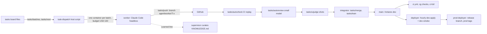
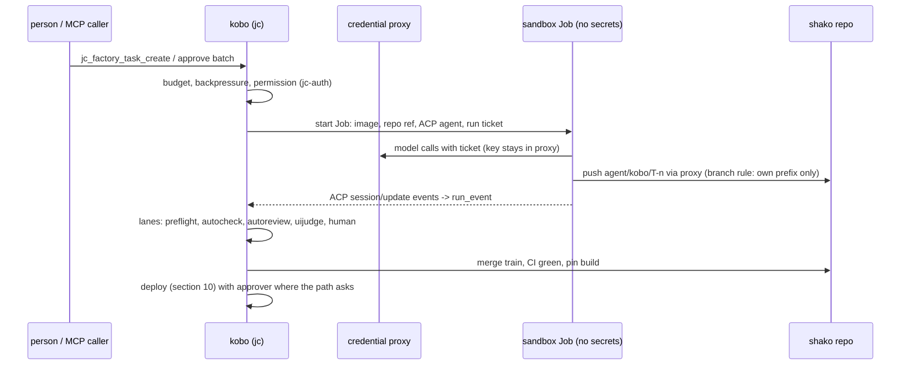

# Code factory and WASM deploy for kobo

This page is the research input for kobo: one Rust module of the `jc` binary in which several AI agents of one Organization take tasks, write code in sandboxed jobs, pass review lanes and CI gates, and deploy what they built, WebAssembly modules first and the platform itself last. It compares the open coding-agent factories, takes our own swarm as the reference that already works, measures what a deployed WASM module costs to start today and with each technique, and gives the pack plan for the Argon generation. Readers: the worker who builds the kobo pack, the reviewer of the generated code, the owner deciding section 9.

## 1. Capability comparison

### Pins

| Short | What | Pin |
|---|---|---|
| `OH` | OpenHands/OpenHands (Agent Canvas UI) | `v1.37.0` `6dad5568d64d` (2026-11-06), MIT, 92 878 stars |
| `OHS` | OpenHands/software-agent-sdk (the agent, tools, server, events since the repo split, `OH README.md:170-177`) | `v1.60.1` `e99e5c71ffe4` (2026-11-05), MIT |
| `CX` | openai/codex, `codex-rs` workspace (117 crates, `codex-rs/Cargo.toml:172-179`) | `rust-v0.167.0` `086ccc833bc9` (2026-11-06), Apache-2.0, 133 566 stars |
| `GO` | aaif-goose/goose (`block/goose` redirects) | `v1.57.0` `30bba95105e5` (2026-10-28), Apache-2.0, 56 327 stars |
| `ACP` | agentclientprotocol/agent-client-protocol (`zed-industries/...` redirects); crates `agent-client-protocol` 5.0.0, `agent-client-protocol-schema` 1.15.1 | `schema-v1.29.1` `0fc18323a9fd` (2026-11-02), Apache-2.0 |
| `ZED` | zed-industries/zed | `v1.27.0` `c84af5b99cbc` (2026-11-04); agent crates (`crates/agent`, `agent_servers`, `acp_thread`, `agent_ui`) carry `LICENSE-GPL` |
| `SWE` | SWE-agent/SWE-agent | `v1.1.0` `0f3acafacabc` (2025-05-22), MIT |
| `AID` | Aider-AI/aider | `v0.86.0` `a4be6ccd87eb` (2025-08-09), Apache-2.0 |
| `MG` | FoundationAgents/MetaGPT | `v0.8.1` `c036574507e7` (2024-04-22), MIT |
| `CD` | OpenBMB/ChatDev | `v2.2.0` `3c72d860d255` (2026-03-23), Apache-2.0 |
| `AG` | microsoft/autogen | `python-v0.7.5` `83afbf5857aa` (2025-09-30); README: archived, successor Microsoft Agent Framework |
| `PX` | plandex-ai/plandex | `cli/v2.2.1` `df17a187974c` (2025-07-16), MIT, Go; Cloud winding down since 2025-10-03 (`README.md:157`) |
| `DV` | stitionai/devika | `main` `80bb343cbe4a` (2025-09-25), MIT; no release |
| `RMCP` | modelcontextprotocol/rust-sdk, crate `rmcp` | `rmcp-v3.9.0` `5596a8a0bba2` (2026-11-05); crates.io Apache-2.0 |
| `PLT` | joinedcontext-platform | `e59ceb9f` (2026-11-05) |
| `POR` | joinedcontext-portal | `d7f91eb28` (2026-11-05) |
| `DEP` | joinedcontext-deployment | `cee6ebcb9` (2026-11-07) |
| `SW` | our swarm: `/workspace/tasks` scripts, `tasks/spend.csv`, `/workspace/supervisor/NOTES.md`, `/workspace/KNOWLEDGE.md` | state on 2026-11-07 |
| `WT` | bytecodealliance/wasmtime | `=49.0.5` as `PLT crates/wasm-host/Cargo.toml:15-19` pins it |

Metadata from `gh api repos/<r>` and `releases/latest`, run 2026-11-07. Small Rust factories, ideas only: `PakhomovAlexander/afactory` (22 stars, Apache-2.0, "multi-agent coding factory"), `solutionscay/skiff` (20, MIT, agents send each other tasks), `ste-bah/archon-cli` (8, MIT), `lhjnano/orcatui` (8, Apache-2.0, one PTY and one git worktree per agent).

### Capability table

Cells name the file at the pin. "none" means searched and not found.

| Capability | OpenHands (`OHS`) | Codex (`CX`) | goose (`GO`) | Our swarm (`SW`) + Portal (`POR`) | kobo verdict |
|---|---|---|---|---|---|
| Agent loop | `openhands-sdk/openhands/sdk/agent/agent.py:727` `step()`: one LLM call + tool batch; `max_iterations` 500 (`conversation/state.py:108`) | `codex-rs/core/src/session/turn.rs:177` `run_turn` | `crates/goose/src/agents/agent.rs:1081`, state machine `agents/state_machine/`; `GOOSE_MAX_TURNS` 1000 (`config/base.rs:1339`) | Claude Code headless per task container; Portal oneshot driver (`POR src/agents/oneshot/mod.rs`) | needed: kobo runs no loop of its own, it drives agents over ACP (section 9 D2) |
| Several agents | `openhands-tools/.../delegate/definition.py:16` `DelegateAction` spawn/delegate, `max_children=5` (`delegate/impl.py:44`); Task tool | `core/src/tools/spec_plan.rs:762-784` `spawn_agent`, `send_message`, `wait_agent`, `close_agent`; `agent_max_threads`, `agent_max_depth` (`core/src/config/mod.rs:975,987`); message board (`message-board/src/lib.rs`) | sub-agents by `summon` with own provider and model (`agents/platform_extensions/summon.rs:46`) | one board, one worker per batch, integrator, deployer, prod-deployer, supervisor roles (`SW tasks/README.md`, `tasks/role-spend.csv`) | needed: board-level roles as in `SW`, in-run sub-agents left to the agent |
| Planner / task split | sub-agent Markdown files (`sdk/subagent/schema.py:57-154`) | role files (`agent-roles/src/`) | recipes (`crates/goose/src/recipe/`) | `tasks/batches` (dependency chain, 10 per batch), `tasks/next` ranking, SPLIT and STACKING rules (worker.md) | needed: board, batches, stacking |
| Sandbox | agent server inside Docker or remote VM (`openhands-workspace/.../docker/workspace.py:53`); local mode none (`OH README.md:65`) | per command: bubblewrap + seccomp + landlock (`linux-sandbox/src/lib.rs:1-5`), Seatbelt (`sandboxing/src/seatbelt.rs`), Windows tokens/ACL/AppContainer/WFP (`windows-sandbox-rs/src/`) | none; optional Docker target (`agents/container.rs`) | container per task (docker-in-docker); Portal builder run = Kubernetes Job, token-less ServiceAccount, NetworkPolicy to the proxy only (`POR src/agents/kube.rs:1-8`), test Job in a namespace with no traffic, 1 CPU, 1 GiB (`POR src/agents/sandbox.rs:1-10`) | needed: Job or microVM per run (section 2.4) plus codex-style per-command policy inside |
| Approval policy | `sdk/security/confirmation_policy.py:27-43` AlwaysConfirm / NeverConfirm / ConfirmRisky + LLM risk analyzer | `protocol/src/protocol.rs:1146` `AskForApproval`, `:1232` `SandboxPolicy`; exec rules (`execpolicy/src/`) | `GooseMode` Auto/Approve/SmartApprove/Chat (`goose-provider-types/src/goose_mode.rs:22`), per-tool levels (`config/permission.rs:21`) | none inside a run (unattended); gates after the push: preflight, autocheck, autoreview, uijudge, integrator, merge train | needed: no prompts inside a run; approval lives at the lanes |
| Tool protocol | MCP client on fastmcp (Python, `sdk/mcp/client.py:8`); ACP client `acp_agent.py` | MCP client on `rmcp` git rev `=3.5.1` (`codex-rs/Cargo.toml:470`); JSON-RPC `app-server` | MCP on `rmcp` 3.4.1; ACP server and client (`GO crates/goose/src/acp/server.rs`, `providers/claude_acp.rs`, `codex_acp.rs`) | MCP: Portal 93 `jc_*` tools (`grep -rhoE '"jc_[a-z_]+"' src/ops \| sort -u \| wc -l` = 93), connector segments (`POR src/connectors.rs:50`) | needed: ACP to agents, MCP to the platform (section 11) |
| Memory | skills, `AGENTS.md`, keyword/path triggers (`sdk/skills/skill.py:179`, `trigger.py:19-39`); LLM condenser | `AGENTS.md` discovery (`core/src/agents_md.rs:1-5`), skills, thread memory | `.goosehints`, `AGENTS.md` (`hints/load_hints.rs:10`), memory MCP server | task bodies as state, `Learned:` lines curated into `KNOWLEDGE.md` by the supervisor, `AI_shared_folder.md` via `tasks/note`, cg code graph | needed: board + curated knowledge per Organization and repo |
| Persistence | append-only events per conversation (`conversation/event_store.py:38`) | JSONL rollouts + SQLite (`rollout/src/recorder.rs:86`, `state/src/`) | SQLite sessions (`session/session_manager.rs`) | files on a shared mount; Portal runs in Postgres (`POR src/agents/store.rs`) | needed: Postgres tables (section 2.3) |
| Cost control | `max_budget_per_run` dollars per conversation and sub-agent (`conversation/state.py:114`) | token budgets (`core/src/session/token_budget.rs`); dollar cap none found | cost tracking (`providers/canonical_cost.rs`), no cap found | USD 100 per batch, ledger `tasks/spend.csv` (3 396 runs, USD 9 631, median USD 1.48, p90 USD 7.56, 2026-10-19..2026-11-07); proxy step and token budget per run (`docs Architecture/19-agent-runner.md:46`, §6) | needed: ledger + caps per run, task, Organization and day |
| Model routing | `RouterLLM`, fallback (`sdk/llm/router/base.py:28`) | provider config (`model-provider/`) | per sub-agent provider/model; lead/worker none at the pin | strong model builds, small model reviews (`SW tasks/autoreview`), UI judge separate subagent | needed: per-lane model policy per Organization |
| Review gates | security analyzer per action | "guardian" reviewer (`core/src/guardian/`) | permission judge (`permission/permission_judge.rs`) | `tasks/autocheck` (CI commands replayed), `tasks/autoreview` (cheap model, JSON verdict), `tasks/uijudge` (pictures), `tasks/automerge`, `tasks/train` (merge train + preflight + CI), cg checks on every main | needed: all of them as lanes |
| Deploy | none | none (`codex cloud` tasks only) | none | deployer role, hourly `just dev-apply`, release gate, prod-deployer with prod tags; Portal publishes Apps after build checks (`POR src/apps/built.rs:1-12`) | needed: section 10 |
| Server / UI | FastAPI + websocket agent server (`openhands-agent-server/.../api.py:584-624`); Canvas SPA | TUI, `codex exec`, JSON-RPC app server (`app-server/src/lib.rs:448`) | ACP server, CLI | Portal React SPA; swarm has no UI (terminal panes) | needed: server-rendered HTML pages in `jc` (T-6640) |
| Benchmark (dated source) | SWE-bench 77.6, variant not stated (`OHS README.md:15`, 2026-11-05) | no source in repo | no source in repo | none; acceptance is the board's Done when + Tests lines | not a gate; kobo measures its own pass rate per lane |

Other frameworks, read for design, not linkable (Python or Go):

| Project | Architecture | Handover | Sandbox | Source |
|---|---|---|---|---|
| SWE-agent | one agent, ReAct over curated shell tool bundles (ACI) | none | SWE-ReX Docker or Modal | `SWE sweagent/environment/swe_env.py:8-10`; README recommends mini-swe-agent (65 % SWE-bench Verified, `README.md:41`, year not stated) |
| Aider | pair programmer; architect model plans, editor model writes edit blocks | plan as text | none, git commit per change | `AID aider/coders/architect_coder.py`; polyglot leaderboard top 84.9 % o3-pro (2025-06-28, `aider/website/_data/polyglot_leaderboard.yml`) |
| MetaGPT | software company: PM, architect, project manager, engineer, QA | typed messages on a shared environment, roles watch upstream actions | none at the pin (unverified) | `MG metagpt/roles/*.py`, `metagpt/environment/base_env.py` |
| ChatDev v2 | YAML graphs of agent, human, python, loop, subgraph nodes | graph edges | Docker | `CD entity/graph_config.py`, `runtime/node/executor/` |
| AutoGen | round robin, selector, swarm handoff, Magentic-One orchestrator with ledgers | handoff messages | Docker executor | `AG python/packages/autogen-agentchat/src/autogen_agentchat/teams/_group_chat/` |
| Plandex | one plan, model roles planner, architect, coder, builder | subtasks | server-side diff review, no OS sandbox | `PX app/shared/ai_models_roles.go:6-14` |
| Devika | orchestrator calls planner, researcher, coder, runner, patcher in turn | sequential | none: `src/sandbox/firejail.py` and `code_runner.py` are empty | `DV src/agents/agent.py` |

Verdict: no surveyed project has a board, review lanes, merge trains, deploy or a multi-organization model. Those are what our swarm adds and what kobo ships. The agent loop itself is a commodity reached over ACP.

## 2. Internals

### 2.1 Today: the swarm as reference



Facts: 3 396 per-task runs between 2026-10-19 and 2026-11-07 cost USD 9 631 API-equivalent (`python3` over `SW tasks/spend.csv`, run 2026-11-07); per-role spend in `SW tasks/role-spend.csv`. Gate scripts: `tasks/autocheck` (T-4939), `tasks/autoreview` (T-4940), `tasks/automerge` (T-4675), `tasks/uijudge` (owner 2026-10-29), `tasks/train` (T-3764), `tasks/bounce` (T-4941). Lessons the swarm paid for and kobo must encode: one build at a time per host (memory), backpressure on the unmerged review queue, one red one fix, stacking on review branches, never edit a cron-run script in place, PREFLIGHT before push (worker.md).

### 2.2 Today: the Portal's builder (seed of kobo)

| Piece | Where | What |
|---|---|---|
| Run kinds | `POR src/agents/run.rs:12` | `conversation`, `application`, `dashboard`, `analysis` |
| States | `POR src/agents/run.rs:20-32` | queued, starting, interviewing, building, testing, previewing, awaiting_approval, published, failed, cancelled, expired |
| Run Job | `POR src/agents/kube.rs:1-8` | ServiceAccount with no token, NetworkPolicy to proxy + DNS + mesh only, ticket by `secretKeyRef`, Job owns the Secret |
| Tests sandbox | `POR src/agents/sandbox.rs:1-10` | ConfigMap with the files, one Job, `vitest` + `tsc -b`, no traffic, restricted PSS, 1 CPU, 1 GiB |
| Proxy | `PLT crates/agent-proxy/src/` (`limits.rs:18` egress bytes, `tickets.rs`, `model_key.rs`) | holds the model key, counts steps, tokens and egress per run (`docs Architecture/19-agent-runner.md:46,181,205`) |
| Reaper | `POR src/agents/reaper.rs` | expires runs past `expires_at`, deletes the Job |
| Build pods | `POR src/apps/build_pods.rs:1-12` | one ephemeral forge runner per App job, own build cache |
| Publish check | `POR src/apps/built.rs:1-12` | commit is head of default branch, artifact digest matches, the Portal writes the package with its own token |
| MCP | `POR src/ops/mod.rs:997-1013`, `src/ops/runs.rs:180-202` | `jc_run_create`, `jc_run_cancel`, `jc_run_publish`, `jc_run_answer`, `jc_run_message`, `jc_run_list`, `jc_run_get` |
| WASM host | `PLT crates/wasm-host/src/host.rs:404-414` | pooling allocator, epoch interruption, fuel; component cache with `ProxyPre` per digest (`host.rs:532-580`) |

### 2.3 kobo data model

Every table carries `org_id` and `instance_id` (kobo instance of that Organization), forced RLS on `org_id = current_setting('jc.org')`, and the common `created_at`, `created_by`. Postgres is the one platform database.

| Table | Key columns | Notes |
|---|---|---|
| `factory` | id, org_id, instance_id, name, repos (shako refs), model_policy (jsonb), budget_day_usd, budget_task_usd, max_parallel_runs | one per kobo instance; several per Organization allowed |
| `task` | id (T-n per factory), status (todo, doing, review, blocked, done), priority, group, batch, depends_on[], merge_after, repo, body (markdown), owner_run | the board; `Done when`, `Tests`, `Security` lines are columns, not text |
| `batch` | id, factory_id, task_ids[], branch | written by the batcher (port of `tasks/batches`) |
| `run` | id, batch_id, agent (acp command id), sandbox (job id), state, started_at, ended_at, tokens_in, tokens_out, usd, exit | one sandbox lifetime |
| `run_event` | run_id, seq, kind (message, tool_call, tool_result, plan, push, gate, error), payload jsonb, redacted bool | append-only; payload redacted at write (secrets, personal data) |
| `lane_result` | batch_id, lane (preflight, autocheck, autoreview, uijudge, human), head_sha, verdict, evidence_ref | one row per head and lane; a new head reruns |
| `train` | id, base_sha, batch_ids[], state, ci_run | merge train per repo |
| `module` | id, org_id, instance_id, name, kind (app, plugin, processor) | deployable WASM unit |
| `module_version` | module_id, digest, signature, signer, engine_hash, cwasm_ref, source_commit, ci_run, state (built, admitted, active, retired) | the registry; at most one active per module and instance |
| `deploy` | id, module_id, from_version, to_version, approver, at, outcome | audit and rollback chain |
| `ledger` | run_id, at, model, tokens, usd | written by the proxy from provider usage, as `SW spend.csv` |
| `knowledge` | id, scope (factory, repo), text, source_task, curated_by | `Learned:` lines, curated |

### 2.4 Run flow



Background jobs: batcher (minute), dispatcher (event + 30 s tick), reaper (minute), lane runner per new head, train per repo, ledger roll-up (5 min), knowledge digest (daily). Scheduler: ekiben when it lands (T-6640), otherwise a Postgres `SKIP LOCKED` queue in kobo. Scaling: the control plane is stateless over Postgres; sandboxes run on build capacity outside the 2 GB platform budget.

## 3. Plugin and extension system

| Upstream | Interface | Lifecycle | Isolation |
|---|---|---|---|
| OpenHands | skills (Markdown with triggers), sub-agent files, MCP servers, hooks and plugins routers (`openhands-agent-server/.../api.py:584-624`) | loaded per conversation | inside the agent's container |
| Codex | skills, plugins (`core-plugins/`, `plugin-host/`), MCP servers, hooks (`hooks/`) | per session | MCP servers run under the same sandbox policy |
| goose | extensions = MCP servers (`agents/extension_manager/`), recipes, built-in servers (`crates/goose-mcp/src/`) | per session; malware check (`agents/extension_malware_check.rs`) | none at OS level |
| ACP | the agent itself is the plug-in: any binary speaking ACP over stdio (`ACP docs/protocol/v1/transports.mdx:6-24`) | one process per session | whatever the host gives the process |

kobo extension points, each a WASM component on the platform wasm-host (`jc:app` world family) with fuel, memory and wall-time caps and no ambient capability:

| Point | WIT shape | Called when | May touch |
|---|---|---|---|
| `lane` | `check(head: head-ref, files: list<changed-file>) -> verdict` | a lane runs on a new head | read-only diff and evidence blobs of that batch |
| `batcher` | `group(tasks: list<task>) -> list<batch>` | the board changes | task metadata only |
| `notifier` | `on-event(event) -> list<message>` | run or lane events | sends through the platform mail service (`docs Architecture/16-apps-on-demand.md` §14) |
| `agent profile` | data, not code: ACP command, image digest, model policy, egress list | run start | n/a |

Built-in lanes (preflight, autocheck, autoreview, uijudge, human) ship as Rust crates behind features; Organization lanes are WASM. An agent is never a WASM plug-in: it runs in a sandbox Job, because it needs a shell, compilers and minutes of CPU.

## 4. Security

### 4.1 Flows

| Flow | Sequence | Guard |
|---|---|---|
| Person starts a batch | session (wardkeep OIDC) -> `POST /kobo/{factory}/batches` -> jc-auth `factory.run.start` on the factory -> budget check -> Job | CSRF token, server-side decision, per-person rate limit |
| Agent calls a model | sandbox -> proxy with run ticket -> proxy checks run state, step and token budget -> provider with key from `secretRef` | key never in the sandbox (`docs Architecture/19-agent-runner.md:46`); ticket hash only in Postgres |
| Agent pushes | sandbox -> proxy -> shako with a token bound to `agent/kobo/{batch}` prefix of the factory's repos | push to any other ref refused by shako branch rule; force-push refused |
| Agent reads platform data | sandbox -> MCP through the person's connector, segment `factory-run` (section 11) | DelegationPolicy ceiling; data inside the untrusted fence (KNOWLEDGE T-5559) |
| Merge | train runner (kobo service account) after every lane green; red-lane paths need a human approver | approver is never the requester nor an agent (`POR` rule: proposer may not approve DataModel and ContextSpace, KNOWLEDGE T-6490) |
| Deploy | section 10.4 | signed artifact, policy admission, audit |

### 4.2 Threat classes

| Class | Seen where | kobo answer |
|---|---|---|
| Prompt injection from repo, issue or tool output | every agent | sandbox holds no credential; egress allow-list; tool results fenced; writes only through lanes |
| Secret exfiltration | agents read env and files | no secrets in the Job; proxy injects; secret scanner lane (gitleaks over the push range, KNOWLEDGE T-4819) |
| Agent edits its own gates (CI, lanes, permissions) | swarm rule "never weaken a check" (worker.md) | protected paths per repo (`.github/`, lane config, `kobo` policy files, `risk-paths`) need an owner-level approver and a second person |
| Self-review collusion | one model reviews its own output | review lane uses another model family or a person; verdict schema `{ok, reasons, missing_tests}` (`SW tasks/autoreview`) |
| Sandbox escape | container runtime CVEs | restricted PSS, no host mounts, no docker.sock, user namespaces; microVM (Kata or Firecracker RuntimeClass) for Organizations without a trust contract (section 9 D4) |
| Supply chain | new dependencies | cooldown (2 days, CVSS >= 7 at once; KNOWLEDGE "Cooldown"), cargo deny + audit, `npm audit`, pinned images by digest |
| Runaway cost | loops | per-run step, token and USD caps in the proxy; per-task and per-day caps per Organization; dispatcher refuses at the cap |
| Cross-Organization leak | shared build nodes, caches | build cache per factory and repo (as `POR src/apps/build_pods.rs` cache per App); no shared sccache across Organizations |
| WASM runtime (section 10.5) | wasmtime advisories | update policy, capability imports, fuel and memory caps |

## 5. Tenancy

| Question | Upstream | Today (ours) | kobo |
|---|---|---|---|
| Unit of isolation | OpenHands: one user per server; Codex, goose: one local user | swarm: one owner; Portal builder: per Project (`POR src/agents/run.rs` run carries project) | Organization -> kobo instance -> factory -> repos |
| Several instances per Organization | n/a | none | `instance_id` in every table; an Organization may run two factories (e.g. Apps and data pipelines) with their own budgets and models |
| Identity | local | Keycloak, ServiceAccount per workload | wardkeep; one service account per factory, run tickets bound to one run |
| Policy | none | Role, RoleBinding, Group, Policy, DelegationPolicy (jc-core kinds) | jc-auth verbs `factory.task.write`, `factory.run.start`, `factory.review.decide`, `factory.merge`, `deploy.apply@staging`, `deploy.apply@prod`, `deploy.rollback`, `factory.budget.set` |
| Repos | n/a | GitHub per repo; forge per Project for Apps | shako repos owned by the factory's Organization; a factory names only its own repos |
| Domain and TLS | n/a | `orgDomain` per installation | module deploys serve under the instance's custom domain (T-6640) |
| Quotas | OpenHands dollar cap per run | USD 100 per batch, assistant daily budget per project | runs in parallel, USD per day, sandbox CPU-hours, module count, artifact bytes, per Organization and per instance |

Isolation tests (part of the generated code):

1. Two Organizations A and B, each with a factory named `apps`, a task `T-1`, a module `kpi`; A's person lists, searches, counts and reads tasks, runs, events, ledger, modules and deploys: every answer holds only A's rows, totals included.
2. A probes B's ids (task, run, module version digest, deploy id) on every route and MCP tool: answer equals the answer for a random id (same status, same body shape, timing within noise).
3. A run of B writes a log line naming A's factory: A's `jc_factory_run_events` never returns it.
4. A sandbox of A cannot resolve or reach B's sandbox, B's repos or the proxy's admin port (NetworkPolicy test).
5. A's agent token pushes to B's repo: refused, audited, no ref created.
6. A deploys a module to B's instance id: 404 as for an unknown id.

## 6. Operations

| Topic | Design |
|---|---|
| Config as code | factory, agent profiles, lanes, budgets are manifests in the Organization's config repo; kobo reconciles them (the Portal reconciler pattern) |
| Migrations | sqlx migrations in the kobo crate, numbered with the module prefix, applied at binary start under an advisory lock |
| Backups | the one Postgres dump; run events older than 90 days roll into a compressed archive table per month |
| Upgrades | kobo keeps the task and run state across a binary restart; a run's Job survives a restart and reattaches by run id; tickets stay valid (store in Postgres) |
| Observability | every event row carries org, instance, factory, task, run ids at write time; metrics `jc_kobo_runs_total`, `jc_kobo_usd_total`, `jc_kobo_lane_seconds`, `jc_wasm_start_seconds` |
| Memory at 100 req/s | control plane budget 64 MiB RSS: HTML pages, board queries and event appends are Postgres-bound; the wasm host budget is separate (section 10.3: per cached component 650 to 1 045 KiB RSS measured, so 2 000 cached components, the default `cached_components`, would take 1.3 to 2 GiB; with mmap'd `.cwasm` code pages are clean file pages the kernel can drop) |
| CPU | Cranelift compile moves from request time to deploy time: 42 to 47 ms per component once, on build capacity |

## 7. Test oracles

| Oracle | What it proves | How a worker reaches 100 % |
|---|---|---|
| Board semantics | the port of `tasks/next`, `batches`, `claim`, `push`, `bounce`, `train` | replay `SW tasks/*.selftest.sh` fixtures (`ci.selftest.sh`, `automerge.selftest.sh`, `bounce.selftest.sh`, `train.selftest.sh`) against kobo's API; every fixture outcome equal |
| Differential board | same input, same batches and order | run `tasks/batches --dry-run` and kobo's batcher over a copy of `/workspace/tasks` (150 open, 6 212 finished tasks on 2026-11-07); diff the batch lists |
| ACP conformance | kobo drives any ACP agent | ACP schema crate round-trip tests; run goose (`goose-acp`) and a Codex ACP adapter in a sandbox through one prompt turn each |
| Isolation | section 5 list | generated tests with two Organizations; each must fail with RLS disabled (red proof) |
| Sandbox | no egress beyond the list, no token mounted | NetworkPolicy test with a probe pod; `automountServiceAccountToken: false` asserted on the rendered Job |
| WASM deploy | start-time budget and rollback | the bench `scripts/research/code-factory-wasm-bench.rs` as a CI perf test with thresholds (cold p99 < 5 ms, warm instantiate p99 < 1 ms); atomic swap test: requests during swap all answer from old or new, none fail |
| Cost | caps hold | proxy test: run at cap gets 429, ledger equals provider usage |

## 8. Argon pack plan

Measured by `scripts/research/code-factory-sources.sh` (repomix, comments and empty lines removed, tests ignored), run 2026-11-07:

| Group | Contents (paths at the pin) | Tokens | Files |
|---|---|---|---|
| U1-codex-agents | `CX codex-rs/core/src/agent/**`, `core/src/tools/multi_agent_tool.rs`, `core/src/session/multi_agents.rs`, `core/src/agent_communication.rs`, `agent-roles/src/**`, `agent-graph-store/src/**`, `message-board/src/**`, `core/src/session/token_budget.rs`, `core/src/rollout_budget.rs`, `protocol/src/protocol.rs`, `protocol/src/config_types.rs` | 145 652 | 72 |
| U2-codex-sandbox | `CX codex-rs/linux-sandbox/src/**` + README, `sandboxing/src/**`, `execpolicy/src/**` + README, `core/src/exec_policy.rs`, `core/src/tools/approvals.rs` | 106 082 | 52 |
| U3-openhands-sdk | `OHS openhands-sdk/openhands/sdk/agent/agent.py`, `acp_agent.py`, `conversation/state.py`, `event_store.py`, `subagent/**`, `security/*.py`, `llm/router/**`, `llm/utils/metrics.py`, `context/condenser/**`, `openhands-tools/.../delegate/**`, `task/**`, `openhands-workspace/.../docker/**`, `remote_api/**` | 106 281 | 47 |
| U4-goose | `GO crates/goose/src/agents/state_machine/**`, `subagent_handler.rs`, `platform_extensions/summon.rs`, `recipe/**`, `scheduler/**`, `config/permission.rs`, `permission/**`, `security/**`, `crates/goose-agent/src/**` | 174 517 | 65 |
| U5-acp | `ACP docs/protocol/v1/` overview, initialization, session-setup, prompt-turn, tool-calls, file-system, terminals, agent-plan, security, transports, cancellation, content | 24 996 | 12 |
| O1-portal-agents | `POR src/agents/**` (without `oneshot/`), `src/apps/build_pods.rs`, `built.rs`, `reconciler.rs`, `src/connectors.rs`, `src/ops/runs.rs`, `src/costs.rs`, `src/quotas.rs` | 209 507 | 42 |
| O2-platform | `PLT crates/wasm-host/src/**`, `Cargo.toml`, `crates/agent-proxy/src/**` | 91 581 | 42 |
| O3-docs | `docs Architecture/16-apps-on-demand.md`, `19-agent-runner.md`, `20-app-sdk.md`, `Decisions/adr-n-044*.md`, this page | 38 855 | 4 |
| O4-swarm | `SW tasks/README.md`, `next`, `batches`, `claim`, `push`, `automerge`, `autoreview`, `autocheck`, `train`, `uijudge`, `bounce`, `merge` | 45 444 | 12 |

Generation split, each run with one contract file `kobo-contract.md` (tables of section 2.3, routes and MCP tools of section 11, WIT of section 3, about 15k tokens):

| Run | Groups | Input tokens | Writes | Expected output |
|---|---|---|---|---|
| A control plane | U1 + U3 + O3 + O4 + contract | about 351k | `crates/modules/kobo/`: board, batcher, dispatcher, lanes, train, ledger, HTML pages, migrations, ops registry entries | 9k to 12k lines Rust + templates |
| B sandbox and agents | U2 + U5 + O1 + contract | about 356k | `crates/modules/kobo-sandbox/` (Job driver, NetworkPolicy, ticket), `kobo-acp/` (ACP client over the Job's stdio relay), proxy changes | 5k to 7k lines |
| C deploy | U4 + O2 + O3 + bench + contract | about 323k | `crates/wasm-host/` AOT path, registry, admission, swap, rollback; `kobo-deploy/` | 3k to 4k lines |

Each run stays under 500k tokens. Run C goes first: it is the smallest and independent of A and B.

## 9. Decisions and open questions

- Decided (worker-t6641, owner may override): module name **kobo** (工房, workshop), because it names one place where work is made and fits wardkeep, shako and ekiben; options: foundry, atelier, kobo.
- D2 Decided (worker-t6641, owner may override): kobo drives agents over ACP and embeds no agent loop, because ACP is Apache-2.0, already spoken by goose, OpenHands and Zed, and lets an Organization pick Claude Code, Codex, goose or our own agent per profile; options: embed codex-rs crates (not on crates.io, 117-crate git dependency), embed `goose-agent` (0.1.0-alpha.13), write our own loop.
- D3 Decided (worker-t6641, owner may override): the board, lanes, trains and deploy are ported from our swarm scripts, not from any surveyed project, because no surveyed project has them (section 1).
- D4 Decided (worker-t6641, owner may override): sandbox = Kubernetes Job as the Portal builder does today (`POR src/agents/kube.rs`), with a microVM RuntimeClass required for Organizations without a trust contract; per-command policy inside follows codex `execpolicy`; options: Docker per run (no fleet scheduling), Firecracker directly (new operator).
- D5 Decided (worker-t6641, owner may override): AOT precompile at deploy time with mmap'd `.cwasm`, `InstancePre` per active version, pooling allocator kept (section 10).
- D6 Decided (worker-t6641, owner may override): controlroom keeps its own dashboard schema with chart presets that expand to Vega-Lite; Grafana JSON only as importer (section 12).
- Crate pins: `agent-client-protocol` 5.0.0 and `rmcp` 3.9.0 were published 2026-11-02 and 2026-11-05, inside the cooldown: the generation pins the newest release at least 2 days old on the day it runs.
- Owner only: (1) which Organizations may run kobo at all, and whether prod deploy of the platform itself ever runs without a person; (2) the money: default USD caps per Organization per day; (3) whether kobo may use the owner's model accounts or each Organization must bring its own key (`secretRef`).

## 10. Deploy and start time

### 10.1 Today

`PLT crates/wasm-host/src/host.rs:544-580`: on a cache miss the host fetches the component, checks its sha256, compiles with Cranelift (`Component::new`, `host.rs:563`), builds `ProxyPre` (`host.rs:571`) and keeps it in an LRU of `cached_components` = 2 000 (`limits.rs:45`). The task text says "no InstancePre": the host does cache an `InstancePre` (`ProxyPre`) per digest in memory; what it lacks is a precompiled artifact, so every shard start and every cache eviction pays Cranelift again.

### 10.2 Measured

Release build, wasmtime 49.0.5, the engine config of `host.rs:404-414`, the two test components of `PLT crates/wasm-host/tests/guest` (194 571 bytes) and `tests/services-guest` (193 492 bytes), 16-core sandbox at load average 11. Bench: `scripts/research/code-factory-wasm-bench.rs` copied to `crates/wasm-host/tests/`, `cargo test --release -p wasm-host --test zz_start_bench -- --nocapture --test-threads=1`; raw output `evidence/T-6641/wasm-start-bench.txt`.

| Step | guest p50 | guest p99 | services-guest p50 | services-guest p99 |
|---|---|---|---|---|
| Today, `Host::serve` on a miss (fetch + digest + Cranelift + InstancePre + instance + request), n=200 | 55.9 ms | 106.0 ms | 43.4 ms | 54.2 ms |
| Today, `Host::serve` on a hit (instance + request), n=1 000 | 150 µs | 313 µs | 195 µs | 778 µs |
| `Component::new` (Cranelift), n=20 | 47.2 ms | 55.5 ms | 41.7 ms | 46.2 ms |
| `serialize` to `.cwasm` (662 040 and 645 256 bytes) | 0.45 ms | 0.70 ms | 0.43 ms | 2.60 ms |
| `Component::deserialize` from bytes | 0.70 ms | 4.81 ms | 0.64 ms | 1.48 ms |
| `Component::deserialize_file` (mmap) | 0.30 ms | 0.34 ms | 0.23 ms | 0.28 ms |
| link + `instantiate_pre` | 0.15 ms | 0.22 ms | 0.09 ms | 0.13 ms |
| `Store` + `instantiate` + drop, pooling, copy-on-write on, n=1 000 | 24.6 µs | 46.8 µs | 27.8 µs | 57.6 µs |
| same, copy-on-write off | 26.9 µs | 54.0 µs | 23.9 µs | 47.1 µs |
| RSS per cached component (200 cached) | 1 045 KiB | | 650 KiB | |

Cold start with AOT, derived as `deserialize_file` + `instantiate_pre` + warm serve: guest 0.6 ms p50, 0.9 ms p99; services-guest 0.5 ms p50, 1.2 ms p99. Target cold < 5 ms p99 holds with about 4x margin; warm instantiate < 1 ms p99 holds today (47 to 58 µs). Copy-on-write images change nothing measurable for these guests because their linear memory initialisation is small; they matter for guests with large data segments. Pre-initialisation (wizer) was not measured: instantiation is already 25 µs, so it can only pay for guests whose start function does heavy work, and none of the Apps does today. Not measured: the 24 sample Apps of `POR apps/` (they need the forge build lane); the two test components use the same SDK shape.

### 10.3 Comparison, dated sources

| Platform | Claim | Source |
|---|---|---|
| Cloudflare Workers | isolate warm-up under 5 ms, hidden in the TLS handshake | blog.cloudflare.com "Eliminating cold starts with Cloudflare Workers", 2020 |
| Fastly Compute | instance start in tens of microseconds (vendor figure 35 µs) | fastly.com product pages; Lucet announcement 2019; vendor claim, not reproduced |
| Spin (Fermyon) | startup under 1 ms with tens of thousands of components in one instance | bytecodealliance.org "Wasmtime Reaches 1.0", 2022-09 |
| wasmCloud | no dated public start-time number found | n/a |
| kobo target | cold < 5 ms p99, warm < 1 ms p99 | section 10.2 measures 1.2 ms and 58 µs |

### 10.4 Deploy flow

```mermaid
sequenceDiagram
  participant F as kobo run (sandbox)
  participant CI as CI on the merged commit
  participant K as kobo registry
  participant A as admission (jc-auth + policy)
  participant H as wasm host
  F->>CI: merge train, green build of commit c
  CI->>K: component bytes, digest, cosign signature of the CI identity
  K->>A: deploy(module, version, instance) by person or rule
  A-->>K: allowed: verb deploy.apply@env on this instance; signer is the Organization's CI identity
  K->>H: precompile with the shard's engine -> .cwasm + engine_hash
  H->>H: deserialize_file, instantiate_pre, health request
  H->>H: atomic swap of the active pointer (old version kept)
  K->>K: deploy row + audit line (who, what, from, to)
```

Rules: `.cwasm` is never accepted from outside; the host precompiles from the signed component and stamps `engine_hash` (wasmtime version + `Config` hash); a mismatch at load discards the `.cwasm` and recompiles. Rollback = swap the pointer back to the kept version, no compile (0.5 ms). No binary restart, no container per App. The previous version stays loaded until its in-flight requests end.

### 10.5 WASM security

| Item | Design |
|---|---|
| Capabilities | imports per module from its manifest: `wasi:http` outgoing only to the gateway origin with the caller's token (`host.rs` `endpoint_target`, `GATEWAY_ALIAS`), `jc:app` storage of its own App, no filesystem, no sockets (test `a_component_reaches_no_environment_file_or_socket`, `PLT tests/host_tests.rs:201`) |
| Caps | fuel 200 G units, wall time 5 s by epoch (10 ms tick), memory 64 MiB, 16 concurrent per App, 64 per Organization (`limits.rs:32-48`); per-Organization overrides from quotas |
| Signatures | cosign keyless by the Organization's CI identity, checked at admission and at every load |
| wasmtime advisories | 172 GHSA listed by `gh api repos/bytecodealliance/wasmtime/security-advisories` (2021-05-21..2026-10-29; 14 critical, 12 high; 126 in the last 12 months, 10 critical). Classes by summary: compiler or runtime memory safety leading to sandbox escape 24, host panic (denial of service) 38, resource accounting bypass (fuel, memory) 20, wasi-http limits 18, WASI filesystem capability bypass 12, data leak between instances 12, other (GC, type confusion) 48. The pinned 49.0.5 is past the fix of the newest advisories checked (GHSA-6fr9-xmw9-5352 fixed in 49.0.5, GHSA-32h6-97mm-8q3c in 49.0.2, GHSA-m9f7-9w4p-gv38 in 49.0.3) |
| Update policy | a high or critical wasmtime advisory lands at once (cooldown exception, KNOWLEDGE "Cooldown"); the `engine_hash` change invalidates every `.cwasm`, the host recompiles in the background from signed components while serving the old code until the new one is ready, then swaps |
| Defence in depth | no WASI filesystem preopen at all (the filesystem classes do not apply); Cranelift only, never Winch (6 of the critical classes are Winch or aarch64 Cranelift); host runs as non-root with seccomp |

## 11. MCP mapping

Every operation is declared once in the ops registry (T-6640 "One operation registry"); MCP, REST and the CLI `jc kobo <op>` are generated. Names follow today's `jc_*` convention. Segments: `factory` (build) and `deploy` are new connector segments beside `POR src/connectors.rs:50` SEGMENTS; `operate` gains the read tools.

| Tool | Input | Output | Permission (jc-auth) | Segment |
|---|---|---|---|---|
| `jc_factory_list` | instance? | factories with budgets used | `factory.read` | factory |
| `jc_factory_task_create` | factory, title, body, done_when, tests, security, depends_on[] | task id | `factory.task.write` | factory |
| `jc_factory_task_update` | task, fields | task | `factory.task.write` | factory |
| `jc_factory_task_list` | factory, status?, group?, cursor | page | `factory.read` | factory |
| `jc_factory_task_get` | task | task + runs + lanes | `factory.read` | factory |
| `jc_factory_batch_start` | factory, task ids? | batch, run | `factory.run.start` | factory |
| `jc_factory_run_cancel` | run | run | `factory.run.start` | factory |
| `jc_factory_run_get` | run | state, tokens, USD, last error | `factory.read` | operate |
| `jc_factory_run_events` | run, since_seq, kinds? | redacted events, next cursor | `factory.read` | operate |
| `jc_factory_lane_list` | batch | lane results with evidence links | `factory.read` | factory |
| `jc_factory_review_decide` | batch, lane `human`, verdict, reason | lane result | `factory.review.decide`, never the batch's requester | factory |
| `jc_factory_merge` | batch | train id | `factory.merge` (red-lane path: plus a human approval row) | factory |
| `jc_factory_budget_get` / `_set` | factory | caps and use | `factory.read` / `factory.budget.set` | operate |
| `jc_factory_knowledge_search` | factory, query | curated lines | `factory.read` | knowledge |
| `jc_module_list` / `jc_module_get` | instance? / module | versions, active, signatures | `deploy.read` | deploy |
| `jc_deploy_plan` | module, version, instance | what changes, checks | `deploy.read` | deploy |
| `jc_deploy_apply` | plan id | deploy row | `deploy.apply@<env>`; prod asks the person's approval in the lane | deploy |
| `jc_deploy_rollback` | module, instance | deploy row | `deploy.rollback` | deploy |
| `jc_situation` (kobo part) | since cursor | failing runs, red lanes, pending approvals, deploys, budget, ranked, under 2k tokens | caller's decision per row | operate |

Logs and run events: written with org, instance, factory, task, run ids; the read tools filter by the caller's decision before paging and counting, so totals, not-found versus forbidden and timing say nothing about other Organizations (section 5 tests 1 to 3). Agent output inside events is fenced as untrusted data. No tool exists only for MCP; no admin bypass.

## 12. controlroom formats

Checked against the proposal in `marek-mraz-jc/joinedcontext crates/controlroom/README.md` at `af23f5a1362c` (2026-11-07): own dashboard schema + scoped query per panel + Vega-Lite per chart, Grafana JSON as importer only.

Converter `scripts/research/controlroom-grafana-convert.py` (run 2026-11-07). Outcome per panel: full (chart, query, unit carry over), partial (chart converts, a feature drops: transformations, field overrides, value mappings, gauge styling, a non-Prometheus query), none.

| Set | Dashboards | Panels | Full | Partial | None |
|---|---|---|---|---|---|
| ours, `DEP components/grafana/charts/dashboards/files/*.json` + `projects/*.json` | 9 | 55 (timeseries 44, table 8, bargauge 2, stat 1) | 51 | 4 (the NGSI-LD datasource panels of `bbsk.json`, `helsinki.json`) | 0 |
| grafana.com top 20 by downloads (Node Exporter Full 1860 r46, ArgoCD 14584, NGINX Ingress 9614, Istio x5, CoreDNS, Blackbox, RabbitMQ x2, Loki stack, NVIDIA DCGM, Erlang x2, K8S 15661, AWS ALB, ElastiCache, EC2) | 20 | 465 | 170 | 294 | 1 (`alertlist`) |

The README's count is off: the deployment holds 9 dashboards and 55 panels; 49 is the count of the 7 files under `files/` alone. Partial reasons in the grafana.com set: field overrides on 154 panels, value mappings on 50, transformations on 15, CloudWatch queries in 3 dashboards. Overrides are mostly series colour and rename, which map to Vega-Lite `encoding.color.scale` and `transform: calculate`; adding that mapping turns most partials into full.

Tokens an agent spends writing the same dashboards (repomix count, o200k, whole set):

| Set | Grafana JSON | controlroom, full Vega-Lite | controlroom, chart presets |
|---|---|---|---|
| ours (9) | 18 391 | 12 207 | 7 294 |
| grafana.com (20) | 438 506 | 142 951 | 105 034 |

Render time of a 12-panel dashboard (2 stat, 1 table as server HTML, 9 Vega-Lite charts of 5 series x 288 points, vega 5.30.0, vega-lite 5.21.0, vega-embed 6.26.0, SVG renderer, headless Chromium, 7 runs, `scripts/research/controlroom-render-bench.py`):

| Width | all 9 charts drawn p50 | max |
|---|---|---|
| 1440 px | 339 ms | 693 ms |
| 400 px | 393 ms | 692 ms |

The page carries 1.4 MB (the data inline and 820 KB of Vega scripts); the scripts are cached after the first view. Verdict (D6): keep the own schema; add presets (`line`, `bar`, `stat`, `table`, `logs`) that expand to Vega-Lite on the server so an agent writes 2.5x fewer tokens than with Grafana JSON for our dashboards, and full Vega-Lite only when a preset does not fit; render stat, table and logs as server HTML; map overrides and value mappings in the importer.

## Related

- [Target architecture](../next-platform/02-architecture.md): the one-binary platform kobo is a module of.
- [Agent runner](../../Architecture/19-agent-runner.md): today's run Job, proxy and budgets that kobo grows from.
- [Apps on demand](../../Architecture/16-apps-on-demand.md): the App lifecycle and the wasm shard the deploy flow extends.
- [ADR-N-044 server WASM Apps on a shared host](../../Decisions/adr-n-044-server-wasm-apps-on-a-shared-host.md): why WASM Apps share a host.
- [Isolation threat model](../next-platform/04-isolation-threat-model.md): the cross-Organization classes section 5 tests.
