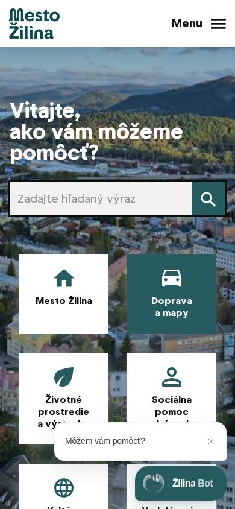
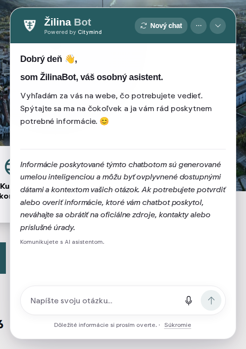
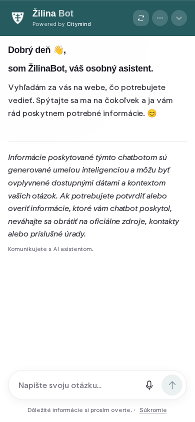

# ŽilinaBot: what a visitor sees and what it calls

The owner named ŽilinaBot on https://zilina.sk/ ("Powered by Citymind") as the assistant to beat (tasks/GOAL-assistant.md, T-4136). This report records what a visitor's browser loads and sends, how the answers look, which parts point to retrieval, and the list of UX requirements the Banská Bystrica assistant takes as its floor. Observation only, on 2026-10-15 between 19:20Z and 19:40Z: the page, the files the widget loads, three ordinary questions in Slovak, and screenshots of the widget opened as a visitor. Nothing else was sent to the vendor's API, and no Žilina content went into our index.

## 1. How the widget is built

| Observation | Evidence |
|---|---|
| One deferred script tag in the page head loads it: `<script id="citymind-script" src="https://api.citymind.tech/resources/js/780" defer>`. `780` is the chatbot's entity id. | zilina.sk HTML, line 55 |
| The script is one 1 091 109-byte bundle, `var CitymindWidget=(function…`: React (react.dev error links), i18next, react-markdown, GSAP. Served by `uvicorn` (a Python backend), `cache-control: no-cache`, last modified 2026-10-05. | `api.citymind.tech/resources/js/780`, response headers; bundle sha256 prefix `fb77b4c69ea9a1d7` |
| On load it fetches two files in parallel, each with a 15 s timeout: `v2/chatbots/780/widget-config` (JSON) and `v2/chatbots/780/widget.css`. A config whose `entityId` or `name` is missing stops the widget. | bundle offset 1087506 |
| The widget lives in a custom element `<citymind-chat>` with a shadow root, so the city's CSS cannot break it. The customer CSS is 191 bytes: one `--primary-color: #265b60` and a logo filter. | bundle offset 1087506; `widget.css` |
| `widget-config` (960 bytes) holds the name, `deployedOn: "Mesto Žilina"`, the welcome message as HTML (greeting, one sentence of purpose, the AI disclaimer), `chatProtocol: "typed-sse-v1"`, `browserVoiceEnabled: false`, `communityBoard: false`, `configVersion: "780:3"`, and a Google Maps browser key and map id (value not copied here). | `v2/chatbots/780/widget-config` |
| The texts come from `v2/chatbots/locales/sk.json` (9 948 bytes): the button ("Dobrý deň, môžem poradiť? 💬", on a phone "Môžem poradiť?"), the input placeholder, ten progress lines (`status.searching` "Vyhľadávam informácie...", `status.planning` "Plánovanie vyhľadávania...", `status.findingData` "Hľadám údaje o {topic}..."), "Zdroje" for sources, a contact card ("Zavolať", "Poslať e-mail"), a map marker ("Zobraziť trasu"), and an error text per HTTP status and per error code (`RATE_LIMIT_EXCEEDED`, `CONTENT_FILTERED`, `OPENAI_SERVICE_ERROR`, …). | `v2/chatbots/locales/sk.json` |
| Voice input exists (a WebSocket to `v2/chatbots/780/speech-recognition`), and so do forms, an e-mail-me-this-file action and a community board. Žilina has the board and browser voice switched off. | bundle offset 1088276; locale keys `voice.*`, `crmLead.*`, `fileEmail.*`, `community-board` |
| Accessibility: 45 `aria-label`s (send, stop answer, new conversation, scroll to latest, follow-up questions, sources), `aria-live` regions, and `prefers-reduced-motion` rules in the CSS. | bundle offsets 75502…76555, 549019, 378605 |
| The open conversation is kept in `localStorage`, so it survives a page change on the city site. | bundle offset 808870 |

## 2. The turn protocol

A question is one `POST https://api.citymind.tech/v2/chatbots/780/turns` with `Accept: text/event-stream`, no cookies (`credentials: "omit"`) and this body (bundle offset 1086008):

```json
{
  "answerFormat": "composed-v2",
  "turnId": "<uuid>",
  "input": { "type": "text", "text": "Aké sú úradné hodiny mestského úradu v Žiline?" },
  "locale": "sk",
  "history": []
}
```

The client keeps the history itself, the last 10 messages (`.slice(-10)`, offset 1085629). The answer is a typed server-sent event stream, every frame `{"version": 2, "responseId", "seq", "type", …}` with `seq` counting up by one (reducer at offset 766849):

| Event | Carries |
|---|---|
| `response.start` | `session.conversationId` (uuid) and a `continuationToken` (32 to 256 characters) |
| `section.open` | a section of type `text`, `notice` (tone `info` or `warning`), `detail`, `collection` or `procedure` (up to 40 steps), and the entities it expects: `contact`, `place`, `event`, `document`, `form` |
| `text.delta` | the next piece of a section's Markdown text |
| `component.pending`, `component.settled` | a slow part (a contact or a place) being resolved |
| `entity.ready`, `entity.error` | a resolved entity, for example a contact with a phone and an e-mail, a place with an address |
| `section.done` | the section is complete |
| `response.done` | `sources` (up to 50, each `{id, url, title}`) and `followUps` |
| `response.error` | a provider error, with the sources found so far |

The client enforces limits (offset 765598): 128 KiB per event, 1 MiB and 10 000 events per answer, 40 sections, 100 entities, 20 000 characters of text. It gives up after 30 s without an event and after 180 s in total (offsets 773623, 773834). A malformed frame turns the answer into an error, never into half-rendered garbage.

## 3. Three questions

Asked one after the other, each in a new conversation, from this sandbox, with the body above. Times are curl's: `ttfb` is the first byte (`response.start`), `total` the end of the stream.

| # | Question | HTTP | ttfb | total | Events | Sources |
|---|---|---|---|---|---|---|
| 1 | Aké sú úradné hodiny mestského úradu v Žiline? | 200 | 0.21 s | 7.5 s | 1 text section, 37 deltas | 5 zilina.sk pages |
| 2 | Má mesto Žilina portál otvorených dát? Aké dáta tam nájdem? | 200 | 0.34 s | 6.2 s | 1 text section, 41 deltas | opendata.zilina.sk (2 pages), smart.zilina.sk, 2 zilina.sk pages |
| 3 | Ako si vybavím parkovaciu kartu pre rezidentov? | 200 | 0.31 s | 8.2 s | 1 text and 2 detail sections, a contact and a place entity | 3 parkovanie.zilina.sk pages |

What came back, quoted:

1. "Úradné hodiny Klientskeho centra Mestského úradu v Žiline sú: **Pondelok:** 7:30 – 15:30 … **Piatok:** 7:30 – 14:00, **Sobota a nedeľa:** nestránkový deň. Poznámka: jednotlivé pracoviská alebo sviatky môžu mať osobitný režim." A Markdown list, one inline link to the source page, then the source list.
2. "Áno. Mesto Žilina má **Katalóg otvorených dát** na adrese opendata.zilina.sk. … Nájdete tam napríklad: obsadenosť parkovacích miest …, meškania vozidiel verejnej dopravy na zastávkach, hodinové počty vozidiel namerané dopravnými sčítačmi. Katalóg ponúka formáty **API JSON, CSV, GeoJSON a XML**." No dataset link, no value, no table.
3. A four-step online procedure for the resident card, who is entitled, then a contact card "Parkovanie – Klientske centrum Mestského úradu v Žiline" and a place card with the address "Námestie obetí komunizmu 1, 011 31 Žilina".

`followUps` was empty in all three answers, so no follow-up chips showed. Text arrived in deltas of 13 to 24 characters on average.

## 4. Signs of retrieval, and what it does not do

- It retrieves from crawled web pages. The welcome says so ("Vyhľadám za vás na webe"), every source is a page of zilina.sk or one of its subdomains (`parkovanie.`, `smart.`, `opendata.`), and source ids are content hashes (`source_<16 hex>`).
- It plans its searches. The progress lines name the stages a loop goes through: analysing the question, planning the search, searching for a query, reading a file, processing what it found, preparing the answer.
- The language model is OpenAI's (the `OPENAI_SERVICE_ERROR` error code).
- It does not read data. Asked about open data, it described the catalogue from the catalogue's web page, with no dataset, no current value and no download. `opendata.zilina.sk` did not accept a connection from this sandbox (TCP timeout after 136 s), so whether the catalogue has an API this report cannot say; the portal itself is surveyed in [Open data sources of Žilina](zilina-open-data-sources.md).
- It has no answer feedback: no thumbs, no rating, no copy button (the bundle's only "feedback" strings belong to the map and to voice).
- It offers no suggested questions on an empty chat (screenshot below), and returned no follow-ups.

## 5. The UX, screen by screen



Closed, the widget is a pill bottom right ("Žilina Bot", an animated logo) and a teaser bubble "Môžem vám pomôcť?" with its own close button. On a phone the bubble covers part of the page's tiles.



Open on a desktop it is a 460 px panel: the header (shield, "Žilina Bot", "Powered by Citymind", "Nový chat", a ··· menu, collapse), the greeting, then a five-line italic disclaimer that takes half the panel, the note "Komunikujete s AI asistentom.", the input ("Napíšte svoju otázku…", microphone, send) and a footer "Dôležité informácie si prosím overte. · Súkromie".



On a phone the panel takes the whole screen; the input sits at the bottom where the thumb is.

| Copy | Beat |
|---|---|
| One script tag, shadow DOM, the city's colour as one CSS variable | A dataset question gets current values, a small table or chart and the dataset link (T-4140), where ŽilinaBot only describes the catalogue |
| Streaming Markdown, sources under every answer, inline links to the page used | Suggested questions on the empty chat and follow-ups after an answer; ŽilinaBot had neither |
| Progress lines while it searches ("Vyhľadávam…"), a stop button | Thumbs up and down and a copy button on every answer |
| Typed answer parts: a contact card with call and e-mail, a place with an address and a route, numbered procedure steps | A disclaimer of one line with a link to the full text, so the first screen shows the questions, not a paragraph |
| Full-screen panel on a phone, input at the bottom | No teaser bubble over the page's content on a phone |
| An error text a person can act on per status (429 "Príliš veľa požiadaviek … Počkajte prosím chvíľu") | Public MCP connectors for the same data, so another assistant can use it (T-4141) |
| The conversation kept across page changes, "Nový chat" to start over | Slovak and English answers from the same index, the language switch visible |

## 6. UX requirements for the Banská Bystrica assistant

The floor T-4138 builds to. A number is the order to build in when time is short.

1. One script tag embeds the widget on any page; it renders in a shadow root, takes the site's primary colour from one attribute or CSS variable and carries no secret.
2. The answer streams as Markdown text; a stop button ends it; the input stays usable on a phone with the keyboard open.
3. Every answer ends with its sources as cards (title, host), and the text links the source it quotes inline.
4. A data answer shows the current values, a small table or chart and the dataset link, with open and download actions (T-4140).
5. The empty chat shows the greeting in two lines, three to five suggested questions set in admin, and a one-line AI disclaimer linking to the full text; nothing else above the fold.
6. After an answer, up to three follow-up questions as chips.
7. While it works, one progress line names the stage ("Hľadám v zdrojoch…", "Hľadám údaje o {téme}…", "Pripravujem odpoveď…").
8. Thumbs up and down and copy on every answer; a thumbs down asks one optional "Čo chýbalo?".
9. "Nová konverzácia" in the header; the open conversation survives a page change on the host site.
10. Errors are one sentence a person can act on, per case (rate limit, service down, message filtered), in the chat, never as a blank answer.
11. On a phone the panel is full screen; the closed widget is a single button that covers no content.
12. Slovak by default, English by the page language or a visible switch; the answer follows the question's language.
13. Keyboard: Enter sends, Shift+Enter breaks a line, Escape closes, focus returns to the button; every control has an accessible name; new answer text is announced through a polite live region; motion respects `prefers-reduced-motion`.
14. Contact, place and procedure answer parts as cards (call, e-mail, map link, numbered steps) when the source page has them.

Items 1 to 6 and 8 to 13 are in T-4138's scope. Items 7 and 14 are not; T-4155 adds them.

Not copied, on purpose: voice input (a microphone and a speech service for a first version nobody asked for), the community board and lead forms (ŽilinaBot has them switched off), and a third-party maps key in the public configuration.

## 7. Provenance

| Claim | Source |
|---|---|
| Page and embed | `https://zilina.sk/` fetched 2026-10-15 19:20Z, 155 103 bytes |
| Widget code | `https://api.citymind.tech/resources/js/780`, 1 091 109 bytes, sha256 prefix `fb77b4c69ea9a1d7`; offsets are byte offsets into that file |
| Configuration, CSS, texts | `https://api.citymind.tech/v2/chatbots/780/widget-config`, `…/780/widget.css`, `…/locales/sk.json`, each as the widget loads it |
| Answers | three `POST …/v2/chatbots/780/turns`, 2026-10-15 19:2xZ, the streams kept with T-4136 outside the repository (they hold a session token) |
| Screenshots | Playwright 1.55 (Chromium), 1440×900 and 390×844, cookies declined, the widget opened, nothing typed |

## Related

- [Open data sources of Žilina](zilina-open-data-sources.md) — the catalogue ŽilinaBot points at but does not read.
- [Open data sources of the Banská Bystrica region](banska-bystrica-open-data-sources.md) — the data the assistant answers from.
- [App builder gap](app-builder-gap.md) — the earlier comparison report this one follows in form.
