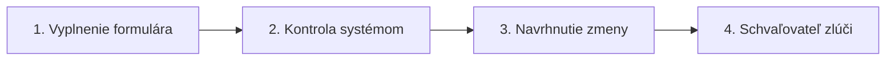

# Používatelia, roly, schvaľovania a správa driftu

Tento návod vysvetľuje, ako v Portáli spravovať tímové oprávnenia, servisné účty, návrhy zmien a živý drift konfigurácie. Každá zmena prístupu a konfigurácie projektu ide rovnakou cestou: vyplníte formulár, systém vykoná kontrolu, navrhnete zmenu a schvaľovateľ ju skontroluje a zlúči skôr, než čokoľvek nadobudne účinnosť. Anglická verzia je [Users, Roles, Approvals & Drift Management](../07-users-roles-approvals.md).

## 1. Prideľovanie rolí členom tímu

Členovia tímu dostávajú oprávnenia prostredníctvom väzieb rolí s rozsahom pre organizáciu, projekt alebo jeden kontextový priestor.

### Pridelenie roly kolegovi

#### Ručne

1. Otvorte `/projects/helsinki/access` z bočnej navigácie výberom **Prístup**.
2. V časti **Ľudia a roly** kliknite na **Prideliť rolu**.
3. V dialógu nastavte **Komu** na `A person`.
4. Do **Používateľské meno alebo e-mail** zadajte `jana.kovacova`.
5. V **Rola** vyberte `steward`.
6. Vo **Kde platí** vyberte `Project helsinki`.
7. Kliknite na **Navrhnúť pridelenie**.
Mali by ste vidieť zelené oznámenie o zmene so zobrazeným identifikátorom návrhu a odkazom na jeho kontrolu v Schvaľovaniach.
8. Schvaľovateľ otvorí `/projects/helsinki/approvals`, prečíta zmenu pole po poli a klikne na **Schváliť**.

Živá cesta `change.spec.ts` prejde tieto kroky.

#### Otázkou pre asistenta

Do poľa asistenta napíšte: `Give jana.kovacova the steward role on the helsinki project`. Asistent prejde na `/projects/helsinki/access` a otvorí dialóg **Prideliť rolu** s predvyplneným používateľským menom, rolou a rozsahom. Skontrolujete polia, kliknete na **Navrhnúť pridelenie** a schvaľovateľ o návrhu rozhodne.

## 2. Správa servisných účtov a API kľúčov

Neľudskí volajúci, ako sú skripty na ingestiu, automatizované úlohy ETL alebo GIS nástroje, sa pripájajú cez vyhradené servisné účty.

### Vytvorenie servisného účtu pomocou formulára

#### Ručne

1. Otvorte `/projects/banskabystrica/access`, prejdite na **Servisné účty** a kliknite na **Nový servisný účet**.
2. V časti Kto a prečo dajte účtu **Názov**, napríklad `bb-senzory-import`, napíšte jeho **Účel** jednou vetou, ktorú audítor môže overiť (*Uploads the city gateway's air-quality readings every 10 minutes.*), a do **Prihlásenie vlastníka** zadajte osobu, ktorá zaň zodpovedá, napríklad `jana.novakova@example.org`.
3. V časti **Čo smie robiť** pridajte jeden riadok do **Oprávnenia** pre každú vec, ktorú program potrebuje: položku **Rola** ako `data-writer`, položku **Úroveň rozsahu** (projekt, jeden kontextový priestor alebo celá organizácia) a **Názov rozsahu**, napríklad `ovzdusie`. Oprávnenie ďalej zúžte pomocou **Operácie** a **Typy entít**, napríklad `AirQualityObserved`. Ak ich necháte prázdne, ponechajú si to, čo povoľuje samotná rola.
4. V časti Ako sa prihlasuje pridajte riadok do **Prihlasovacie údaje**: `oauth-client`, jediný druh, ktorý existuje, s položkou **Názov údaja**, napríklad `brana-mesta`, a ak môžete, dátum **Platí do**. Nikdy sem nepíšte tajomstvo; klientske tajomstvo sa vydáva po schválení. Platforma nevydáva žiadne API kľúče (T-4362).
5. V časti Limity a záťaž nastavte **Požiadavky za minútu**, ak má byť program držaný pod vlastným limitom endpointu. Keď program beží vnútri klastra, uveďte jeho **Menný priestor** a **Servisný účet Kubernetes**, aby sa prihlasoval pomocou identity svojej záťaže a nedržal žiadny kľúč.
6. Kliknite na **Navrhnúť zmenu**. Účet a jeho klient v Keycloaku existujú, len čo schvaľovateľ návrh prijme.

## 3. Kontrola a rozhodovanie o návrhoch zmien

Každá zmena čaká v Schvaľovaniach, kým o nej niekto nerozhodne. Zmena v zelenom pruhu je za vás schválená samotnou platformou a stále sa zapíše ako zmena, ktorú si môžete prečítať a vrátiť; zmena v žltom pruhu potrebuje jedného schvaľovateľa; zmena v červenom pruhu (čokoľvek verejné, čokoľvek naprieč projektmi, akékoľvek zmazanie) potrebuje úplný schvaľovací reťazec.

### Kontrola a rozhodnutie o návrhu

#### Ručne

1. V bočnej navigácii kliknite na **Schvaľovania** a otvorte `/projects/helsinki/approvals`.
2. Nájdite riadok čakajúceho návrhu a kliknite na **Zobraziť** alebo kliknite na súhrnný názov.
3. Na `/projects/helsinki/approvals/chg-a1b2c3d4` si prečítajte **Súhrn**, položky **Autor**, **Úroveň rizika** a **Fáza**, potom tabuľku zmien: každé **Pole** s jeho **Typ zmeny** a jeho hodnotu **Predtým** a **Potom**, označené ako **Pridané**, **Zmenené** alebo **Odstránené**. Zmena, ktorá sa dotýka viacerých súborov, ich uvádza pod **Súbory v tejto zmene**.
4. Ak je zmena v červenej úrovni rizika, napíšte názov prostriedku do **Názov prostriedku pre potvrdenie**; kým to neurobíte, stránka na to upozorňuje a tlačidlo **Schváliť** zostáva nedostupné.
5. Kliknite na **Schváliť**, aby sa zmena zlúčila a zosúladila, alebo kliknite na **Zamietnuť**, čím otvoríte dialóg zamietnutia.
6. Pri zamietnutí zadajte podrobné vysvetlenie do **Prečo to zamietate?** a kliknite na **Zamietnuť zmenu**.
Mali by ste vidieť, ako sa štítok fázy zmení na Merged alebo Applied, spolu so stavovým oznámením odkazujúcim na dotknutý zdroj.

Živé cesty `roles-refusals.spec.ts` a `one-change-at-a-time.spec.ts` prejdú tieto kroky.

#### Otázkou pre asistenta

Do poľa asistenta napíšte: `What waits for approval in helsinki?`. Asistent vyhľadá otvorené návrhy zmien a v texte oznámi ich názvy, autorov a rizikové triedy. Asistent nemôže schvaľovať ani zamietať zmeny vo vašom mene, takže v Portáli musíte kliknúť na **Schváliť** alebo **Zamietnuť** vy sami.

Živá cesta `assistant-reads.spec.ts` prejde tieto kroky.

## 4. Riešenie driftu konfigurácie

Drift znamená, že priestor odpovedá inak, než deklaruje projekt: niekto zapísal entitu ručne, alebo entita, ktorú projekt deklaruje, v ňom nie je.

### Zosúladenie živého driftu

#### Ručne

1. Otvorte `/projects/helsinki/spaces` a prezrite si svoje kontextové priestory.
2. Priestor, ktorý má drift, to uvádza vo svojom stave; otvorte ho a dialóg **Čo sa zmenilo v „{id}“** zobrazí každý **Atribút** s tým, čo je **Deklarované** a čo je **Aktívne**.
Mali by ste vidieť oba stĺpce vedľa seba a pod tabuľkou názov súboru, v ktorom je entita deklarovaná.
3. Ak chcete priestor vrátiť do stavu, ktorý projekt deklaruje, kliknite na **Vrátiť na Git**.
4. Ak si chcete namiesto toho ponechať to, čo je aktívne, kliknite na **Prevziať ako návrh**: projekt sa aktualizuje tak, aby mu zodpovedal, ako zmena, ktorú schvaľovateľ prečíta ako každú inú.

#### Otázkou pre asistenta

Do poľa asistenta napíšte: `Check for configuration drift in the helsinki space`. Asistent skontroluje aktuálny stav synchronizácie a poskytne priamy odkaz na otvorenie dialógu riešenia driftu.

## 5. Zistenie, k čomu má niekto prístup

Prehľad prístupu odpovedá administrátorovi organizácie na jednu otázku: k čomu táto osoba, skupina, rola alebo servisný účet dosiahne a čo tam smie robiť? Brána rozhoduje o každom riadku rovnakým spôsobom, ako rozhoduje o skutočnom volaní, a endpoint, ku ktorému aktér nemá prístup, nie je uvedený vôbec.

### Vyhľadanie aktéra

1. Otvorte **Nastavenia projektu → Prehľad prístupu** (`/projects/helsinki/settings/explorer`). Túto záložku vidia len administrátori organizácie.
2. V **Kto** vyberte osobu, člena skupiny, držiteľa roly realm, ServiceAccount alebo verejnosť, a potom vyberte konkrétneho aktéra.
3. Kliknite na **Zobraziť prístup**. Adresa teraz uvádza aktéra (`?kind=serviceAccount&name=etl`), takže odkaz môžete poslať kolegovi, ktorý organizáciu tiež spravuje.

Mali by ste vidieť jeden riadok pre každý endpoint, ku ktorému aktér dosiahne, s jeho kontextovým priestorom a rozhraniami, ktoré obsluhuje (NGSI-LD, OGC Features, MCP a ďalšie). Ak ich žiadny endpoint nepripustí, stránka uvádza **Nedosiahne nič**.

### Čítanie jedného endpointu

Otvorte riadok. Zobrazuje:

- **Udelené cez**: platné politiky pre aktéra; každá otvorí politiku, kde sa navrhuje a posudzuje zmena oprávnenia.
- **Môže** a **Nesmie**: podľa typu entity operácie, atribúty a akékoľvek obmedzenie pohľadu ako NGSI-LD `q`, `scopeQ` alebo `geoQ`. `geoQ` je nakreslené ako tvar územia.
- **Kopírovať … URL**: jedno tlačidlo na rozhranie, ktorým aktérovi odovzdáte presnú adresu.

### Pripojenie jedného MCP klienta k celému prístupu

V časti **Jeden MCP konektor na všetko** položka **Pripojiť všetko (kopírovať URL hubu)** skopíruje adresu hubu (`/api/mcp`). Jeden konektor tam pokrýva každý endpoint v zozname; endpoint sa uvádza pri každom volaní. Pomenované MCP servery, ktoré tieto endpointy zahŕňajú, sú uvedené pod ním.

### Odobratie pripojeného klienta

Pre osobu zoznam **Pripojení klienti** uvádza klientov, ktorým udelila súhlas (hub, MCP klient endpointu, aplikácia), s časom ich posledného použitia. Kliknite na **Odobrať** a potvrďte: klient stratí svoje spojenie a offline relácie a musí požiadať znova. Odobratie nemení žiadne oprávnenie; ak chcete prístup odobrať, zmeňte politiku, skupinu alebo väzbu roly, ktorú riadok uvádza.

## Súvisiace

- [06-dashboards.md](06-dashboards.md): konfigurácia prevádzkových mapových pohľadov a widgetov.
- [08-working-with-ai-agents.md](08-working-with-ai-agents.md): spolupráca s autonómnymi agentmi a nastavenie oprávnení.
- [10-role-guides.md](../10-role-guides.md): denné prevádzkové postupy prispôsobené konkrétnym projektovým rolám.
