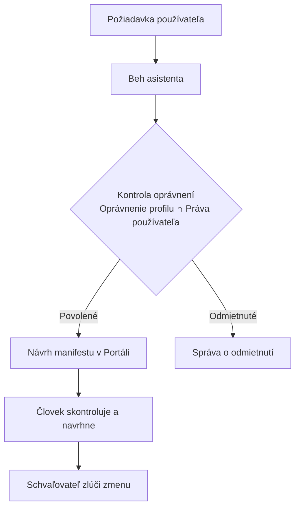

# Spolupráca s autonómnymi AI agentmi

Portál pristupuje k AI agentom ako k členom tímu riadeným princípom najnižších nutných oprávnení. S asistentom sa môžete rozprávať z ktorejkoľvek obrazovky, spúšťať behy práce agenta na pozadí, kontrolovať oprávnenia za behu a pripájať externých AI klientov cez Model Context Protocol (MCP). Každá zmena pripravená agentom pristane ako návrh, ktorý vyžaduje kontrolu človekom a schválenie schvaľovateľom. Anglická verzia je [Collaborating with Autonomous AI Agents](../08-working-with-ai-agents.md).



## 1. Používanie ukotveného asistenta

Asistent je prístupný z každej stránky cez trvalé tlačidlo upevnené v pravom dolnom rohu obrazovky.

### Kladenie otázok a navigácia v Portáli

#### Ručne

1. Kliknite na **Otvoriť asistenta** v pravom dolnom rohu ľubovoľnej stránky.
2. Do textového poľa s označením **Povedzte asistentovi, čo má postaviť alebo zmeniť…** zadajte svoju otázku, napríklad o aktivite platformy.
3. Stlačte Enter alebo kliknite na **Odoslať**.
4. Na správu konverzácie použite ovládacie prvky v záhlaví doku:
   - Kliknite na **Zastaviť asistenta**, ak chcete prerušiť aktívnu odpoveď.
   - Kliknite na **Celá obrazovka**, ak chcete zobrazenie konverzácie rozbaliť na celú pracovnú plochu.
   - Kliknite na **Skryť asistenta**, ak chcete panel zvinúť do bubliny pri zachovaní kontextu konverzácie.
   - Kliknite na **Zavrieť asistenta**, ak chcete uvoľniť aktívny dialóg.
Mali by ste vidieť, ako asistent streamuje volania nástrojov, odpovedá na vaše otázky a prechádza do cieľových formulárov s predvyplnenými návrhmi.

Živé cesty `assistant-reads.spec.ts` a `assistant-creates.spec.ts` prejdú tieto kroky.

#### Otázkou pre asistenta

Do poľa asistenta napíšte: `Create a context space called air-quality in the helsinki project`. Asistent prepne trasu na `/projects/helsinki/spaces`, otvorí dialóg **Nový kontextový priestor** a vyplní polia názvu a modelu. Sami spustíte kontrolu a kliknete na **Navrhnúť zmenu**.

## 2. Spúšťanie práce agenta na pozadí

Z vyhradenej pracovnej plochy asistenta môžete spúšťať autonómne behy, ktoré generujú aplikácie, dashboardy alebo analýzy údajov bez dialógových výziev krok za krokom.

### Spustenie behu práce na pozadí

#### Ručne

1. V bočnej navigácii kliknite na **Asistent** a otvorte `/projects/helsinki/assistant`.
2. Posuňte sa nadol na kartu novej práce.
3. V časti čo vytvoriť vyberte `Application`, `Dashboard` alebo `Analysis`.
4. Do **Názov** zadajte `bikes-summary`.
5. V **Endpoint** vyberte publikovaný pohľad na dáta, napríklad `helsinki-bikes`.
6. V časti čo má aplikácia robiť popíšte očakávané rozloženie a metriky, napríklad `Show total available bikes and station capacity`.
7. Kliknite na spustenie.
Mali by ste vidieť, ako sa beh zobrazí v tabuľke so svojou aktuálnou fázou, pričom zobrazuje uplynutý čas vykonávania a možnosti pokračovania po dokončení.

Živá cesta `build-samples.spec.ts` prejde tieto kroky.

#### Otázkou pre asistenta

Do poľa asistenta napíšte: `Build an application called bikes-summary from the helsinki-bikes endpoint showing total available bikes`. Asistent spustí beh a poskytne priamy odkaz na otvorenie zobrazenia vykonávania.

## 3. Kontrola a úprava prístupu agentov

Profil agenta definuje vonkajšiu hranicu operácií, ktoré môže agent dosiahnuť. Prístup za behu sa vždy počíta ako striktný prienik oprávnení profilu a vašich osobných oprávnení.

### Kontrola schopností profilu

#### Ručne

1. Otvorte `/projects/helsinki/assistant` a prejdite na časť **Prístup agentov**.
2. Vyberte kartu profilu, napríklad `app-builder`.
Mali by ste vidieť tabuľku so zoznamom operácií, ktorá uvádza, či profil každú schopnosť udeľuje, či ňou disponuje váš používateľský účet a prípadné dôvody obmedzení.
3. Kliknite na **Upraviť prístup**, čím otvoríte editor konfigurácie prístupu.
4. Aktualizujte špecifikáciu YAML v časti **Blok prístupu (YAML)** a pridajte alebo odoberte povolené operácie.
5. Kliknite na **Navrhnúť zmenu**, čím odošlete úpravu ako návrh do Schvaľovaní.

#### Otázkou pre asistenta

Asistent nemôže sám rozšíriť svoje oprávnenia ani priamo zmeniť svoj priradený profil. Oprávnenia profilu musíte skontrolovať a aktualizovať ručne v Portáli.

## 4. Pripájanie externých agentov cez MCP

Zverejnené endpointy poskytujú Streamable HTTP endpointy implementujúce Model Context Protocol, čo umožňuje externým agentom ako Claude Code alebo OpenHands dopytovať kontextové údaje.

### Konfigurácia pripojenia externého agenta

#### Ručne

1. Otvorte `/projects/helsinki/endpoints` a vyberte endpoint so zapnutou reprezentáciou `mcp`, napríklad `helsinki-all`.
2. Vyhľadajte verejnú adresu URL a skopírujte adresu MCP: `https://api.joinedcontext.com/api/endpoint/mluyob4nz52lok3ssk7pgn5vwt/mcp`.
3. Do konfigurácie lokálneho MCP klienta pridajte záznam servera:

   ```json
   {
     "mcpServers": {
       "helsinki-context": {
         "url": "https://api.joinedcontext.com/api/endpoint/mluyob4nz52lok3ssk7pgn5vwt/mcp"
       }
     }
   }
   ```

4. Pripojte svojho klienta. Verejný endpoint odpovie na zoznam nástrojov a každé čítanie bez akéhokoľvek prihlásenia. Endpoint publikovaný pre organizáciu alebo vybrané projekty odmietne anonymné volanie a povie klientovi, kde sa má prihlásiť, takže váš klient vykoná toto prihlásenie raz a vráti sa s tokenom platným pre tento jeden endpoint.
Mali by ste vidieť, ako váš externý agent objaví dostupné nástroje na prehliadanie dát a vykonáva dotazy v súlade s politikou endpointu.

#### Otázkou pre asistenta

Do poľa asistenta napíšte: `What is the MCP address for the helsinki-all endpoint?`. Asistent skontroluje manifest endpointu a vráti úplnú Streamable HTTP URL pripravenú na vloženie do konfigurácie vášho externého klienta.

#### Rozhodnutie o volaní, na ktoré sa pýta váš klient

Keď AI klient prihlásený za vás chce spustiť volanie, ktoré mení projekt, Portál sa najprv spýta vás. Klient zobrazí odkaz na `/projects/$project/mcp-elicitations/$id`, stránku s názvom „Rozhodnite o volaní AI klienta“, ktorá uvádza operáciu a čas, dokedy zostáva otvorená. Stlačte „Prijať volanie“, ak má toto jedno volanie raz prebehnúť, alebo „Odmietnuť volanie“, ak ho chcete zastaviť, a vráťte sa ku klientovi: keď volanie pošle znova, spustí ho, alebo sa dozvie, že ste ho odmietli. Otázka zostáva otvorená desať minút a odpovedať na ňu môžete len vy; klient prihlásený ako servisný účet za vás odpovedať nemôže.

## 5. Zdroje znalostí a asistenti

Asistent odpovedá zo zdrojov znalostí, ktoré mu poskytnete: webovej stránky, dátového katalógu, kontextových priestorov tohto projektu, používateľskej príručky alebo súborov, ktoré nahráte. Stránka **Zdroje znalostí** na `/projects/{project}/knowledge` ich uvádza spolu s tým, čo asistent prečítal, a nižšie uvádza zoznam **Asistenti** projektu.

### Pridanie zdroja a asistenta

1. Kliknite na **Pridať zdroj**. Vyberte jeho **Typ**, napríklad **Web**, zadajte **Začiatočné adresy**, napríklad `https://www.example.sk/`, a obmedzte čítanie pomocou **Čítať len tieto cesty**, **Preskočiť tieto cesty**, **Hĺbka odkazov** a **Najviac stránok**. V časti **Komu sa z neho smie odpovedať** zvoľte **Interný: prihlásení zamestnanci** alebo **Verejný: každý kanál**.
2. Kliknite na **Navrhnúť zmenu**. Po schválení schvaľovateľom sa zdroj prečíta v priebehu niekoľkých minút. Voľba **Prejsť teraz** ho znova prečíta na požiadanie.
3. Kliknite na **Pridať asistenta**. Zadajte jeho **Názov**, **Kde odpovedá** (**Verejné**, **Interný (Portál)**, **Dátový katalóg** alebo **Vložený na webe**), položku **Zdroje**, z ktorých odpovedá, a jeho **Pokyny**, a navrhnite ho. Na verejnom kanáli nastavte **Povolené weby** a **Rozpočet**.
4. V riadku asistenta voľba **Opýtať sa** asistenta vyskúša, **Vložiť** poskytne úryvok kódu pre váš web, **Duplikovať** vytvorí variant a **Využitie** zobrazuje otázky a tokeny za deň.

Rovnaké druhy sú uvedené ako tabuľky v častiach **Zdroje znalostí** (`/projects/{project}/knowledgesources`), **Nasadenia asistenta** (`/projects/{project}/assistantdeployments`) a **Profily agentov** (`/projects/{project}/agentprofiles`), s tlačidlom na pridanie a rovnakými formulármi; profil agenta je popísaný v časti 3.

### Rozhodnutie, z čoho asistent odpovedá

Kliknutím na zdroj otvoríte jeho stránku. Položky **Stránky** a **Dokumenty** uvádzajú všetko, čo bolo prečítané, s príslušným stavom: **Čítanie**, **Preskočené**, **Nedalo sa prečítať** alebo **Ešte neprečítané**.

1. Nájdite stránku pomocou **Nájsť stránky**, začiarknite ju a kliknite na **Vynechať z odpovedí**. Začiarknite **Aj so všetkými stránkami pod vybranou stránkou a dokumentmi, na ktoré odkazujú**, ak chcete vynechať celú časť webu. Tlačidlo **Vrátiť do odpovedí** to vráti späť.
2. V časti **Vyskúšať vyhľadávanie** zadajte **Otázka alebo slová** a kliknite na **Vyskúšať vyhľadávanie**, aby ste videli, z ktorých pasáží by asistent odpovedal.
3. Pre zdroj nahratých súborov použite **Vyberte súbory na nahratie** a **Nahrať súbory**: PDF, DOCX, XLSX, CSV, Markdown alebo text, každý s veľkosťou najviac 50 MB.

Stránka bez úryvku sa v odpovedi nikdy nepoužije.

## 6. Čítanie uložených konverzácií

Časť **Konverzácie**, prepojená zo stránky znalostí, zobrazuje, čo sa návštevníci pýtali verejného asistenta a ako vznikla každá odpoveď. Čítať ju môže iba osoba, ktorá schvaľuje nasadenia asistenta v projekte, a každé prečítanie sa zaznamenáva; konverzácie sa uchovávajú 90 dní.

1. Zoznam zúžte podľa **Slová v otázke alebo odpovedi**, **Stav**, **Hodnotenie**, **Asistent** a dátumov, alebo ho zoraďte, napríklad **Najdrahšie**.
2. Otvorte konverzáciu a prečítajte si jej **Kroky**: čo asistent hľadal, čítal a odpovedal.
3. Položky **Rovnaká otázka** a **Porovnať** postavia dve odpovede vedľa seba. Voľba **Kopírovať ako test** premení repliku na testovací prípad pre asistenta.
4. Voľba **Vymazať konverzáciu** ju vymaže, keď o to návštevník požiada. Tento krok nemožno vrátiť späť.
5. Panel využitia sčítava **Otázky** a **Cena spolu** za dané obdobie s možnosťou **Stiahnuť CSV**.

## 7. MCP servery a vaše vlastné konektory

Časť **MCP servery** na `/projects/{project}/mcp` spája niekoľko endpointov pod jednu adresu pre AI klientov.

1. Kliknite na **Nový MCP server**. Zadajte **Názov** a **Popis**, pridajte členské endpointy (nájdite ich cez **Nájsť endpoint**), prípadne **Zdroje znalostí**, a vyberte **Kto sa smie pripojiť**: **Vybrané projekty**, **Organizácia** alebo **Verejné**.
2. Položka **Nástroje, ktoré by ste dostali** uvádza čítania a zápisy, ktoré server ponúkne. Kliknite na **Skontrolovať a navrhnúť**. Verejný server potrebuje schvaľovateľa, ktorý má oprávnenie publikovať.
3. Na karte servera skopírujte **Adresa** alebo **Záznam do konfigurácie AI klienta**. Verejný server má aj voľbu **Otvoriť verejnú stránku pripojenia**, stránku popísanú v príručke [Katalóg a verejné stránky](17-catalogue-and-public-pages.md).

Časť **Moje MCP konektory** na `/connectors` drží vaše vlastné adresy, až desať, mimo akéhokoľvek projektu. Otvára ich iba vaše prihlásenie a každý dosiahne iba na endpointy, ktoré smiete čítať.

1. Kliknite na **Nový konektor** a zadajte **Názov**, napríklad `traffic`: malé písmená, číslice a pomlčky, posledná časť jeho adresy.
2. Zúžte ho pomocou **Projekty**, **Kontextové priestory**, **Domény** a **Témy**, a vyberte **Prístup**: **Verejné**, **Celá organizácia**, **Moje projekty** alebo **Zdieľané so mnou**. Text „Práve pripojené“ uvádza, koľko endpointov dosahuje.
3. Kliknite na **Uložiť**, potom skopírujte **Adresa** do svojho AI klienta.

Označenie endpointu hviezdičkou na jeho vlastnej stránke ho pridá do konektora s názvom `favourites`.

## Súvisiace

- [07-users-roles-approvals.md](07-users-roles-approvals.md): posudzovanie návrhov na zlúčenie a správa prístupu používateľov.
- [11-apps.md](11-apps.md): dohľad nad agentmi na tvorbu aplikácií a vyhodnocovanie náhľadov.
- [10-role-guides.md](../10-role-guides.md): pracovné postupy špecifické pre jednotlivé roly a prehľad navigácie v platforme.
