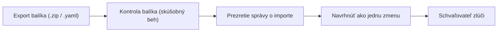

# Export, prenosnosť a duplikácia projektov

Všetky konfigurácie platformy je možné exportovať, klonovať, importovať alebo synchronizovať s externými repozitármi. Každý importovaný zdroj sa skompiluje do posúditeľného návrhu zmeny v Schvaľovaniach, čo zaručuje, že cudzie konfigurácie nikdy neprepíšu lokálny stav bez posúdenia. Anglická verzia je [Export, Portability & Project Duplication](../09-export-import.md).

## 1. Export projektu alebo prostriedku

Celý projekt alebo jednotlivý manifest môžete zabaliť do prenosných formátov archívov.

### Stiahnutie konfiguračného archívu

#### Ručne

1. Otvorte `/projects/helsinki/endpoints` alebo ľubovoľné zobrazenie zdroja v projekte.
2. V ponuke riadka alebo v záhlaví stránky kliknite na **Export**.
3. V dialógu s názvom **Stiahnuť konfiguráciu** vyberte cieľový **Formát**:
   - **Celý projekt (konfigurácia, schémy a dátové modely)** pre kompletný ZIP archív vrátane schém a dokumentácie.
   - **YAML** pre dátové toky manifestov s viacerými dokumentmi.
   - **Zoznam JSON** pre štruktúrované objekty manifestov.
   - **Archív ZIP** pre manifesty, natívne súbory a index.
4. Vyberte požadovanú **Revízia** (predvolene je vybratá aktuálna).
5. Kliknite na **Stiahnuť**.
Mali by ste vidieť, ako váš prehliadač sťahuje balík obsahujúci manifesty, LinkML schémy a konfigurácie pipeline.

#### Otázkou pre asistenta

Do poľa asistenta napíšte: `Export the helsinki project as a ZIP archive`. Asistent otvorí dialóg exportu s vybratým formátom celého projektu na potvrdenie.

## 2. Import konfiguračných balíkov

Exportovaný archív môžete obnoviť alebo načítať manifesty do existujúceho projektu.

### Načítanie externého balíka

#### Ručne

1. V bočnej navigácii kliknite na **Import** a prejdite na `/projects/helsinki/import`.
2. V časti **Archív alebo manifesty** kliknite na prehľadávať a vyberte súbor `.zip`, `.yaml` alebo `.json`.
3. V položke **Projekt, do ktorého sa importuje** potvrďte `helsinki`. Každý importovaný manifest sa prepíše doňho.
4. Do **Doména organizácie** zadajte `hel.fi` alebo nechajte pole prázdne na použitie predvolenej hodnoty inštancie.
5. V časti **Zdroj, ktorý tento projekt už má** vyberte správanie pri kolízii:
   - **Zastaviť import**: zastaví sa, ak akýkoľvek pomenovaný zdroj už existuje.
   - **Nechať náš**: preskočí existujúce zdroje a naimportuje zostávajúce.
   - **Nahradiť náš**: prepíše existujúce manifesty verziami z balíka.
   - **Importovať pod novým menom**: premenuje konfliktné prichádzajúce manifesty.
6. Kliknite na **Skontrolovať balík**, aby sa vykonal skúšobný beh.
Mali by ste vidieť správu s názvom **Čo by tento import urobil**, ktorá sumarizuje vytvorené, nahradené, preskočené a premenované súbory spolu s požadovanými prihlasovacími údajmi.
7. Kliknite na **Navrhnúť import**.
8. Prejdite na `/projects/helsinki/approvals` a schváľte navrhnutú zmenu.

#### Otázkou pre asistenta

Asistent nemôže čítať lokálne súbory z vášho počítača bez výberu súboru v prehliadači. Nahrajte balík na `/projects/helsinki/import` alebo priložte textovú vzorku priamo do zóny na vloženie v asistentovi.

## 3. Udržiavanie synchronizácie s externými zdrojmi

SyncSource udržiava váš projekt v kroku s nadradeným zdrojom: repozitárom, publikovaným balíkom alebo API inej inštancie.

### Pridanie nadradeného synchronizačného zdroja

#### Ručne

1. V bočnej navigácii kliknite na **Synchronizácia** a otvorte `/projects/helsinki/syncsources`.
2. V hornom výbere pôvodu vyberte **Git repozitár**, **Zverejnený balík** alebo **API inej inštancie**.
3. Kliknite na **Pridať zdroj**.
4. V dialógu nastavte **Názov** na `regional-models-sync`, **URL na klonovanie** na `https://git.example.org/models.git` a **Spúšťať každých** na `6h`.
5. Nastavte **Režim** na `mirror` a položku **Keď zdroj už existuje** na `fail`.
6. Kliknite na navrhnutie zdroja.
7. Schvaľovateľ zlúči návrh v Schvaľovaniach.
8. Po uplatnení karta zobrazuje zistenú revíziu a stav synchronizácie. Kliknite na **Synchronizovať teraz**, ak chcete spustiť okamžité stiahnutie, **Pozastaviť**, ak chcete synchronizácie pozastaviť, alebo **Odpojiť**, ak chcete odstrániť SyncSource a zároveň zachovať importované zdroje.

#### Otázkou pre asistenta

Do poľa asistenta napíšte: `Add a git sync source called regional-models-sync reading https://git.example.org/models.git every 6h`. Asistent otvorí formulár na `/projects/helsinki/syncsources` s vyplnenými hodnotami na kontrolu.

## 4. Zverejňovanie otvorených údajov do CKAN

Verejné endpointy možno zverejniť priamo na portáli otvorených údajov pomocou natívnych DCAT-AP metadát.

### Registrácia katalógu a zverejňovanie datasetov

#### Ručne

1. Prejdite na `/projects/helsinki/ckan`.
2. V časti **Katalógy** zadajte **Názov** ako `helsinki-ckan`, **URL** ako `https://data.example.org` a **Predvolená organizácia** ako `helsinki-region-context`.
3. Do **Tajomstvo s API tokenom** zadajte názov tajomstva, ktoré drží vaše prihlasovacie údaje, napríklad `ckan-token`.
4. Kliknite na **Navrhnúť katalóg**.
5. Po zlúčení otvorte `/projects/helsinki/endpoints` a upravte svoj verejný endpoint, napríklad `helsinki-bikes`.
6. V konfigurácii endpointu vyberte `helsinki-ckan` ako cieľový katalóg otvorených údajov.
Mali by ste vidieť dataset uvedený pod zverejnenými endpointmi s priamymi odkazmi na jeho záznam DCAT-AP a vlastné API endpointu.

#### Otázkou pre asistenta

Do poľa asistenta napíšte: `Publish the helsinki-bikes endpoint to the open data catalogue`. Asistent otvorí dialóg konfigurácie endpointu s predvyplnenými poľami katalógu.

## Súvisiace

- [02-organizations-projects-spaces.md](02-organizations-projects-spaces.md): projekty, kontextové priestory a hranice medzi nimi.
- [07-users-roles-approvals.md](07-users-roles-approvals.md): posudzovanie návrhov a riešenie driftu konfigurácie.
- [10-role-guides.md](../10-role-guides.md): kontrolné zoznamy špecifické pre jednotlivé roly pre administrátorov a stewardov.
