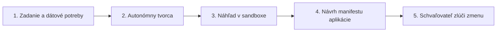

# Aplikácie na požiadanie

Aplikácie na požiadanie sú ľahké, jednoúčelové webové nástroje vygenerované AI agentom na tvorbu aplikácií, ktoré plnia konkrétne pracovné postupy. Vyberiete existujúci dátový endpoint, popíšete, čo má aplikácia zobrazovať, a tvorca pripraví kostru, otestuje ju a poskytne náhľad. Každá vygenerovaná aplikácia je súkromná pre prihlásených členov tímu a pred produkčným nasadením vyžaduje schválenie schvaľovateľom. Anglická verzia je [Apps on Demand](../11-apps.md).

## 1. Vygenerovanie aplikácie

Aplikácie vytvárate z publikovaných endpointov, pričom definujete presný okruh typov a atribútov, ktoré aplikácia smie čítať.

### Vyžiadanie aplikácie

#### Ručne

1. V bočnej navigácii kliknite na **Aplikácie** a otvorte `/projects/helsinki/apps`.
2. Kliknite na **Vygenerujte si vlastnú aplikáciu**.
3. V časti **Endpoint** vyberte zdrojový dátový kanál, napríklad `Helsinki city news` alebo `helsinki-bikes`.
4. Do poľa **Čo má aplikácia robiť?** zadajte jednoduchý popis, napríklad: `A table of the latest city news: the headline and when it was published.`
5. Kliknite na **Podrobnosti: názov, druh a čo smí čítať ({name})**, čím rozbalíte možnosti konfigurácie:
   - Do **Názov aplikácie** zadajte jedinečný identifikátor, napríklad `news-feed-summary`.
   - V **Druh** zvoľte `Full stack (Rust backend and React screens)`, `Static (screens only)` alebo `Service (backend only, no screens)`.
   - V časti **Čo bude aplikácia smieť čítať** skontrolujte zoznam atribútov odvodených z endpointu a odznačte atribúty, ktoré aplikácia nepotrebuje.
6. Kliknite na **Vygenerovať aplikáciu**.
Uvidíte, ako Portál otvorí zobrazenie behu na `/projects/helsinki/apps/news-feed-summary`, ktoré sleduje fázy zostavenia.

Živá cesta `build-samples.spec.ts` zopakuje tieto kroky.

#### Požiadaním asistenta

Do poľa pre asistenta napíšte: `Build a static application called news-feed-summary from the helsinki-news endpoint displaying headlines and publication dates`. Asistent otvorí nástroj na tvorbu aplikácie s predvyplneným zadaním, endpointom a názvom na vašu kontrolu.

## 2. Dohľad nad tvorcom a spresnenie architektúry

Počas generovania tvorca postupuje definovanými fázami životného cyklu: Vo fronte, Spúšťanie pracovného priestoru, Otázky, Zostavovanie a Testovanie.

### Odpovedanie na otázky

#### Ručne

1. Na stránke behu aplikácie `/projects/helsinki/apps/news-feed-summary` sledujte priebežnú časovú os.
2. Ak tvorca potrebuje spresnenie rozloženia, farebných paliet alebo agregačných okien, v konverzácii sa zobrazí interaktívny formulár s otázkami.
3. Vyberte preferované možnosti a kliknite na **Odoslať**.
4. Ak kompilácia alebo automatizované testy zlyhajú, tvorca preskúma diagnostiku kompilátora a pokúsi sa o automatickú opravu kódu.
Keď kompilácia kódu a testy prejdú, uvidíte, ako sa stav posunie na **Náhľad je hotový**.

#### Požiadaním asistenta

Do poľa pre asistenta napíšte: `What is the current status of the news-feed-summary build?`. Asistent skontroluje časovú os behu a nahlási aktuálnu fázu a spotrebu tokenov.

## 3. Náhľad v sandboxe

Pred navrhnutím aplikácie na produkčné použitie s ňou pracujete v izolovanom rámci sandboxu.

### Hodnotenie správania aplikácie

#### Ručne

1. Keď stav behu dosiahne **Náhľad je hotový**, iframe vykreslí plochu aplikácie priamo na stránke behu.
2. Vnútri rámu otestujte filtre, ovládacie prvky triedenia a vrstvy mapy.
3. Overte, že dátové záznamy sa zobrazujú správne a neodkrývajú nezaškrtnuté atribúty.
4. Ak sú potrebné úpravy, napíšte pokyny do vstupu konverzácie a kliknite na **Odoslať**, čím spustíte opätovné zostavenie.
Uvidíte, ako sa iframe náhľadu automaticky aktualizuje a zobrazí požadované úpravy.

#### Požiadaním asistenta

Do poľa pre asistenta napíšte: `Open the preview for news-feed-summary`. Asistent poskytne URL náhľadu a zobrazí ho v pracovnom priestore.

## 4. Zverejnenie a ukončenie aplikácií

Nasadenie aplikácie do produkcie vygeneruje deklaratívny manifest `App`, ktorý sa riadi štandardným tokom schvaľovania zmien.

### Zverejnenie aplikácie

#### Ručne

1. Na stránke behu kliknite na **Publikovať túto aplikáciu**.
2. V potvrdzovacom dialógu skontrolujte cieľovú viditeľnosť (`Visible to project` alebo `Visible to organization`).
3. Kliknite na **Otvoriť merge request**, čím odošlete manifest `App` do **Schvaľovania**.
4. Schvaľovateľ otvorí `/projects/helsinki/approvals`, skontroluje rozdiel v manifeste a klikne na **Schváliť**.
5. Po zlúčení je aplikácia aktívna na vlastnom hostiteli, `https://news-feed-summary.apps.<domain>/`, za autentifikáciou platformy.
6. Ak chcete aplikáciu vyradiť, otvorte `/projects/helsinki/apps`, nájdite kartu aplikácie, kliknite na **Odstrániť**, potvrďte názov a kliknite na **Navrhnúť odstránenie**.

#### Požiadaním asistenta

Do poľa pre asistenta napíšte: `Propose publication for the news-feed-summary application`. Asistent pripraví návrh zmeny na posúdenie schvaľovateľom.

## 5. Zdieľanie aplikácie

Aplikácia začína ako viditeľná pre svoj projekt. Tlačidlo **Zdieľať** rozširuje alebo zužuje okruh tých, ktorí ju môžu otvoriť, vždy prostredníctvom zmeny, ktorú skontroluje schvaľovateľ, nikdy nie ako okamžitý prepínač naživo.

### Zmena toho, kto aplikáciu otvorí

#### Ručne

1. Otvorte `/projects/helsinki/apps`, otvorte ponuku na karte aplikácie a kliknite na **Zdieľať**.
2. Dialóg zobrazuje, kto aplikáciu otvára teraz, a pri každej možnosti uvádza, koho zasiahne a koľko je to ľudí, napríklad „Všetci v Helsinki, 42 ľudí“.
3. Vyberte možnosť. Možnosť **Ľudia s rolou** sa ponúka, keď aplikácia deklaruje roly; **Ktokoľvek na internete** len vtedy, keď organizácia povoľuje verejné aplikácie.
4. Kliknite na **Navrhnúť zmenu**. Dialóg oznámi, že zmena čaká na schválenie, a odkáže na **Schvaľovania**.
5. Schvaľovateľ ju schváli v `/projects/helsinki/approvals`. Zverejnenie aplikácie pre verejnosť vyžaduje osobu s rolou `publisher` alebo `org-admin`, ktorá zmenu nenavrhla; asistent, agent ani servisný účet ju schváliť nemôžu.
6. Kliknite na **Kopírovať odkaz**, čím skopírujete adresu aplikácie a pošlete ju ľuďom, s ktorými ste ju zdieľali.

#### Požiadaním asistenta

Do poľa pre asistenta napíšte: `Share the news-feed-summary application with the whole organization`. Asistent navrhne tú istú zmenu; schvaľovateľ stále rozhoduje.

### Hľadanie aplikácií zdieľaných s vami

Úvodná stránka Portálu uvádza časť **Zdieľané so mnou**: zverejnené aplikácie iných projektov, ktoré ich vlastníci zdieľali s celou organizáciou a ktoré môžete otvoriť. Kliknutím na názov aplikáciu otvoríte. Aplikácia viditeľná len pre svoj projekt, pre držiteľov rolí alebo pre svojho autora sa tam nikdy nezobrazí.

## 6. Aplikácia alebo dashboard?

Pri vizualizácii mestských dát na obrazovke si medzi aplikáciou a dashboardom vyberajte podľa potrieb pracovného postupu:

- Dashboard na `/projects/helsinki/dashboards` použite vtedy, keď potrebujete stále mapové vrstvy, graf v čase alebo tabuľku, pričom netreba nič generovať ani programovať.
- Možnosť **Vygenerujte si vlastnú aplikáciu** na `/projects/helsinki/apps` použite vtedy, keď potrebujete interakciu, ktorú dashboard neposkytuje: mapu vedľa vlastných tabuliek, karty s číslami, stiahnutie dát vyvolané čitateľom alebo formulár, ktorý upravuje záznam.

## Súvisiace

- [Endpoints, Data Sharing & Integration](05-endpoints-and-sharing.md): publikovanie a zabezpečenie viacformátových endpointov.
- [Dashboards & Geospatial Visualization](06-dashboards.md): konfigurácia mapových vrstiev a prevádzkových dashboardov.
- [Collaborating with Autonomous AI Agents](08-working-with-ai-agents.md): dohľad nad autonómnymi agentmi a nastavenie oprávnení.
