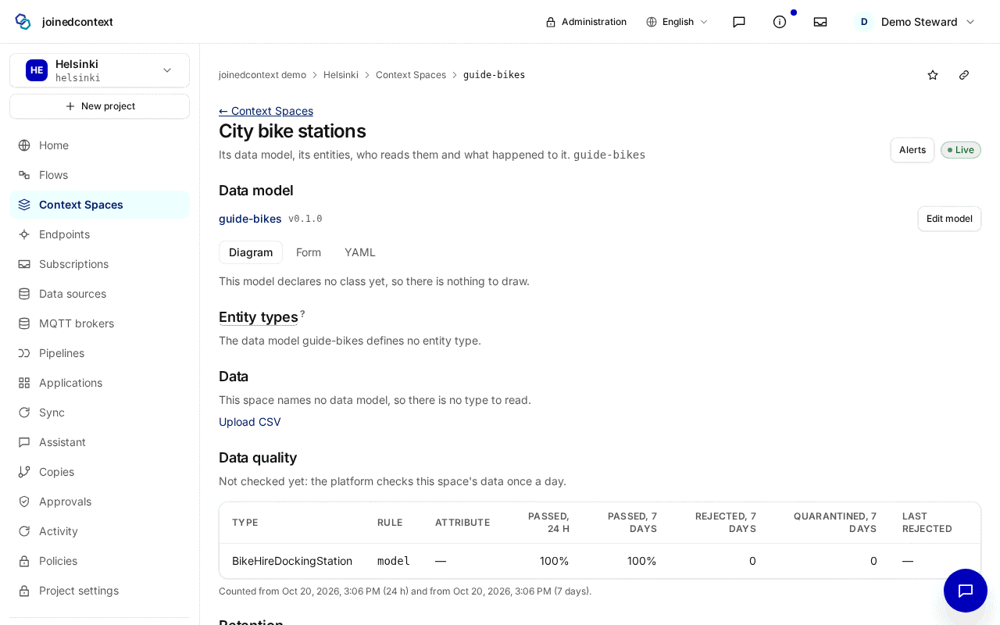
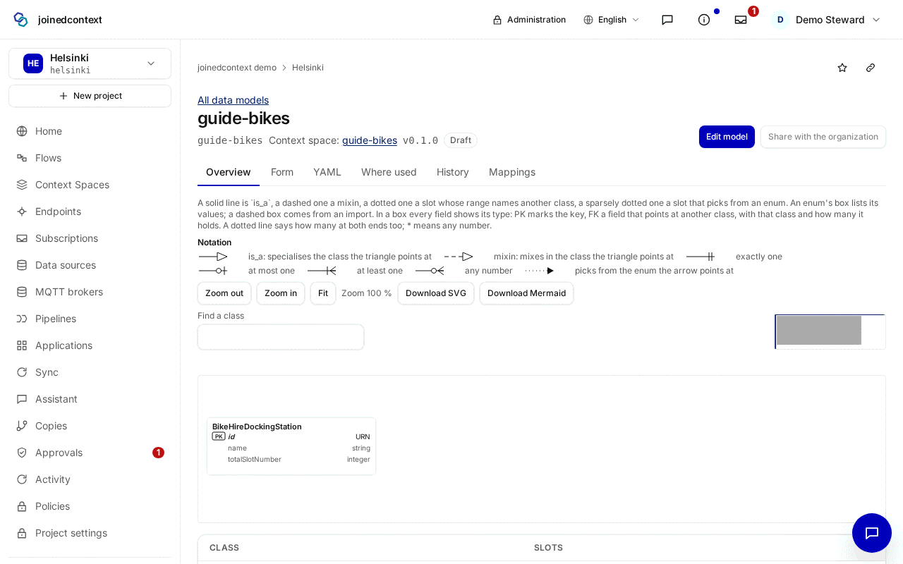
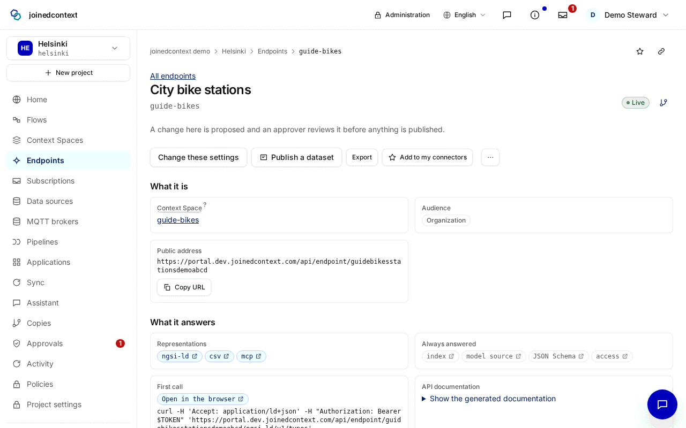
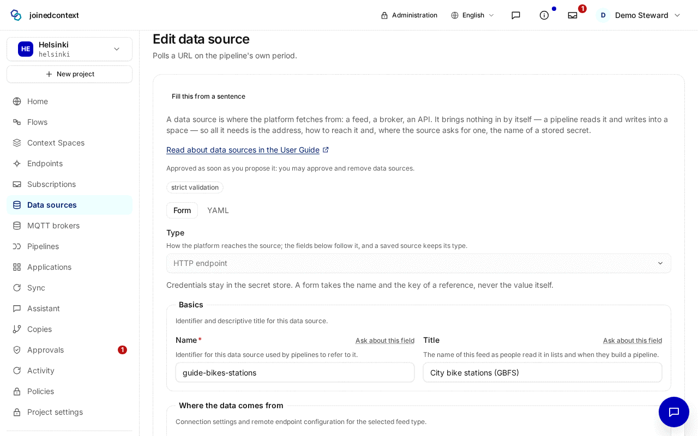
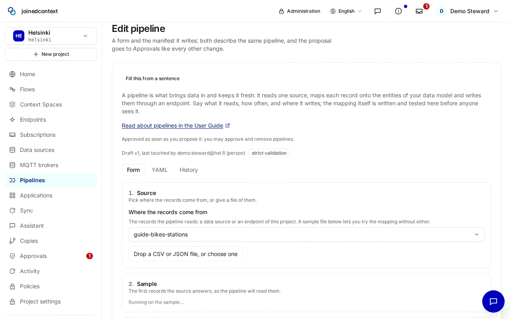
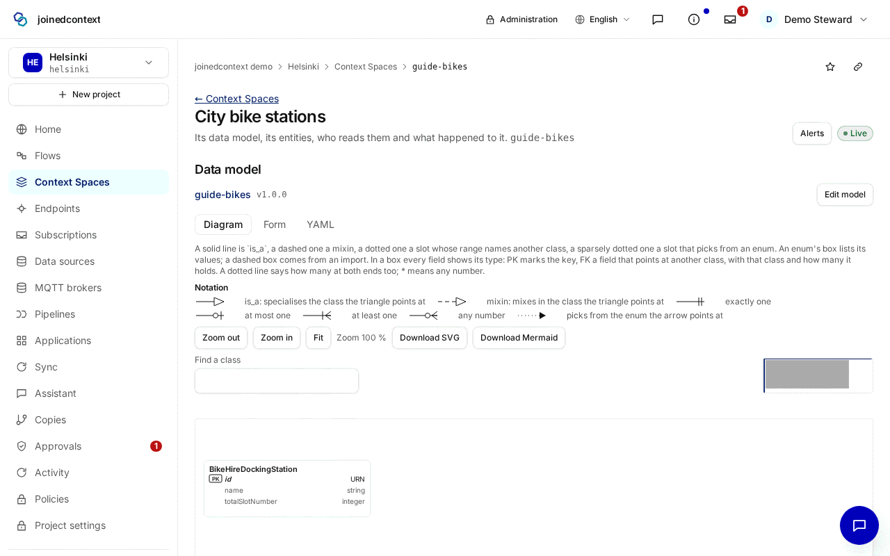

# Postavte si dáta od začiatku do konca

Táto stránka postaví jeden zdroj od nuly: stanice mestských bicyklov v Helsinkách z otvoreného GBFS kanála prevádzkovateľa, zverejnené cez endpoint vašej organizácie. Prechádza piatimi druhmi zdrojov v poradí, v akom ich Portál potrebuje, a pri každom hovorí, na čo slúži, ktorá stránka ho zapíše, aký YAML navrhne, čo platforma doplní sama a akú chybu tam ľudia robia. Druhý, kratší príklad nahrá súbor CSV. Anglická verzia je [Build Your Data, End to End](../15-build-your-data.md).

Každý krok je zmena: navrhnete ju, schvaľovateľ ju schváli a ďalší krok ju môže pomenovať, keď je živá. Na dev je zmena živá asi minútu po schválení. Živá cesta `build-your-data.spec.ts` prejde túto stránku na dev ako `demo.steward@hel.fi`, prečíta stanice cez endpoint, všetko znova odstráni a urobí snímky nižšie.

| Krok | Druh | Na čo slúži |
|---|---|---|
| 1 | Kontextový priestor | miesto, kde entity žijú, a pravidlá ich uchovávania |
| 2 | Dátový model | typy a atribúty, ktoré priestor prijme |
| 3 | Endpoint a jeho politiky | kto priestor číta, v akých formátoch, a kto doň zapisuje |
| 4 | Zdroj údajov | odkiaľ platforma číta |
| 5 | Pipeline | ako často číta a čo sa stane z jedného záznamu |

Poradie je dôležité. Priestor ide prvý, lebo Portál vytvára dátový model vnútri priestoru. Endpoint ide pred pipelinou, lebo pipeline zapisuje cez endpoint.

## 1. Kontextový priestor

Kontextový priestor drží entity jednej témy a určuje, ako dlho sa uchovávajú.

Otvorte **Kontextové priestory**, zvoľte **Nový kontextový priestor**, do **Názov** zadajte `guide-bikes`, do popisu `City bike stations`, **Dátový model** nechajte prázdny, zvoľte **Skontrolovať** a potom **Navrhnúť zmenu**. Stránka navrhne:

```yaml title="projects/helsinki/spaces/guide-bikes/space.yaml"
apiVersion: joinedcontext.com/v1alpha1
kind: ContextSpace
metadata:
  name: guide-bikes
  namespace: helsinki
  title: { en: "City bike stations" }
spec:
  defaultLocale: en
  isSandbox: false
```

Čo platforma doplní, keď nič nenastavíte:

| Nastavenie | Predvolené | Čo to znamená |
|---|---|---|
| Dátový model | prázdny model s menom priestoru | vznikne s priestorom; krok 2 mu dá typy |
| Aktuálne hodnoty | držia sa, kým ich niečo neodstráni | stanica, ktorú kanál prestane uvádzať, v priestore zostane |
| História | 28 dní, predvolené v platforme | každá zmena každého atribútu sa drží štyri týždne, potom sa zmaže |
| Kvalita údajov | žiadne pravidlá | kontrolujú sa len obmedzenia modelu |
| Identifikátory entít | `urn:ngsi-ld:{Type}:{id}` | id, ktoré pipeline zapíše, je identita entity v tomto priestore |

Stránka priestoru ukazuje každé z nich: **Dátový model**, **Kvalita údajov** a **Uchovávanie**, kde stĺpec **História** ukazuje **Predvolené v platforme**, kým nenastavíte pravidlo.



**Chyba:** čakať, že priestor staré údaje zabudne sám. Drží každú aktuálnu hodnotu, kým ju neodstráni koncový čas, pravidlo priestoru alebo expirácia pipeliny. Rozhodnite o tom hneď, s [Retention & Expiry](../14-retention-and-expiry.md); pre tento kanál sú predvolené hodnoty správne, lebo stanice sa zatvárajú zriedka.

## 2. Dátový model

Dátový model je zoznam typov, ktoré priestor prijme, a atribútov každého typu. Zápis typu, ktorý model nedeklaruje, sa odmietne, rovnako ako hodnota mimo jeho obmedzení.

Otvorte model priestoru cez **Upraviť model**, pridajte triedu `BikeHireDockingStation` s dvoma slotmi a navrhnite zmenu. Editor zapíše zdroj modelu v LinkML:

```yaml title="projects/helsinki/spaces/guide-bikes/datamodels/guide-bikes.linkml.yaml"
id: https://hel.fi/models/helsinki/guide-bikes
name: guide-bikes
description: The types of the guide-bikes space, one class per entity type (DM-61).
prefixes:
  linkml: https://w3id.org/linkml/
  ngsi-ld: https://uri.etsi.org/ngsi-ld/
  helsinki: https://hel.fi/models/helsinki/guide-bikes/
default_prefix: helsinki
default_range: string
imports:
  - linkml:types
  - ngsi-ld-core
slots:
  name:
    description: The station's name as the operator writes it.
    required: true
  totalSlotNumber:
    description: How many bikes the station docks when full.
    range: integer
    minimum_value: 0
classes:
  BikeHireDockingStation:
    description: A city bike station.
    is_a: Entity
    slots:
      - name
      - totalSlotNumber
```

Dôležité polia: meno triedy, ktoré nesie každá entita tohto typu ako `type`; `required`, ktoré odmietne entitu bez atribútu; `range` a `minimum_value`, ktoré odmietnu zlú hodnotu. `is_a: Entity` prinesie to, čo má každá entita NGSI-LD, `id`, `type` a `location`, takže ich nedeklarujete.

Predvolené: slot bez `range` je text (`default_range: string`), slot bez `required` je nepovinný a model začína vo verzii `0.1.0` v stave **Návrh**. Na vlastný priestor návrh stačí; verziu zverejnite, keď na ňom majú stavať iné projekty ([Data Models](../03-data-models.md#6-deciding-a-model-versions-lifecycle)).



**Chyba:** iné meno typu v modeli a v pipeline (`BikeStation` tu, `BikeHireDockingStation` tam). Každý zápis sa potom odmietne ako neznámy typ. Meno triedy skopírujte z modelu do pipeliny.

## 3. Endpoint a jeho politiky

Endpoint je adresa, cez ktorú sa priestor číta. Politiky hovoria, kto smie čo s priestorom robiť: jedna dovolí členom projektu čítať stanice, druhá dovolí pipelinám zapisovať.

Otvorte **Politiky** a navrhnite obe politiky; formulár opisuje [Endpoints & Sharing](../05-endpoints-and-sharing.md#6-deciding-who-may-read-and-write-policies). Potom otvorte **Endpointy**, zvoľte **Nový endpoint**, do **Názov** zadajte `guide-bikes`, v **Kontextový priestor** vyberte `guide-bikes`, zvoľte **Vygenerovať slug**, **Publikum** nastavte na *Organizácia*, v **Reprezentácie** zaškrtnite *NGSI-LD API* a *CSV* a navrhnite zmenu. Spolu zapíšu:

```yaml title="projects/helsinki/policies/guide-bikes-pipelines-write.yaml"
apiVersion: joinedcontext.com/v1alpha1
kind: Policy
metadata:
  name: guide-bikes-pipelines-write
  namespace: helsinki
  title: { en: "The pipeline writes the bike stations" }
spec:
  contextSpaceRef: { kind: ContextSpace, name: guide-bikes }
  assigner: did:web:{orgDomain}
  assignee: { kind: serviceAccount, id: pipelines }
  operations: [upsertBatch, createBatch, queryBatch]
```

```yaml title="projects/helsinki/policies/guide-bikes-read.yaml"
apiVersion: joinedcontext.com/v1alpha1
kind: Policy
metadata:
  name: guide-bikes-read
  namespace: helsinki
  title: { en: "The project's members read the bike stations" }
spec:
  contextSpaceRef: { kind: ContextSpace, name: guide-bikes }
  assigner: did:web:{orgDomain}
  assignee: { kind: group, id: helsinki }
  operations: [retrieveOps]
  information:
    - entities:
        - type: BikeHireDockingStation
```

```yaml title="projects/helsinki/endpoints/guide-bikes.yaml"
apiVersion: joinedcontext.com/v1alpha1
kind: Endpoint
metadata:
  name: guide-bikes
  namespace: helsinki
  title: { en: "City bike stations" }
spec:
  contextSpaceRef: guide-bikes
  slug: guidebikesstationsdemoabcd
  audience: organization
  enabledRepresentations: [ngsi-ld, csv]
```

Dôležité polia:

- **Publikum**: *Organizácia* dovolí volať endpoint každému prihlásenému členovi a servisnému účtu organizácie; *Vybrané projekty* to zúži na zaškrtnuté projekty; *Verejné* ho otvorí komukoľvek a na schválenie potrebuje rolu publikujúceho.
- **Reprezentácie**: bez zoznamu endpoint obsluhuje každú reprezentáciu okrem SensorThings; zoznam obsluhuje len to, čo vymenuje. Rozhranie MCP pre AI asistentov je zapnuté tak či tak, za tými istými politikami, kým manifest nepovie `mcp: false`.
- Slug: adresa. Nikdy sa nemení, takže odkaz, ktorý rozdáte, funguje ďalej; vygenerujte ho namiesto písania slova, lebo uhádnuteľná adresa je slabšia.
- Politika: čitateľská politika určuje, kto číta (`assignee`: skupina `helsinki` sú členovia projektu) a aké typy a atribúty dostane (`information`); **Skryté atribúty** endpointu môžu len ubrať. Zapisovacia politika menuje servisný účet `pipelines`, identitu, pod ktorou zapisuje každá pipeline projektu. Politika udeľuje právo, preto je jej zmena v červenom pruhu: schvaľovateľ napíše meno politiky, kým **Schváliť** zafunguje.

Predvolené: žiadny limit požiadaviek, žiadne cachovanie, nič skryté, žiadny záznam v katalógu. Pridajte ich na stránke endpointu, keď je verejný ([Endpoints & Sharing](../05-endpoints-and-sharing.md)).



**Chyba:** endpoint bez čitateľskej politiky. Endpoint existuje, jeho odkazy odpovedajú a každé čítanie je prázdne alebo odmietnuté. Stránka priestoru povie prečo: jeho politiky neudeľujú žiadnu operáciu, ktorú pohľad obsluhuje. Čitateľskú politiku navrhnite spolu s endpointom, nie neskôr. To isté odmietnutie spôsobí politika pre skupinu, v ktorej čitatelia nie sú: udelenie doméne organizácie (`hel.fi`) namiesto skupiny projektu (`helsinki`) odpovie na každé čítanie 403 `AccessDenied`.

## 4. Zdroj údajov

Zdroj údajov hovorí, odkiaľ a ako platforma číta; nedrží rozvrh ani mapovanie, takže jeden zdroj môže čítať viac pipelín.

Otvorte **Zdroje údajov**, zvoľte **Nový zdroj údajov**, ako typ vyberte *HTTP endpoint*, do **Názov** zadajte `guide-bikes-stations`, do **URL** adresu kanála, **Metóda** `GET` a **Časový limit** `15s`, zvoľte **Skontrolovať** a potom **Navrhnúť zmenu**:

```yaml title="projects/helsinki/datasources/guide-bikes-stations.yaml"
apiVersion: joinedcontext.com/v1alpha1
kind: DataSource
metadata:
  name: guide-bikes-stations
  namespace: helsinki
  title: { en: "City bike stations (GBFS)" }
spec:
  type: http
  http:
    url: https://gbfs.theta.fifteen.eu/gbfs/2.2/helsinki/en/station_information.json
    verb: GET
    headers: { Accept: application/json }
    timeout: 15s
```

**Skontrolovať** adresu raz načíta a ukáže, čo prišlo: tu jeden dokument JSON so zoznamom `data.stations`, jedna položka na stanicu s `station_id`, `name`, `lat`, `lon` a `capacity`. Prečítajte si ho skôr, ako napíšete pipeline; mapovanie v kroku 5 je napísané presne na tento tvar.



**Chyba:** vložiť kľúč alebo token do **URL** alebo do hlavičky. Tento kanál je otvorený a žiadny nepotrebuje. Kanál, ktorý ho potrebuje, dostane **Názov tajomstva** a **Kľúč v tajomstve** v **Prihlasovacie údaje**: zdroj drží odkaz, úložisko tajomstiev hodnotu a nič tajné neskončí v repozitári ani v logu.

## 5. Pipeline

Pipeline číta zdroj údajov podľa rozvrhu, každý záznam premení na entity NGSI-LD a zapíše ich cez endpoint.

Otvorte **Pipeliny** a začnite novú: ako **Zdroj údajov** vyberte `guide-bikes-stations`, **Beh** nastavte na *Automaticky, podľa periódy* s periódou `15m`, mapovanie vložte do **Bloblang mapovanie**, ako **Cieľový endpoint** vyberte `guide-bikes`, **Režim zápisu** nastavte na *Vytvoriť alebo zlúčiť*, otestujte na vzorke a navrhnite zmenu:

```yaml title="projects/helsinki/pipelines/guide-bikes-stations.yaml"
apiVersion: joinedcontext.com/v1alpha1
kind: Pipeline
metadata:
  name: guide-bikes-stations
  namespace: helsinki
  title: { en: "City bike stations from GBFS" }
spec:
  class: auto
  period: 15m
  source:
    dataSourceRef: { kind: DataSource, name: guide-bikes-stations }
  compute:
    kind: bloblang
    bloblang: |
      root = this.data.stations.map_each(s -> {
        "id": "urn:ngsi-ld:BikeHireDockingStation:station-" + s.station_id.string(),
        "type": "BikeHireDockingStation",
        "name": { "type": "Property", "value": s.name },
        "totalSlotNumber": { "type": "Property", "value": s.capacity },
        "location": { "type": "GeoProperty", "value": { "type": "Point", "coordinates": [ s.lon, s.lat ] } }
      })
  output: { mode: upsert, type: BikeHireDockingStation }
  targetEndpoint: urn:ngsi-ld:Endpoint:hel.fi:helsinki-guide-bikes:guide-bikes
  quotas:
    maxMemoryMb: 64
    cpuMillicores: 100
```

Dôležité polia:

- `id`: zložené z vlastného `station_id` kanála, takže každý beh aktualizuje tých istých 455 entít. Id, ktoré sa mení s behom (počítadlo, čas), pridá novú entitu každých pätnásť minút.
- `coordinates`: najprv zemepisná dĺžka, potom šírka, ako chce GeoJSON; kanál dáva `lat` a `lon` zvlášť.
- Perióda: tu `15m`. *Automaticky, podľa periódy* spúšťa periódu 30 sekúnd a viac ako plánovanú úlohu a kratšiu ako stále bežiaci prúd; *Podľa rozvrhu* vyberte, len keď potrebujete čas cron, napríklad `10 0 * * *`.
- **Režim zápisu**: *Vytvoriť alebo zlúčiť* ponechá atribúty, ktoré nastavili iní zapisovatelia; *Nahradiť celú entitu* ich zahodí.

Predvolené: bez expirácie (entita, ktorú kanál prestane posielať, zostane), bez koncového času na entitách, história podľa pravidla priestoru (tu 28 dní) a kvóty vyššie, keď žiadne nenastavíte. Keď má stanica, ktorá z kanála zmizne, zmiznúť aj z priestoru, zapnite **Odstraňovať entity, ktoré zdroj už neposiela**; keď každý záznam nesie vlastný koniec, zapíšte `expiresAt` v mapovaní. Ktoré zvoliť, hovorí [Retention & Expiry](../14-retention-and-expiry.md#3-which-one-do-i-pick).



**Chyba:** zapísať súradnice ako `[lat, lon]`. Každá stanica potom pristane v mori pri Iráne, zápis aj tak prejde a mapa je zlá bez chyby. Po prvom behu si jednu entitu pozrite na mape.

## 6. Prečítajte si to

Pipeline beží raz, hneď ako je živá, potom každých 15 minút. Stránka priestoru spočíta stanice, ktoré teraz drží (455 dňa 2026-10-20). Vaša relácia v Portáli je členom organizácie, takže odkazy endpointu na jeho stránke otvoria údaje priamo a **Prieskum** ukáže stanice na mape. Program číta tie isté údaje s tokenom servisného účtu organizácie:

```bash
curl -s -H "Accept: application/json" \
  -H "Authorization: Bearer $TOKEN" \
  "https://portal.dev.joinedcontext.com/api/endpoint/guidebikesstationsdemoabcd/ngsi-ld/v1/entities?type=BikeHireDockingStation&limit=2"
```



## 7. Druhý príklad: nahratie súboru CSV

Súbor nepotrebuje zdroj údajov ani pipeline: Portál ho prečíta vo vašom prehliadači a riadky zapíše pod vaším menom.

1. Na stránke priestoru zvoľte **Nahrať CSV**, alebo ho otvorte z **Kontextové priestory**.
2. **Vybrať súbor CSV** do 50 MB. Portál porovná stĺpce s typmi Smart Data Models.
3. V **Čo riadky sú** vezmite ponúknutý typ, alebo **Vlastný model** s **Názov typu**, napríklad `Garage`.
4. Vyberte **Kontextový priestor** a potom **Navrhnúť zmenu**. Jedna zmena navrhne všetko, čo riadky potrebujú: typ v modeli priestoru, endpoint a vaše právo zapisovať.
5. Keď ju schvaľovateľ schváli a je živá, stránka ponúkne zápis riadkov. Opätovný zápis toho istého súboru aktualizuje tie isté entity, lebo id každého riadku pochádza zo súboru.

Predvolené: nahraté riadky nikdy neexpirujú a ich história sa riadi pravidlom priestoru, 28 dní, ak priestor nehovorí inak. Súbor, ktorého riadky majú koniec (povolenie platné do dátumu), potrebuje ten koniec v každom riadku; recept je v [Retention & Expiry](../14-retention-and-expiry.md#11-recipe-data-imported-from-a-file).

**Chyba:** nahrať novú verziu súboru, ktorej riadky stratili stĺpec s id. Každý riadok potom dostane nové id a priestor drží obe verzie. Držte stabilný stĺpec id, alebo staré riadky najprv odstráňte.

## Related

- [Build Your Data, End to End](../15-build-your-data.md): táto stránka po anglicky.
- [Getting Started](../01-getting-started.md): tie isté kroky ako prvá prehliadka Portálu.
- [Retention & Expiry](../14-retention-and-expiry.md): každý spôsob, ako sa údaje odstraňujú, a ktorý vyhráva.
